# Classification

🇹🇷 Türkçe sürüm: [Sınıflandırma](Classification.tr.md)

> [!NOTE]
> **Goal:** Understand core machine learning methods — from classification and clustering to NLP, PCA, model selection, and recommendation systems — through intuition, clear math, and runnable code.

**Executed implementations:** [10 notebooks, outputs and setup](README.md). Each chapter links to its code, tables and figures.

**Contents**

- [The big picture](#the-big-picture)
- [1. Logistic Regression](#1-logistic-regression)
- [2. K-Nearest Neighbours (KNN)](#2-k-nearest-neighbours-knn)
- [3. Support Vector Machine (SVM)](#3-support-vector-machine-svm)
- [4. Naive Bayes](#4-naive-bayes)
- [5. Decision Tree Classification](#5-decision-tree-classification)
- [6. Random Forest Classification](#6-random-forest-classification)
- [7. Confusion Matrix and Evaluation Metrics](#7-confusion-matrix-and-evaluation-metrics)
- [Algorithm Comparison](#algorithm-comparison)
- [8. K-means Clustering](#8-k-means-clustering-unsupervised-learning)
- [9. Hierarchical Clustering](#9-hierarchical-clustering)
- [10. Natural Language Processing](#10-natural-language-processing-nlp--text-classification)
- [11. PCA — Principal Component Analysis](#11-pca--principal-component-analysis)
- [12. Model Selection: K-Fold CV & Grid Search CV](#12-model-selection-k-fold-cv--grid-search-cv)
- [13. Recommendation Systems](#13-recommendation-systems)
- [Check yourself](#check-yourself)

---

## The big picture

Classification is the task of predicting which **category** (class) a data point belongs to. Unlike regression (which predicts a continuous number, see [Regression](../Regression/Regression.md)), classification outputs a discrete label — for example *Malignant vs. Benign*, *Spam vs. Not Spam*, or *Cat vs. Dog*.

The six classifiers and evaluation in chapters 1–7 are demonstrated on the **Wisconsin Breast Cancer dataset** (569 samples, 30 numeric features, binary target: `M` = Malignant → `1`, `B` = Benign → `0`). The classes are not balanced: **357 benign (62.7%)** and **212 malignant (37.3%)**. Keep those two numbers in mind; they come back in Naive Bayes and in the evaluation section.

Each algorithm answers the same question with a different idea:

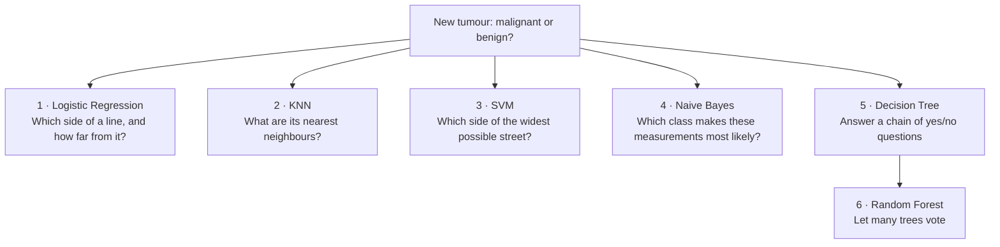

### The pipeline used by notebooks 1–7

1. **Load** the CSV and drop `id` and the empty `Unnamed: 32` column.
2. **Encode** the target: `M` → 1, `B` → 0.
3. **Split** into training and test sets first.
4. Where needed, **normalize using training-fitted statistics**; refit the scaler separately inside each CV training fold.
5. Select models/settings with training CV, **fit** the final model on training rows and **score** on held-out test rows.

> **Current notebook protocol:** chapters 1–7 share a stratified 80/20 split (`random_state=42`). Some older figures and worked tables below refer to earlier splits stated in their captions. All current measurements are in the [notebook index](README.md); do not rank models by mixing those protocols.

> [!NOTE]
> Most pictures below use only two of the 30 features, `radius_mean` and `texture_mean`, because two dimensions can be drawn. The accuracies quoted in the text use all 30 features unless I say otherwise.

---

## 1. Logistic Regression

**Executed notebook:** [Logistic Regression](1%29%20%20Logistic%20Regression%20Classification/Logistic%20Regression.ipynb)

Despite its name, Logistic Regression is a **classification** algorithm, not a regression one. It models the probability that a sample belongs to a given class and outputs a value between 0 and 1 using the **sigmoid function**.

### Why Not Linear Regression for Classification?

Linear regression can predict values outside `[0, 1]`, which makes no sense as a probability. The sigmoid function squashes any real number into `(0, 1)`:

```math
\sigma(z) = \frac{1}{1 + e^{-z}}
```

If $`\sigma(z) \ge 0.5`$ → predict class `1`; otherwise predict class `0`.

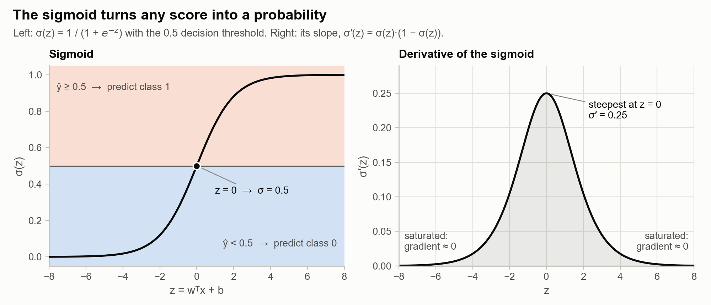

*Left: the sigmoid maps any score z to a probability between 0 and 1. Right: its derivative, largest at z = 0 and almost zero where the curve is flat.*

### The model: a linear score pushed through the sigmoid

```math
z = w^{\top}x + b, \qquad \hat{y} = \sigma(z) = P(y = 1 \mid x)
```

- $`w`$ = one **weight** per feature (30 here), $`b`$ = **bias**
- $`z`$ = a raw score that can be any real number
- $`\hat{y}`$ = the predicted probability of class 1 (malignant)

**What does z mean?** Solve the sigmoid for z and you get the **log-odds**:

```math
\log\frac{\hat{y}}{1 - \hat{y}} = w^{\top}x + b
```

So logistic regression is a *linear model for the log-odds*. Increasing feature $`x_j`$ by 1 adds $`w_j`$ to the log-odds, which multiplies the odds by $`e^{w_j}`$.

**Where is the decision boundary?** $`\hat{y} \ge 0.5`$ exactly when $`z \ge 0`$, so the boundary is the set of points where

```math
w^{\top}x + b = 0
```

That is a straight line in 2-D and a flat hyperplane in 30-D. Logistic regression is a **linear classifier**: the sigmoid only decides how confident it is on each side.

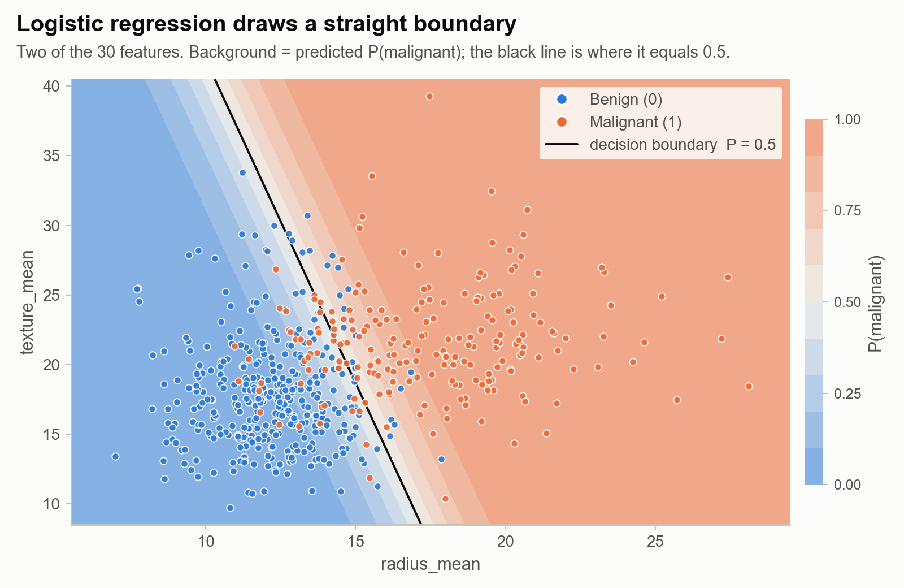

*Logistic regression on two features. The background colour is the predicted probability of malignant; the black line is where it equals 0.5.*

### Computation Graph

A computation graph is a visual way to express mathematical operations as a directed graph of nodes. Each node represents an operation; edges carry values between them. This makes it easy to reason about the **forward pass** (computing the output) and the **backward pass** (computing gradients).

For logistic regression, the full forward pass looks like this — the inputs are multiplied by learned weights, summed with a bias, passed through the sigmoid, and compared with the true label:

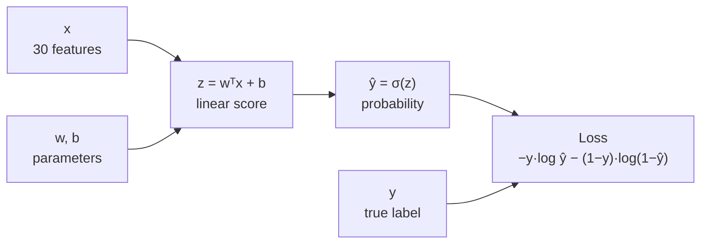

The backward pass walks the same graph **from right to left**, multiplying local derivatives (the chain rule) to find out how the loss changes when each parameter changes.

### Loss vs. Cost

| Term | Definition |
|---|---|
| **Loss** | Error for a **single** training example |
| **Cost** | Average loss over **all** training examples |

We minimize the **cost** during training.

### Binary Cross-Entropy Loss

```math
L(y, \hat{y}) = -\,y\log(\hat{y}) - (1 - y)\log(1 - \hat{y})
```

- When $`y = 1`$: loss = $`-\log(\hat{y})`$. If the model predicts $`\hat{y} = 1`$, loss → 0. If $`\hat{y} \to 0`$, loss → ∞.
- When $`y = 0`$: loss = $`-\log(1 - \hat{y})`$. Symmetric reasoning.

This function penalizes confident wrong predictions very heavily.

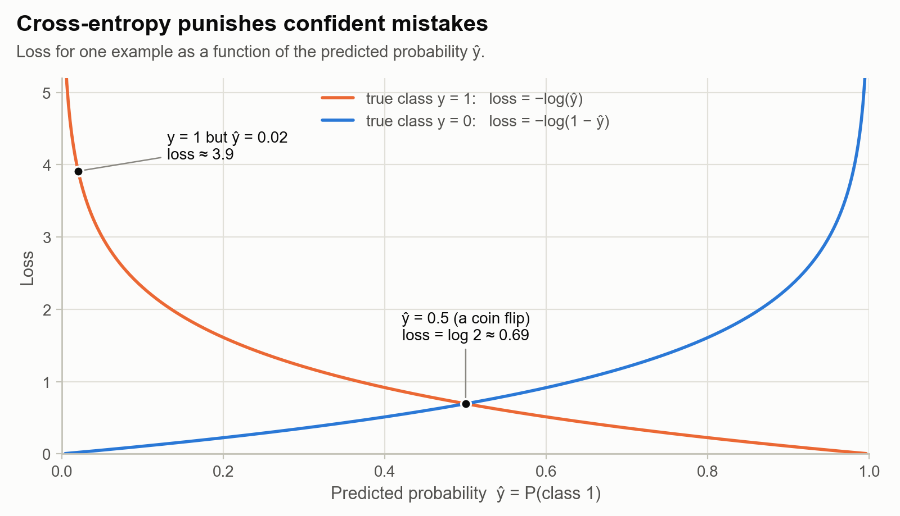

*Cross-entropy for a single example. Being confidently wrong costs far more than being unsure.*

The cost over all $`m`$ training examples:

```math
J(w, b) = \frac{1}{m}\sum_{i=1}^{m}\Big[-y_i\log(\hat{y}_i) - (1 - y_i)\log(1 - \hat{y}_i)\Big]
```

<details>
<summary><b>Deeper: where does this formula come from? (maximum likelihood)</b></summary>

The model says the label is a coin flip with probability $`\hat{y}`$ of landing on 1. Both cases fit in one expression:

```math
P(y \mid x) = \hat{y}^{\,y}\,(1 - \hat{y})^{\,1 - y}
```

Check it: for $`y = 1`$ it gives $`\hat{y}`$, for $`y = 0`$ it gives $`1 - \hat{y}`$. Assuming the examples are independent, the probability of the whole training set is the product, and its logarithm is a sum:

```math
\log \mathcal{L}(w, b) = \sum_{i=1}^{m}\Big[y_i\log(\hat{y}_i) + (1 - y_i)\log(1 - \hat{y}_i)\Big]
```

Training should make the observed labels as probable as possible, so we **maximize** this. Flip the sign and divide by $`m`$ and you have exactly the cost $`J`$. Cross-entropy is not an arbitrary choice: minimizing it is maximum-likelihood estimation.

</details>

<details>
<summary><b>Deeper: why not just use squared error like in regression?</b></summary>

With the sigmoid inside, $`(y - \sigma(w^{\top}x + b))^2`$ is **not convex** in $`w`$: it has flat regions and can trap gradient descent. Its gradient also contains the factor $`\sigma'(z)`$, which is almost zero when the model is confidently wrong, so learning stalls exactly where it should be fastest. Cross-entropy is convex for this model and its gradient has no such factor, as the next section shows.

</details>

### Initializing Parameters

```python
def initialize_weights_and_bias(dimension):
    w = np.full((dimension, 1), 0.01)  # small non-zero value
    b = 0.0
    return w, b
```

- **Weights are initialized to a small constant (0.01)** rather than 0. In a neural network with hidden layers, starting every weight at the same value makes every neuron compute the same output and receive the same gradient, so they can never learn different features (the *symmetry problem*). Plain logistic regression is a single unit with a convex cost, so it would also converge from zero; I keep the small non-zero start because it is the habit that carries over to neural networks.
- **Bias starts at 0**, which is fine because the symmetry issue only applies to weights.
- With weights this small, $`z \approx 0`$ and $`\hat{y} \approx 0.5`$ for every sample, so the very first cost is $`\log 2 \approx 0.693`$: the cost of pure guessing. That is a handy sanity check for any implementation.

### Forward & Backward Propagation

**Forward propagation** computes the prediction and the cost:

```math
z = w^{\top}X + b, \qquad \hat{y} = \sigma(z), \qquad J = \frac{1}{m}\sum_{i=1}^{m} L(y_i, \hat{y}_i)
```

**Backward propagation** computes the gradients of the cost with respect to $`w`$ and $`b`$. Apply the chain rule along the computation graph, one link at a time:

```math
\frac{\partial L}{\partial w} = \frac{\partial L}{\partial \hat{y}}\cdot\frac{\partial \hat{y}}{\partial z}\cdot\frac{\partial z}{\partial w}
```

| Link | Derivative |
|---|---|
| Loss with respect to the prediction | $`\dfrac{\partial L}{\partial \hat{y}} = -\dfrac{y}{\hat{y}} + \dfrac{1 - y}{1 - \hat{y}} = \dfrac{\hat{y} - y}{\hat{y}(1 - \hat{y})}`$ |
| Prediction with respect to the score | $`\dfrac{\partial \hat{y}}{\partial z} = \sigma(z)(1 - \sigma(z)) = \hat{y}(1 - \hat{y})`$ |
| Score with respect to the parameters | $`\dfrac{\partial z}{\partial w} = x, \qquad \dfrac{\partial z}{\partial b} = 1`$ |

Multiply the first two links and the awkward fraction cancels completely:

```math
dz = \frac{\partial L}{\partial z} = \frac{\hat{y} - y}{\hat{y}(1 - \hat{y})}\cdot\hat{y}(1 - \hat{y}) = \hat{y} - y
```

The gradient with respect to the score is simply **prediction minus truth**. Averaging over all $`m`$ samples gives these three lines in the column convention:

```math
dz = \hat{y} - y, \qquad dw = \frac{1}{m}\,X\,dz^{\top}, \qquad db = \frac{1}{m}\sum_{i=1}^{m} dz_i
```

(This derivation uses one **column** per sample, shape 30 × m. The current notebook uses the equivalent row convention, shape m × 30: its weight gradient is `X.T @ (p-y) / m`; no transpose of the dataset is needed.)

These gradients tell us in which direction (and how steeply) the cost increases — so we move the parameters in the **opposite** direction.

### Gradient Descent (Updating Weights)

```math
w \leftarrow w - \alpha \cdot dw, \qquad b \leftarrow b - \alpha \cdot db
```

$`\alpha`$ (alpha) is the **learning rate** — how big a step we take each iteration. The update loop repeats for a fixed number of iterations until the cost converges (stops decreasing significantly).

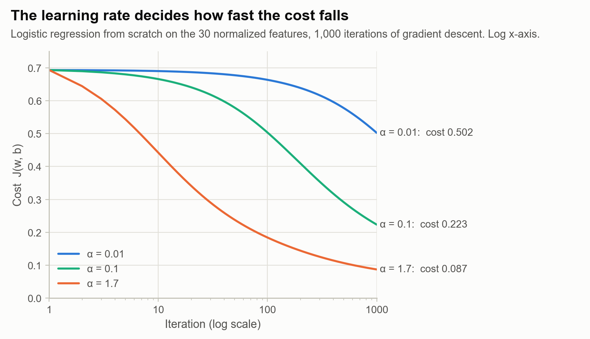

*Cost during training for three learning rates. All three start at log 2 = 0.693; a larger learning rate gets much further in the same 1,000 iterations.*

| Learning rate α | Cost after 1,000 iterations | Train accuracy | Test accuracy |
|---|---|---|---|
| 0.01 | 0.502 | 89.9% | 91.2% |
| 0.1 | 0.223 | 94.3% | 95.6% |
| **1.7** (this figure’s setting) | **0.087** | **98.2%** | **97.4%** |

> [!TIP]
> A learning rate of 1.7 sounds huge, but it works here because every feature was normalized to `[0, 1]`, which keeps the gradients small and the cost surface well-shaped. On unscaled features the same value would make the cost explode. The right learning rate always depends on how the inputs are scaled.

### Why Sigmoid? Key Properties

1. **Probabilistic output** — result is always in `(0, 1)`, interpretable as probability.
2. **Differentiable** — essential for gradient descent; its derivative is $`\sigma(z)(1 - \sigma(z))`$.
3. **Monotonic** — larger $`z`$ always means higher predicted probability.

<details>
<summary><b>Deeper: proof that σ′(z) = σ(z)(1 − σ(z))</b></summary>

Write $`\sigma(z) = (1 + e^{-z})^{-1}`$ and differentiate with the chain rule:

```math
\sigma'(z) = \frac{e^{-z}}{(1 + e^{-z})^2} = \frac{1}{1 + e^{-z}}\cdot\frac{e^{-z}}{1 + e^{-z}} = \sigma(z)\,\big(1 - \sigma(z)\big)
```

The last step uses $`1 - \sigma(z) = \dfrac{e^{-z}}{1 + e^{-z}}`$. The derivative peaks at 0.25 when $`z = 0`$ and vanishes for large positive or negative z, which is the “saturation” shown in the right panel of the sigmoid figure.

</details>

### Implementation in This Notebook

This notebook implements logistic regression **from scratch** using NumPy, then compares the result to **scikit-learn’s** `LogisticRegression`. Building it from scratch first is the best way to understand what sklearn is doing under the hood.

```python
import numpy as np
import pandas as pd
from scipy.special import expit
from sklearn.model_selection import train_test_split
from sklearn.preprocessing import MinMaxScaler
from sklearn.pipeline import make_pipeline
from sklearn.linear_model import LogisticRegression

# Run from a numbered algorithm folder; full portable setup is in the notebook.
data = pd.read_csv("../datasets/data.csv")
x = data.drop(columns=["id", "diagnosis", "Unnamed: 32"])
y = data.diagnosis.map({"B": 0, "M": 1})
x_train, x_test, y_train, y_test = train_test_split(
    x, y, test_size=0.2, stratify=y, random_state=42
)
scaler = MinMaxScaler().fit(x_train)
A_train, A_test = scaler.transform(x_train), scaler.transform(x_test)

def train(X, y, alpha=1.0, iterations=4000):
    w, b = np.zeros(X.shape[1]), 0.0
    for _ in range(iterations):
        error = expit(X @ w + b) - y
        dw, db = X.T @ error / len(y), error.mean()
        w -= alpha * dw
        b -= alpha * db
    return w, b

w, b = train(A_train, y_train.to_numpy())
y_pred = (expit(A_test @ w + b) >= 0.5).astype(int)
print((y_pred == y_test).mean())             # 0.973684... (NumPy)
lr = make_pipeline(MinMaxScaler(), LogisticRegression(max_iter=3000, random_state=42))
lr.fit(x_train, y_train)                     # scaler fitted on training rows only
print(lr.score(x_test, y_test))              # 0.973684... (sklearn, L2)
```

On the current shared split, both implementations reach **97.37%** test accuracy (111 of 114). Equal accuracy does not mean equal coefficients: the NumPy example has no regularization, while sklearn uses L2. The full notebook also checks a gradient numerically and plots the stable cross-entropy loss. Earlier learning-rate figures above describe their own illustrative experiment.

---

## 2. K-Nearest Neighbours (KNN)

**Executed notebook:** [K-Nearest Neighbours](2%29%20K-Nearest%20Neighbour%20%28KNN%29%20Classification/K-Nearest%20Neighbour%20%28KNN%29.ipynb)

KNN is a simple, **non-parametric** algorithm — it memorises the entire training set and makes predictions at query time by looking at the closest points. There is no training step at all, which is why it is called a **lazy learner**.

### Algorithm (Step by Step)

1. **Choose K** — the number of neighbours to consider.
2. **Compute distances** from the query point to every training sample (Euclidean distance is most common).
3. **Find the K closest** training samples.
4. **Vote** — the majority class among those K neighbours becomes the prediction.

Written as a formula, with $`N_K(x)`$ the set of the K nearest training points, the estimated probability of class 1 is just the share of neighbours that belong to it:

```math
\hat{P}(y = 1 \mid x) = \frac{1}{K}\sum_{i \in N_K(x)} y_i, \qquad \hat{y} = \begin{cases} 1 & \text{if } \hat{P} \gt 0.5 \\ 0 & \text{otherwise} \end{cases}
```

### Euclidean Distance

In two dimensions (Pythagoras):

```math
d(p, q) = \sqrt{(p_1 - q_1)^2 + (p_2 - q_2)^2}
```

In higher dimensions this generalises to:

```math
d(p, q) = \sqrt{\sum_{j=1}^{n}(p_j - q_j)^2}
```

Euclidean distance is one member of the **Minkowski** family. scikit-learn’s default is `metric="minkowski"` with `p=2`:

```math
d_r(p, q) = \Big(\sum_{j=1}^{n}\lvert p_j - q_j\rvert^{\,r}\Big)^{1/r} \qquad r = 1:\ \text{Manhattan}, \quad r = 2:\ \text{Euclidean}
```

### Choosing K

- **Small K (e.g. 1):** Very sensitive to noise — a single outlier can change the prediction. Low bias, high variance → **overfitting**.
- **Large K:** Smoother decision boundary but may include irrelevant neighbours. High bias, low variance → **underfitting**.
- **Best practice:** Plot accuracy vs. K and pick the point where accuracy stops improving.

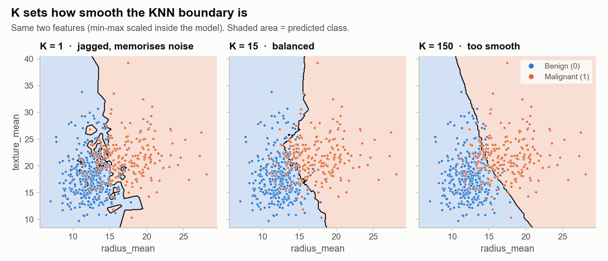

*The same data classified with K = 1, 15 and 150. A small K draws islands around single points; a very large K flattens the boundary.*

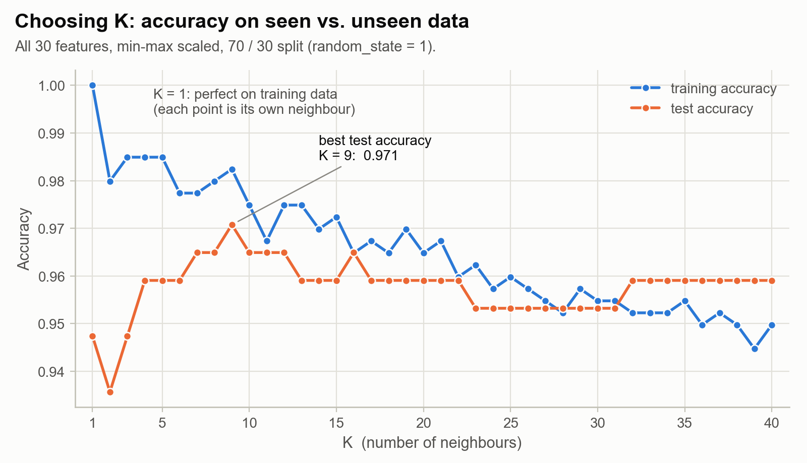

*Training and test accuracy for K = 1 to 40, all 30 features. K = 1 is perfect on the training data and worst on the test data.*

What the curve says on my split (70 / 30, `random_state=1`, 171 test tumours):

- **K = 1** scores 100% on the training set, because every point is its own nearest neighbour, but only 94.7% on the test set. That gap is overfitting.
- Test accuracy peaks at **K = 9 (97.1%, 166 of 171)**. Every K from 7 to 12 lands within one tumour of that, so the curve is flat there. That earlier illustration used **K = 8**; the current notebook chooses **K = 3** using training CV on the shared 80/20 split.
- Beyond K ≈ 20 both curves drift down together: the model is becoming too smooth.

> [!WARNING]
> **Two habits worth building.**
>
> - Picking K by looking at **test** accuracy quietly leaks the test set into the model. The clean way is to choose K with cross-validation on the training data and touch the test set once, at the end.
> - With two classes an **odd K** can never produce a tied vote.

### Normalization is Critical for KNN

KNN is entirely distance-based. A feature with large values (e.g. `area_mean`, 144 to 2,501) will dominate the distance over a small-valued feature (e.g. `smoothness_mean`, 0.05 to 0.16). **Min-Max normalization** scales every feature to `[0, 1]`:

```math
x_{norm} = \frac{x - x_{min}}{x_{max} - x_{min}}
```

**A worked example.** Take two tumours that are almost identical in area but at opposite ends of the smoothness range:

|   | Difference in area_mean | Difference in smoothness_mean | Euclidean distance |
|---|---|---|---|
| **Raw values** | 20 | 0.10 | $`\sqrt{20^2 + 0.10^2} = 20.0002`$ |
| **After min-max** | 20 / 2357.5 = 0.008 | 0.10 / 0.11 = 0.909 | $`\sqrt{0.008^2 + 0.909^2} = 0.909`$ |

On raw values the smoothness difference, almost the entire range of that feature, contributes nothing to the distance. After scaling it dominates, as it should.

| Model (same 70 / 30 split) | Test accuracy, raw features | Test accuracy, min-max scaled |
|---|---|---|
| KNN, K = 8 | 93.0% | **96.5%** |
| SVM, RBF kernel | 91.8% | **97.1%** |
| Gaussian Naive Bayes | 94.7% | 94.7% (scale does not matter) |

> [!TIP]
> Compute $`x_{min}`$ and $`x_{max}`$ from the **training set only**, then apply the same numbers to the test set. Otherwise information about the test data leaks into training. A scikit-learn `Pipeline` does this for you.

### The price of laziness

- **Training is free, prediction is expensive.** `fit` only stores the data. Every single prediction computes a distance to all $`n`$ training points across all $`d`$ features: $`O(n \cdot d)`$ per query.
- **Curse of dimensionality.** As the number of features grows, all points drift towards being equally far from each other, and “nearest” loses its meaning. Removing uninformative features or reducing dimensions first helps a lot.

### Python implementation

```python
from sklearn.neighbors import KNeighborsClassifier
from sklearn.preprocessing import MinMaxScaler
from sklearn.pipeline import Pipeline
from sklearn.model_selection import GridSearchCV, StratifiedKFold

# x_train/x_test are the raw, stratified 80/20 split from section 1.
cv = StratifiedKFold(n_splits=5, shuffle=True, random_state=42)
pipeline = Pipeline([("scale", MinMaxScaler()), ("knn", KNeighborsClassifier())])
search = GridSearchCV(pipeline, {"knn__n_neighbors": list(range(1, 26))},
                      cv=cv, scoring="accuracy", n_jobs=1)
search.fit(x_train, y_train)                 # each fold fits its own scaler
knn = search.best_estimator_
print(search.best_params_)                  # {'knn__n_neighbors': 3}
print(search.best_score_)                   # 0.975824... (training CV)
print(knn.score(x_test, y_test))             # 0.956140... (held-out test)
```

---

## 3. Support Vector Machine (SVM)

**Executed notebook:** [Support Vector Machine](3%29%20Support%20Vector%20Machine%20%28SVM%29%20Classification/Support%20Vector%20Machine%20%28SVM%29.ipynb)

SVM finds the **hyperplane** that separates two classes with the **maximum margin** — the widest possible gap between the nearest data points of each class. Those nearest points are called **support vectors**.

### Intuition

Imagine drawing a line between two clusters of points. There are infinitely many lines that separate them correctly. SVM picks the one that is **furthest from both clusters** — maximising the margin makes the classifier more robust to new data. Think of it as fitting the widest possible street between the two classes; the decision boundary is the centre line.

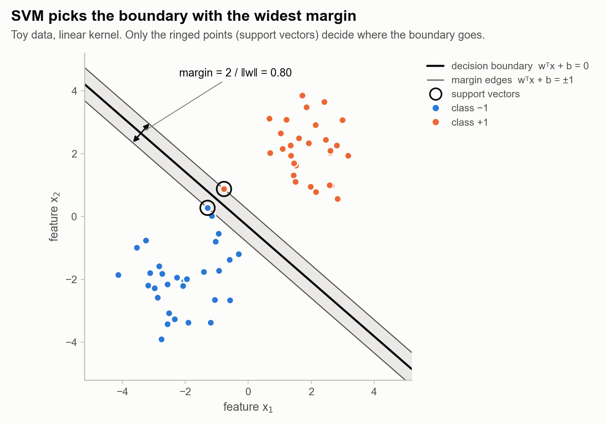

*A linear SVM on toy data. The grey band is the margin. Only the two ringed points touch its edges; every other point could move or disappear without changing the boundary.*

### The math: where the margin formula comes from

SVM uses the labels $`y_i \in \{-1, +1\}`$ instead of 0 and 1. The boundary is the set of points with $`w^{\top}x + b = 0`$, and the distance from any point $`x`$ to it is:

```math
\text{distance}(x) = \frac{\lvert w^{\top}x + b\rvert}{\lVert w\rVert}
```

Multiplying $`w`$ and $`b`$ by the same constant does not move the boundary, so we are free to fix the scale. Choose it so that the closest points on each side satisfy $`w^{\top}x + b = \pm 1`$. Those points then sit at distance $`1/\lVert w\rVert`$, and the street is twice that wide:

```math
\text{Margin} = \frac{2}{\lVert w\rVert}
```

In the figure above $`w = (1.65,\ 1.90)`$, so $`\lVert w\rVert = 2.52`$ and the margin is $`2 / 2.52 = 0.80`$.

Maximising the margin is equivalent to minimising $`\lVert w\rVert^2 / 2`$, subject to the constraint that all points are correctly classified and outside the street:

```math
\min_{w,\,b}\ \frac{1}{2}\lVert w\rVert^2 \qquad \text{subject to} \qquad y_i\,(w^{\top}x_i + b) \ge 1 \quad \text{for every } i
```

### Hard vs. Soft Margin

| Type | Description |
|---|---|
| **Hard margin** | No misclassification allowed. Only works when data is perfectly linearly separable. |
| **Soft margin** | Allows some misclassification (controlled by the `C` parameter). More practical for real-world noisy data. |

The soft margin gives every point a **slack** $`\xi_i \ge 0`$ that measures how far it is allowed to violate the margin, and charges for the total slack:

```math
\min_{w,\,b,\,\xi}\ \frac{1}{2}\lVert w\rVert^2 + C\sum_{i=1}^{m}\xi_i \qquad \text{subject to} \qquad y_i\,(w^{\top}x_i + b) \ge 1 - \xi_i, \quad \xi_i \ge 0
```

**`C`**** (regularisation parameter)** is the price of one unit of slack:

- Large `C` → penalises misclassification heavily → narrow margin, risk of overfitting.
- Small `C` → tolerates more errors → wider margin, better generalisation.

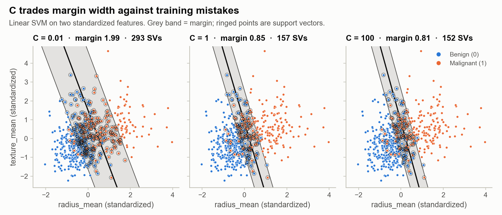

*The same two features with three values of C. A small C buys a wide street and accepts many points inside it; a large C narrows the street to reduce violations.*

| C | Margin width | Support vectors (of 569) |
|---|---|---|
| 0.01 | 1.99 | 293 |
| 1 | 0.85 | 157 |
| 100 | 0.81 | 152 |

### SVM and logistic regression are cousins

At the optimum each slack equals $`\xi_i = \max(0,\ 1 - y_i f(x_i))`$ with $`f(x) = w^{\top}x + b`$. Substituting that back removes the constraints and shows what SVM really minimises:

```math
\min_{w,\,b}\ \frac{1}{2}\lVert w\rVert^2 + C\sum_{i=1}^{m}\max\big(0,\ 1 - y_i f(x_i)\big)
```

The second term is the **hinge loss**. Logistic regression minimises the **log loss** $`\log(1 + e^{-y_i f(x_i)})`$ instead. Both are smooth-ish stand-ins for the 0–1 loss that accuracy counts:

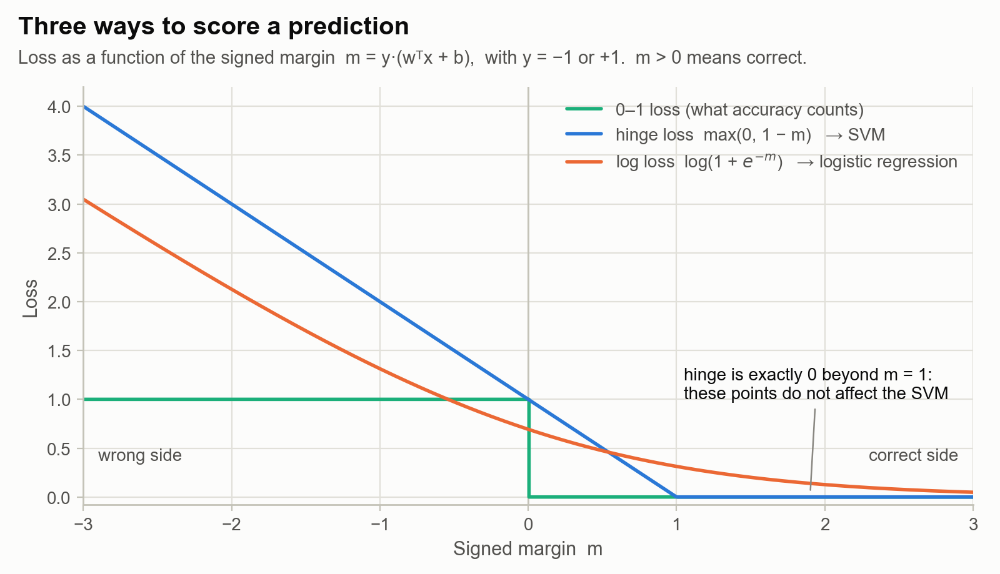

*Three loss functions against the signed margin. Hinge loss is exactly zero for points safely beyond the margin; log loss never quite reaches zero.*

The flat zero part of the hinge loss is the mathematical reason for support vectors: points that are correct and beyond the margin contribute nothing, so the solution depends only on the few points on or inside the street.

### Kernel Trick

When data is not linearly separable, SVM maps the data to a **higher-dimensional space** where a separating hyperplane exists. Common kernels:

- `linear` — no transformation (for linearly separable data)
- `rbf` (Radial Basis Function) — maps to infinite dimensions; handles most non-linear cases
- `poly` — polynomial transformation

scikit-learn’s `SVC` uses `kernel='rbf'` by default.

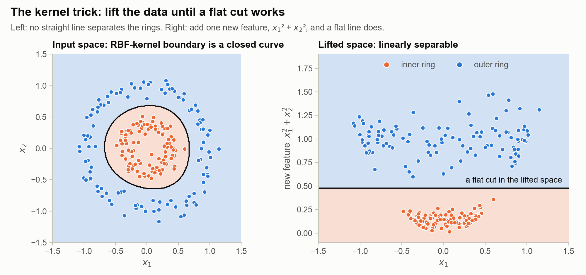

*Left: two rings that no straight line can separate. Right: after adding one new feature, the squared distance from the centre, a flat cut separates them perfectly.*

On those rings a linear SVM gets 62% of the points right; the RBF kernel gets 100%.

**Why is it called a trick?** The SVM solution only ever needs **dot products** between data points. A kernel $`K(x, x') = \phi(x)^{\top}\phi(x')`$ returns the dot product in the lifted space **without ever computing the lifted coordinates** $`\phi(x)`$. For the RBF kernel that lifted space is infinite-dimensional, yet the kernel itself is one line:

```math
K(x, x') = \exp\big(-\gamma\,\lVert x - x'\rVert^2\big)
```

It is a similarity score: 1 for identical points, falling towards 0 as they move apart. $`\gamma`$ sets how fast it falls. Large `gamma` → each support vector only influences its close surroundings → a wiggly boundary that can overfit. Small `gamma` → broad influence → a smoother boundary.

<details>
<summary><b>Deeper: the dual problem (where the dot products appear)</b></summary>

Introduce one Lagrange multiplier $`\alpha_i \ge 0`$ per training point. Solving for $`w`$ gives $`w = \sum_i \alpha_i y_i x_i`$, and the optimisation becomes:

```math
\max_{\alpha}\ \sum_{i=1}^{m}\alpha_i - \frac{1}{2}\sum_{i=1}^{m}\sum_{j=1}^{m}\alpha_i\alpha_j\,y_i y_j\,x_i^{\top}x_j \qquad \text{subject to} \qquad 0 \le \alpha_i \le C, \quad \sum_{i=1}^{m}\alpha_i y_i = 0
```

The data enters only through $`x_i^{\top}x_j`$. Replace that with $`K(x_i, x_j)`$ and the same algorithm works in the lifted space. The prediction for a new point is:

```math
f(x) = \sum_{i=1}^{m}\alpha_i\,y_i\,K(x_i, x) + b
```

Most $`\alpha_i`$ come out exactly zero. The points with $`\alpha_i \gt 0`$ are the support vectors, and they are the only ones needed at prediction time.

</details>

### Python implementation

```python
from sklearn.svm import SVC
from sklearn.pipeline import Pipeline
from sklearn.preprocessing import MinMaxScaler
from sklearn.model_selection import GridSearchCV, StratifiedKFold

cv = StratifiedKFold(n_splits=5, shuffle=True, random_state=42)
pipeline = Pipeline([("scale", MinMaxScaler()), ("svm", SVC(random_state=42))])
grid = [
    {"svm__kernel": ["linear"], "svm__C": [0.1, 1, 10]},
    {"svm__kernel": ["rbf"], "svm__C": [0.1, 1, 10], "svm__gamma": ["scale", 0.1, 1]},
]
search = GridSearchCV(pipeline, grid, cv=cv, scoring="accuracy", n_jobs=1)
search.fit(x_train, y_train)
svm = search.best_estimator_
print(search.best_params_)                  # C=10, gamma=1, kernel='rbf'
print(svm.score(x_test, y_test))             # 0.973684...
print(svm.named_steps["svm"].n_support_)     # [34 33]
```

Like KNN, SVM measures distances, so it needs scaled features: on the raw data the same model scores only 91.8%.

---

## 4. Naive Bayes

**Executed notebook:** [Naive Bayes](4%29%20Naive%20Bayes%20Classification/Naive%20Bayes.ipynb)

Naive Bayes is a **probabilistic classifier** based on Bayes’ Theorem. It is called *naive* because it assumes all features are **conditionally independent** given the class label — a simplification that rarely holds in practice but works surprisingly well.

### Bayes’ Theorem

```math
P(c \mid x) = \frac{P(x \mid c)\,P(c)}{P(x)}
```

| Term | Name | Meaning |
|---|---|---|
| $`P(c \mid x)`$ | **Posterior** | Probability of the class given the observed features |
| $`P(x \mid c)`$ | **Likelihood** | Probability of observing these features from this class |
| $`P(c)`$ | **Prior** | How frequent this class is in the training set |
| $`P(x)`$ | **Evidence** | Constant normaliser; can be ignored for classification |

To classify, we compute the posterior for each class and pick the highest one. Because $`P(x)`$ is the same for every class, comparing the numerators is enough:

```math
\hat{c} = \underset{c}{\arg\max}\ P(c)\,P(x \mid c)
```

### The “Naive” Independence Assumption

```math
P(x_1, x_2, \dots, x_n \mid c) = P(x_1 \mid c)\cdot P(x_2 \mid c)\cdots P(x_n \mid c) = \prod_{j=1}^{n} P(x_j \mid c)
```

Each feature is treated as if it contributes to the class probability independently. This makes the maths tractable, avoids the curse of dimensionality, and speeds up computation dramatically.

**How much simpler?** Modelling 30 features jointly with a full Gaussian needs 30 means plus 465 variances and covariances per class. The naive version needs 30 means and 30 variances: 60 numbers per class, each estimated from a simple average.

<details>
<summary><b>Deeper: why implementations add logarithms instead of multiplying</b></summary>

Multiplying 30 small probabilities quickly underflows to zero in floating point. The logarithm is monotonic, so the class with the largest product also has the largest sum of logs:

```math
\hat{c} = \underset{c}{\arg\max}\ \Big[\log P(c) + \sum_{j=1}^{n}\log P(x_j \mid c)\Big]
```

Every Naive Bayes implementation, including scikit-learn’s, works in this log space.

</details>

### Gaussian Naive Bayes

When features are **continuous** (like all 30 features in the breast cancer dataset), `GaussianNB` assumes each feature follows a **normal (Gaussian) distribution** within each class:

```math
P(x_j \mid c) = \frac{1}{\sqrt{2\pi\sigma_{jc}^2}}\exp\!\left(-\frac{(x_j - \mu_{jc})^2}{2\sigma_{jc}^2}\right)
```

The model learns $`\mu`$ (mean) and $`\sigma^2`$ (variance) for each feature in each class from the training data. “Training” is nothing more than computing those averages, so there is almost nothing to tune.

### A worked example on one feature

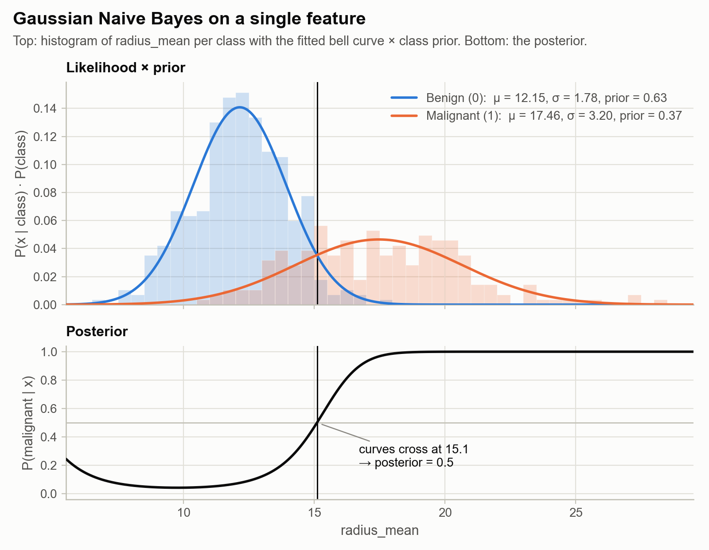

*Top: the distribution of radius_mean in each class with its fitted bell curve, scaled by the class prior. Bottom: the resulting probability of malignant. The decision flips where the two curves cross.*

Classify a tumour with **radius_mean = 15** using only this feature:

|   | Benign | Malignant |
|---|---|---|
| Prior $`P(c)`$ | 0.627 | 0.373 |
| Mean, standard deviation | 12.15, 1.78 | 17.46, 3.20 |
| Likelihood $`P(15 \mid c)`$ | 0.0619 | **0.0928** |
| Likelihood × prior | **0.0388** | 0.0346 |
| Posterior | **52.9%** | 47.1% |

> [!TIP]
> **The prior changes the answer.** A radius of 15 is more typical of a malignant tumour (likelihood 0.093 vs 0.062). But benign tumours are simply more common in the data, and after multiplying by the priors the benign side wins, narrowly. The two curves cross at **15.1**: above that, this one-feature model says malignant.

One more thing the bottom panel shows: far to the left the malignant probability creeps up again. No tumour is that small. It happens only because the malignant bell curve is wider, so its tail eventually overtakes the narrow benign one. A reminder that the Gaussian assumption is a model, not a fact.

### Strengths & Weaknesses

| Strengths | Weaknesses |
|---|---|
| Very fast to train and predict | Assumes feature independence (often violated) |
| Works well with small data | Probability estimates can be poorly calibrated |
| Handles high-dimensional data gracefully | Poor on features with complex correlations |
| Naturally multi-class | Sensitive to feature scaling in some variants |

In this dataset many features are near-copies of each other (radius, perimeter and area all measure size). Naive Bayes counts that same evidence several times, which is one reason it ends up below the other models in the comparison at the end.

### Python implementation

```python
from sklearn.naive_bayes import GaussianNB

nb = GaussianNB().fit(x_train, y_train)      # continuous raw features; no scaler needed
print(nb.score(x_test, y_test))             # 0.938596...
print(nb.class_prior_)                      # [0.62637363 0.37362637]
print(nb.theta_[:, 0])                      # class means of radius_mean
print(nb.var_[:, 0])                        # smoothed class variances
```

---

## 5. Decision Tree Classification

**Executed notebook:** [Decision Tree](5%29%20Decision%20Tree%20Classification/Decision%20Tree.ipynb)

**CART** stands for *Classification and Regression Trees*: one algorithm, two jobs. The regression version is explained on the [Regression](../Regression/Regression.md) page. For classification only two things change:

|   | Regression tree | Classification tree |
|---|---|---|
| A leaf predicts | The **mean** of its training rows | The **majority class** of its training rows |
| A split is scored by | Variance (MSE) of the children | **Impurity** of the children: entropy or Gini |

Everything else is identical: try every feature and every threshold, keep the best split, repeat inside each child.

### The math: measuring how mixed a node is

A node is **pure** if all its samples belong to one class and **impure** if the classes are mixed. With $`p_k`$ the share of class $`k`$ in the node:

```math
\text{Entropy:}\quad H = -\sum_{k} p_k\log_2 p_k \qquad\qquad \text{Gini:}\quad G = 1 - \sum_{k} p_k^2
```

For two classes with $`p`$ = share of class 1:

```math
H(p) = -p\log_2 p - (1 - p)\log_2(1 - p), \qquad G(p) = 2p(1 - p)
```

- **Entropy** comes from information theory: the average number of yes/no questions (bits) needed to learn the class of a random sample from the node. A pure node needs 0 questions; a 50 / 50 node needs 1.
- **Gini** is the probability of labelling a random sample wrongly if you guess according to the node’s own class shares.

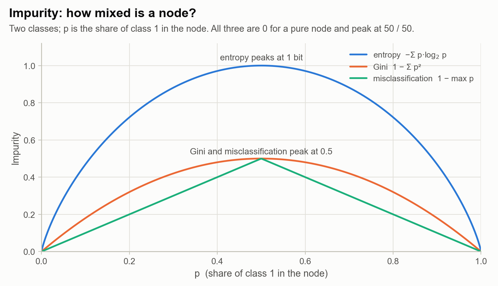

*Entropy, Gini and misclassification rate for a two-class node. All are zero for a pure node and largest at a 50 / 50 mix.*

### The math: minimizing entropy = maximizing information gain

A split sends the $`n`$ samples of a node into a left child ($`n_L`$) and a right child ($`n_R`$). Its **information gain** is the entropy we had minus the weighted entropy we are left with:

```math
IG = H(\text{parent}) - \left[\frac{n_L}{n}H(L) + \frac{n_R}{n}H(R)\right]
```

The tree picks the split with the **largest information gain**, which is the same as the split with the **lowest weighted child entropy**.

### The root split, computed by hand

On the two features `radius_mean` and `texture_mean`, the best first question is “radius_mean ≤ 15.05?”.

| Node | Samples | Benign | Malignant | Share malignant | Entropy (bits) |
|---|---|---|---|---|---|
| Parent (all data) | 569 | 357 | 212 | 0.373 | 0.953 |
| Left: radius_mean ≤ 15.05 | 397 | 346 | 51 | 0.128 | 0.553 |
| Right: radius_mean above 15.05 | 172 | 11 | 161 | 0.936 | 0.343 |

```math
H(\text{parent}) = -0.373\log_2 0.373 - 0.627\log_2 0.627 = 0.953
```

```math
IG = 0.953 - \left[\frac{397}{569}\cdot 0.553 + \frac{172}{569}\cdot 0.343\right] = 0.953 - 0.490 = 0.463 \text{ bits}
```

One question about the radius removes almost half of the uncertainty about the diagnosis. The full depth-2 tree:

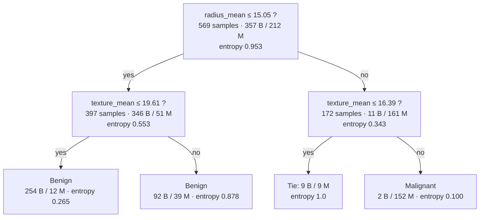

Notice the leaf with 9 benign and 9 malignant tumours: entropy exactly 1, a coin flip. A deeper tree would keep splitting there.

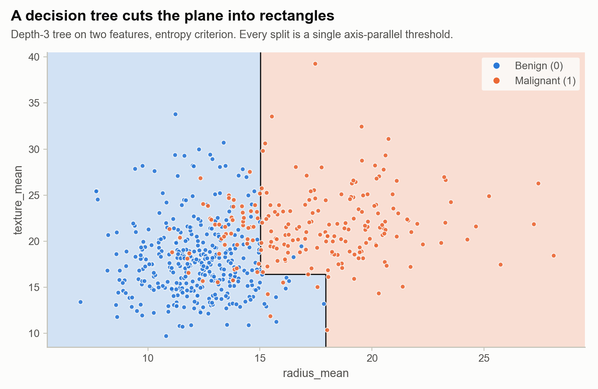

*A depth-3 tree on two features. Every split is one threshold on one feature, so the regions are always rectangles with edges parallel to the axes.*

### Entropy or Gini?

They almost always choose the same splits. Gini needs no logarithm, so it is slightly faster, and it is scikit-learn’s default (`criterion="gini"`). Use `criterion="entropy"` to get the information-gain version described above.

### Pros and cons

- **Pros:** Reads like a flowchart; no feature scaling needed; handles non-linear boundaries and feature interactions.
- **Cons:** Boundaries are always axis-parallel steps; a deep tree memorises the training set; small changes in the data can change the whole tree (high variance). The same hyperparameters as for regression trees keep it in check: `max_depth`, `min_samples_split`, `min_samples_leaf`.

### Python implementation

```python
from sklearn.tree import DecisionTreeClassifier, plot_tree
from sklearn.model_selection import GridSearchCV, StratifiedKFold
import matplotlib.pyplot as plt

cv = StratifiedKFold(n_splits=5, shuffle=True, random_state=42)
search = GridSearchCV(DecisionTreeClassifier(criterion="entropy", random_state=42),
                      {"max_depth": [2, 3, 4, 5, None], "min_samples_leaf": [1, 3, 5]},
                      cv=cv, scoring="accuracy", n_jobs=1)
search.fit(x_train, y_train)
tree = search.best_estimator_
print(search.best_params_)                  # max_depth=4, min_samples_leaf=1
print(tree.score(x_test, y_test))           # 0.929824...

# A separate readable illustration, also fitted on training rows only.
features = ["radius_mean", "texture_mean"]
small_tree = DecisionTreeClassifier(max_depth=2, criterion="entropy", random_state=42)
small_tree.fit(x_train[features], y_train)
plt.figure(figsize=(12, 6))
plot_tree(small_tree, feature_names=features, class_names=["Benign", "Malignant"],
          filled=True, rounded=True, fontsize=10)
plt.tight_layout()
plt.show()
```

---

## 6. Random Forest Classification

**Executed notebook:** [Random Forest](6%29%20Random%20Forest%20Classification/Random%20Forest.ipynb)

**Ensemble learning:** instead of trusting one model, train many and combine their answers. A random forest is an ensemble of decision trees.

### Algorithm (Step by Step)

1. From the $`n`$ training rows, pick $`n`$ rows at random **with replacement**. The selected rows are called a **sub-sample** (bootstrap sample). Some rows appear several times, about a third not at all.
2. Grow a decision tree on that sub-sample. At every split, consider only a **random subset of the features** (by default $`\sqrt{30} \approx 5`$ of the 30).
3. Repeat steps 1 and 2 for $`B`$ trees (`n_estimators`).
4. To classify a new sample, let **every tree vote** and take the majority. (scikit-learn averages the trees’ class probabilities, a “soft” vote.)

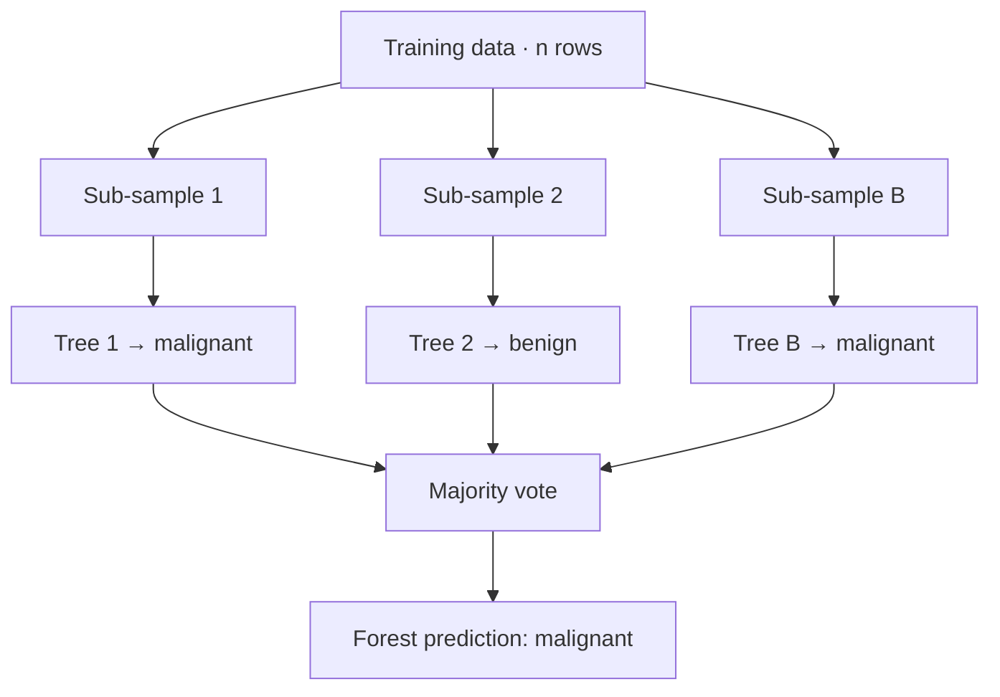

### The math: why a vote beats a single voter

Suppose each tree is right with probability $`p \gt 0.5`$ and the trees make their mistakes **independently**. The majority of $`B`$ trees is right with probability:

```math
P(\text{majority correct}) = \sum_{k \gt B/2}\binom{B}{k}\,p^{k}(1 - p)^{B - k}
```

| Trees B (each 70% accurate) | Accuracy of the majority vote |
|---|---|
| 1 | 70.0% |
| 11 | 92.2% |
| 101 | 99.999% |

> [!WARNING]
> **The catch is the word “independently”.** Real trees are trained on overlapping data and make many of the same mistakes, so the gain is far smaller than this table promises. That is exactly why the forest injects randomness (sub-samples and random feature subsets): the less alike the trees are, the more a vote helps. The Regression page derives the same idea as a formula for the variance of an average, $`\rho\sigma^2 + \tfrac{1-\rho}{B}\sigma^2`$.

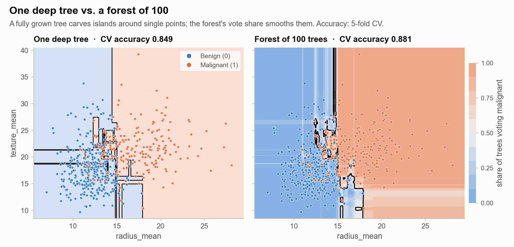

*Left: one fully grown tree draws small islands around single tumours. Right: the share of 100 trees voting malignant changes gradually, and the islands dissolve.*

| Cross-validated accuracy | Single tree | Forest of 100 trees |
|---|---|---|
| Two features (5-fold) | 84.9% | **88.1%** |
| All 30 features (10-fold) | 92.6% | **95.6%** |

### Two free extras

- **Out-of-bag score.** Each tree can be tested on the rows that were left out of its sub-sample. Averaged over the forest this gives an accuracy estimate without touching the test set: 95.7% here, next to 95.9% on the real test set.
- **Feature importance.** Summing how much each feature reduced impurity across all trees ranks the features. The top five on this dataset: `concave points_worst` (0.150), `area_worst` (0.131), `concave points_mean` (0.094), `perimeter_worst` (0.092), `radius_worst` (0.083).

### Python implementation

```python
from sklearn.ensemble import RandomForestClassifier
from sklearn.model_selection import cross_val_score, StratifiedKFold

rf = RandomForestClassifier(n_estimators=200, oob_score=True, random_state=42, n_jobs=1)
cv = StratifiedKFold(n_splits=5, shuffle=True, random_state=42)
print(cross_val_score(rf, x_train, y_train, cv=cv, scoring="accuracy").mean())  # 0.962637...
rf.fit(x_train, y_train)
print(rf.score(x_test, y_test))              # 0.964912...
print(rf.oob_score_)                        # 0.953846...
print(pd.Series(rf.feature_importances_, index=x.columns).nlargest(10))
```

---

## 7. Confusion Matrix and Evaluation Metrics

**Executed notebook:** [Evaluation & algorithm comparison](7%29%20Model%20Evaluation/Model%20Evaluation.ipynb)

Accuracy tells you **how many** predictions were right. A **confusion matrix** tells you **which kind** of mistakes were made, and for a cancer test the two kinds are not equally bad.

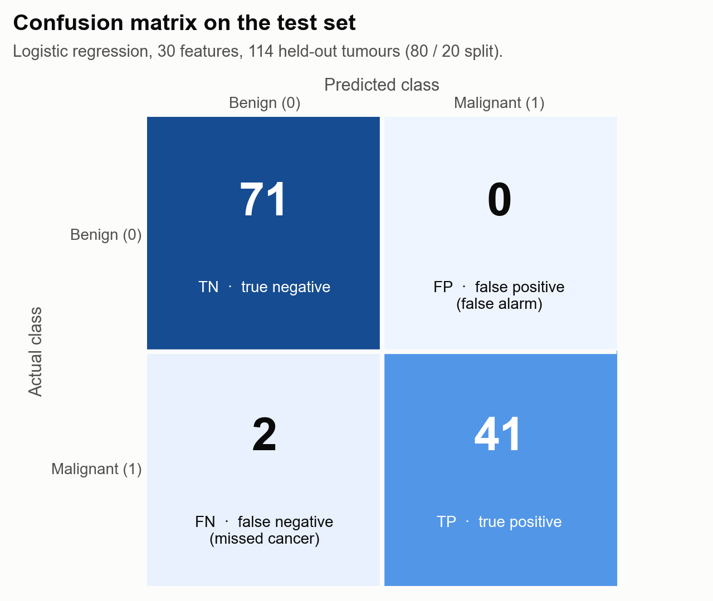

*Confusion matrix of the logistic regression model from section 1 on its 114 test tumours.*

|   | Predicted benign (0) | Predicted malignant (1) |
|---|---|---|
| Actually benign (0) | **TN = 71** true negative: healthy, and the model says so | **FP = 0** false positive: a false alarm |
| Actually malignant (1) | **FN = 2** false negative: a missed cancer | **TP = 41** true positive: cancer, and the model finds it |

### The metrics built from those four numbers

| Metric | Formula | This model | Question it answers |
|---|---|---|---|
| **Accuracy** | $`\dfrac{TP + TN}{TP + TN + FP + FN}`$ | 112 / 114 = 0.982 | How often is the model right overall? |
| **Precision** | $`\dfrac{TP}{TP + FP}`$ | 41 / 41 = 1.000 | When it says malignant, how often is that true? |
| **Recall** (sensitivity) | $`\dfrac{TP}{TP + FN}`$ | 41 / 43 = 0.953 | Of all malignant tumours, how many did it find? |
| **Specificity** | $`\dfrac{TN}{TN + FP}`$ | 71 / 71 = 1.000 | Of all benign tumours, how many did it clear? |
| **F1 score** | $`2\cdot\dfrac{\text{precision}\cdot\text{recall}}{\text{precision} + \text{recall}}`$ | 0.976 | One number balancing precision and recall |

> [!WARNING]
> **Why accuracy alone can fool you.** A “model” that calls every tumour benign is right 62.7% of the time on this dataset, because that is the share of benign cases, and it finds exactly zero cancers (recall = 0). In screening, a missed cancer (FN) is far more costly than a false alarm (FP), so **recall** is the number to watch. Here it is 95.3%: two malignant tumours slipped through.

### The threshold is a dial

Predicting class 1 when $`\hat{y} \ge 0.5`$ is only a convention. Lowering the threshold catches more cancers and raises more false alarms; raising it does the opposite.

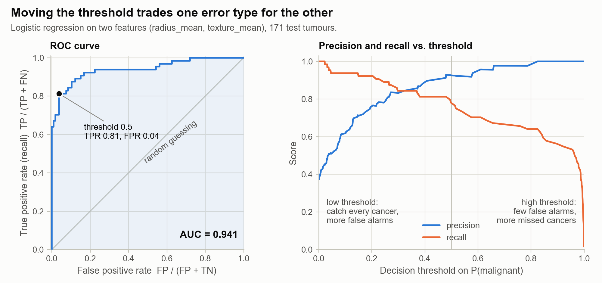

*Left: the ROC curve, which traces every possible threshold. Right: precision and recall as the threshold moves from 0 to 1.*

For the two-feature logistic regression in the figure (its errors are frequent enough to show the trade-off clearly):

| Threshold | Precision | Recall |
|---|---|---|
| 0.2 | 0.77 | 0.92 |
| 0.5 | 0.92 | 0.77 |
| 0.8 | 1.00 | 0.64 |

- The **ROC curve** plots the true positive rate (recall) against the false positive rate $`FP / (FP + TN)`$ for every threshold. A perfect model hugs the top-left corner; random guessing follows the diagonal.
- **AUC**, the area under that curve, summarises it in one number: the probability that a randomly chosen malignant tumour gets a higher score than a randomly chosen benign one. 0.5 is guessing, 1.0 is perfect; this two-feature model reaches **0.941**.

### Python implementation

```python
from sklearn.metrics import confusion_matrix, classification_report, roc_auc_score

# The section 1 logistic pipeline and its shared stratified 80/20 split.
y_pred = lr.predict(x_test)
print(confusion_matrix(y_test, y_pred, labels=[0, 1]))
# [[72  0]
#  [ 3 39]]
print(classification_report(y_test, y_pred, target_names=["benign", "malignant"]))
print(roc_auc_score(y_test, lr.predict_proba(x_test)[:, 1]))
```

This short excerpt evaluates chapter 1’s logistic model. The full chapter 7 notebook additionally compares six fixed configurations using training CV, selects an SVM and chooses a threshold using training OOF predictions; it is a separate experiment from this logistic excerpt.

---

## Algorithm Comparison

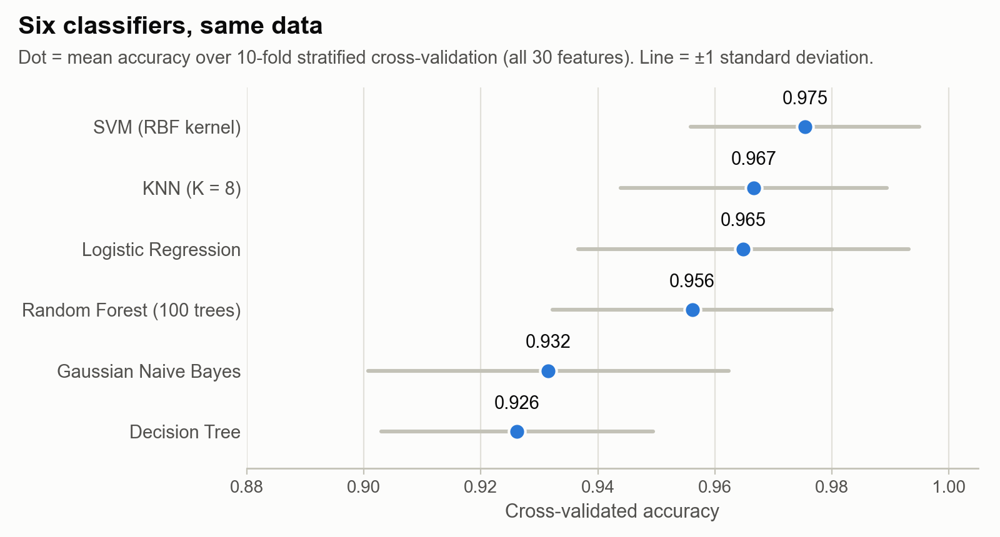

*Mean accuracy of the six classifiers over 10-fold cross-validation on all 30 features. The horizontal line through each dot shows how much the score varies from fold to fold.*

| Algorithm | 10-fold CV accuracy | Standard deviation across folds |
|---|---|---|
| SVM (RBF kernel) | **0.975** | 0.020 |
| KNN (K = 8) | 0.967 | 0.023 |
| Logistic Regression | 0.965 | 0.028 |
| Random Forest (100 trees) | 0.956 | 0.024 |
| Gaussian Naive Bayes | 0.932 | 0.031 |
| Decision Tree | 0.926 | 0.023 |

> [!TIP]
> **Read the ranking with care.** These are descriptive means and fold standard deviations from the older 10-fold experiment. Overlapping training folds and these error bars do not establish statistical equivalence or significant differences. The current chapter 7 notebook uses training-only 5-fold comparison followed by held-out evaluation; use its saved table for the current protocol.

| Algorithm | Type | Key Hyperparameter | Interpretable? | Scales Well? | Needs feature scaling? |
|---|---|---|---|---|---|
| Logistic Regression | Probabilistic (linear) | Learning rate, iterations | ✅ Yes | ✅ Yes | Yes (gradient descent) |
| KNN | Instance-based | K (neighbours) | ✅ Yes | ❌ Slow on large N | Yes (distances) |
| SVM | Geometric margin | C, kernel, gamma | ⚠️ Partial | ✅ Kernel-dependent | Yes (distances) |
| Naive Bayes | Probabilistic | — | ✅ Yes | ✅ Yes | No |
| Decision Tree | Rule-based | max_depth | ✅ Yes | ✅ Yes | No |
| Random Forest | Ensemble of trees | n_estimators, max_features | ⚠️ Partial | ✅ Yes | No |

## 8. K-Means Clustering (Unsupervised Learning)

**Executed notebook:** [K-means clustering](8%29%20K-Means%20Clustering/K-Means.ipynb)

Every algorithm up to this point was **supervised**: we had $`(x_i, y_i)`$ pairs and the model learned by comparing its guesses against known labels. **Clustering** changes the game. You only get the feature vectors $`x_i`$ — no labels at all — and the algorithm's job is to group similar points together on its own.

Grouping customers by spending habits, sorting articles by topic, or finding natural subgroups in sensor readings are classic examples. Clustering only tells you *"these points sit near each other"*; giving those groups human names (like "weekend shoppers") comes afterwards.

For this section and hierarchical clustering next, we use a clean 2-D synthetic dataset so we can actually see what is happening: 1,000 points around each of $`(25, 25)`$, $`(55, 60)`$, and $`(55, 15)`$ with standard deviation 5 on both axes (3,000 points total). We know how we generated them, but neither algorithm ever sees a single label.

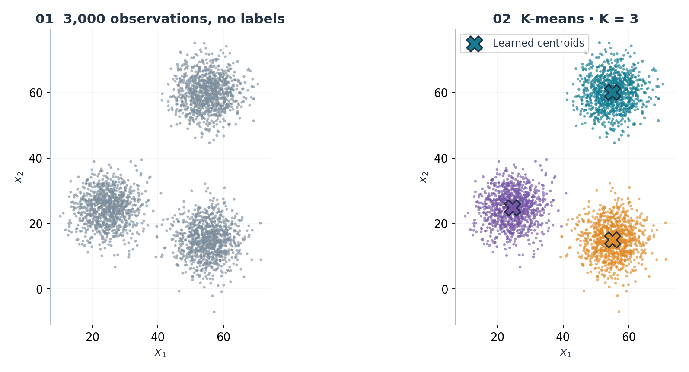

*Left: the 3,000 unlabelled points handed to the algorithm. Right: K-means with K = 3 recovers the three clouds; crosses mark the learned centroids.*

### The objective: what does K-means actually minimize?

Given $`n`$ points with $`d`$ features, we want to partition them into $`K`$ clusters ($`C_1, \dots, C_K`$), each represented by a centroid $`\mu_k`$. K-means minimizes the **within-cluster sum of squares (WCSS)**:

```math
J(c, \mu) = \sum_{k=1}^{K} \sum_{i \in C_k} \|x_i - \mu_k\|_2^2
```

In two dimensions, the squared distance from a point to its centroid is just Pythagoras without the square root:

```math
\|x_i - \mu_k\|_2^2 = (x_{i1} - \mu_{k1})^2 + (x_{i2} - \mu_{k2})^2
```

Because distances are squared, a point twice as far from its centroid contributes four times as much to the cost. In scikit-learn, this final value is stored in `model.inertia_`.

### Lloyd's algorithm: alternate two easy steps

Optimizing all assignments and all centroids at the same time is hard. Fixing one makes the other trivial:

1. **Initialize:** Pick $`K`$ and place $`K`$ starting centroids.
2. **Assignment:** Freeze the centroids and send each point to its nearest one.
3. **Update:** Freeze the assignments and move each centroid to the mean of its assigned points.
4. **Repeat** steps 2 and 3 until assignments stop changing (or centroids barely move).

Written as equations, the two alternating steps are:

```math
c_i = \underset{k}{\arg\min}\; \|x_i - \mu_k\|_2^2, \qquad \mu_k = \frac{1}{|C_k|} \sum_{i \in C_k} x_i
```

Note: we don't need square roots during assignment because squaring preserves which distance is smallest. Also, a centroid is a cluster's center of mass — it doesn't have to land on an actual data point.

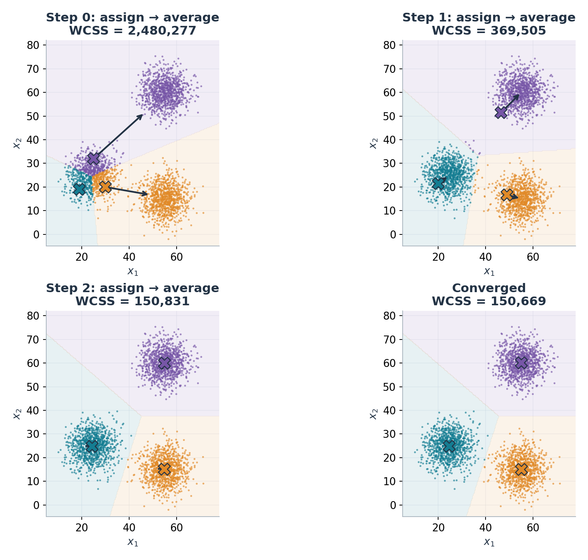

*Lloyd's loop starting from deliberately awkward centroids. Arrows show how each centroid slides toward its cluster mean at every step.*

From that poor starting point, WCSS drops rapidly in just a few steps: **2,480,277 → 369,505 → 150,831 → 150,670 → 150,669**.

<details>
<summary><strong>Why is the best centroid always the arithmetic mean?</strong></summary>

Hold the cluster members fixed and differentiate the cluster cost with respect to a candidate center $`\mu`$:

```math
J_k(\mu) = \sum_{i \in C_k} \|x_i - \mu\|_2^2, \qquad \nabla_\mu J_k = 2|C_k|\mu - 2\sum_{i \in C_k} x_i = 0
```

Solving for $`\mu`$ gives $`\mu = \frac{1}{|C_k|}\sum_{i \in C_k} x_i`$. The "means" in K-means comes directly from using squared error. If you switched to absolute error ($`L_1`$) instead, the optimal center would become the coordinate-wise median (K-medians).

</details>

### One step by hand

Take four points: $`A=(1,1)`$, $`B=(1,3)`$, $`C=(5,5)`$, $`D=(7,5)`$, and start with $`\mu_1=(1,1)`$ and $`\mu_2=(7,5)`$:

| Point | Squared dist to $`\mu_1`$ | Squared dist to $`\mu_2`$ | Assigned cluster |
| --- | --- | --- | --- |
| A (1, 1) | 0 | 52 | 1 |
| B (1, 3) | 4 | 40 | 1 |
| C (5, 5) | 32 | 4 | 2 |
| D (7, 5) | 52 | 0 | 2 |

Starting WCSS is $`0 + 4 + 4 + 0 = 8`$. Now update the centroids:

```math
\mu_1 = \frac{(1,1)+(1,3)}{2} = (1, 2), \qquad \mu_2 = \frac{(5,5)+(7,5)}{2} = (6, 5)
```

With the updated centers, every point is at squared distance $`1`$ from its centroid, so WCSS drops from **8 to 4**. On the next pass nothing moves, so the algorithm stops.

### Why initialization matters (K-means++)

Neither assignment nor update can ever increase WCSS, so K-means is guaranteed to converge. The catch is that it can settle into a **local minimum** if the starting centroids land in a bad spot.

Two defaults fix most of that risk:
- **K-means++:** Picks the first center at random, then picks each remaining center with probability proportional to its squared distance from the nearest existing center — spreading the initial seeds across the data.
- **Multiple restarts (`n_init=20`):** Runs K-means 20 times from different seeds and keeps the lowest-WCSS result.

### Choosing K: Elbow and Silhouette

You cannot just pick the $`K`$ with the smallest WCSS. Adding more centroids always lowers WCSS — at $`K = n`$, every point gets its own center and WCSS hits zero, which is useless.

Instead, combine two diagnostics:

1. **Elbow method:** Plot WCSS against $`K`$ and look for the bend where adding another cluster stops giving big gains.
2. **Silhouette score:** For each point $`i`$, let $`a(i)`$ be its average distance to other points in its *own* cluster, and $`b(i)`$ be its average distance to points in the *nearest neighboring* cluster:

```math
s(i) = \frac{b(i) - a(i)}{\max\{a(i),\; b(i)\}}, \qquad -1 \le s(i) \le 1
```

Near $`+1`$ means the point sits snugly inside its own cluster, far from others. Near $`0`$ means it lies on a boundary. Negative means it probably belongs to the neighboring cluster.

| K | WCSS (rounded) | Mean Silhouette |
| --- | --- | --- |
| 1 | 1,893,615 | — |
| 2 | 663,481 | 0.629 |
| **3** | **150,669** | **0.744** |
| 4 | 133,699 | 0.598 |
| 5 | 116,800 | 0.465 |

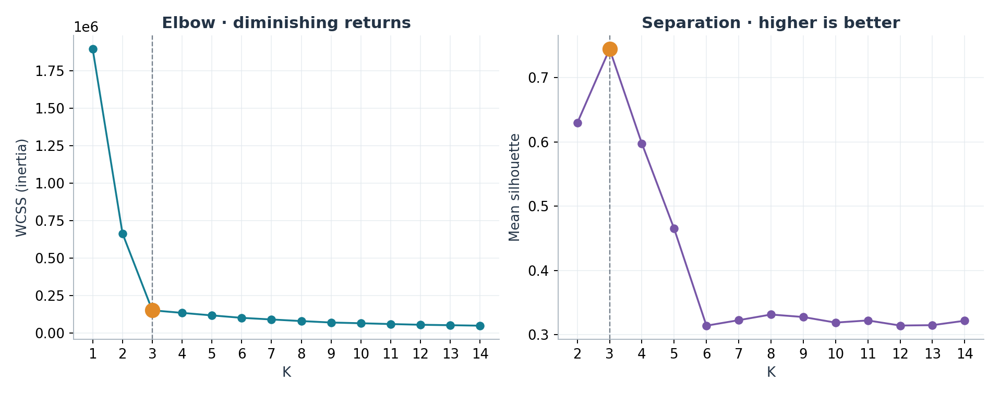

*Left: WCSS plunges until K = 3, then flattens out. Right: mean silhouette also peaks cleanly at K = 3.*

### Where K-means struggles

- **Feature scales:** Like KNN, K-means relies on Euclidean distance. Multiplying a column by 10 multiplies its squared contribution by 100. Always apply `StandardScaler` when features have different units (like age and income).
- **Non-spherical shapes:** K-means splits space with straight boundaries (Voronoi cells). On curved moons or rings, even the right $`K`$ slices straight through the clusters.
- **Outliers:** Squaring distances gives a single faraway point huge leverage, pulling the centroid away from the main cloud.

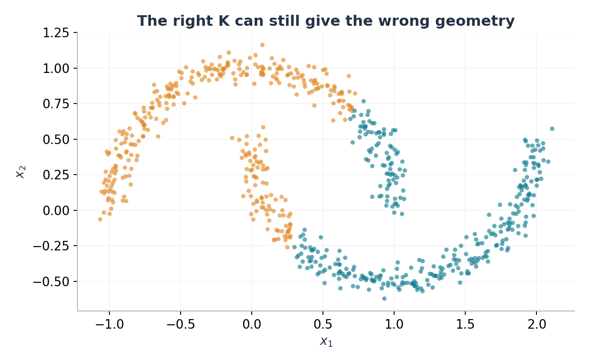

*K-means on two curved moons. Even with K = 2, nearest-centroid regions cut across the curves.*

### Python implementation

```python
import numpy as np
from sklearn.cluster import KMeans
from sklearn.metrics import silhouette_score

rng = np.random.default_rng(42)
X = np.vstack([
    rng.normal(loc=mean, scale=5, size=(1000, 2))
    for mean in [(25, 25), (55, 60), (55, 15)]
])

for k in range(2, 6):
    km = KMeans(n_clusters=k, init="k-means++", n_init=20, random_state=42).fit(X)
    sil = silhouette_score(X, km.labels_, sample_size=1500, random_state=42)
    print(f"K={k}  WCSS={km.inertia_:,.0f}  silhouette={sil:.3f}")

# Best model: K = 3
model = KMeans(n_clusters=3, init="k-means++", n_init=20, random_state=42).fit(X)
print("Centers:\n", np.round(model.cluster_centers_, 2))
# [[24.63, 24.81], [55.07, 60.09], [55.12, 15.01]]
```

> [!TIP]
> **Quick habit:** Cluster IDs like `0, 1, 2` are arbitrary labels — not probabilities and not ordered rankings. And never refit K-means on a DataFrame after appending the `cluster` column to `X`, or you'll feed the previous answer back in as a feature.

---

## 9. Hierarchical Clustering

**Executed notebook:** [Hierarchical clustering](9%29%20Hierarchical%20Clustering/Hierarchical%20Clustering.ipynb)

K-means gives you one flat partition for one chosen $`K`$. **Hierarchical clustering** builds the whole family tree of how groups merge step by step — so you can inspect the tree first and decide where to cut afterwards.

It comes in two directions:
- **Agglomerative (bottom-up):** Start with every point as its own cluster and keep merging the closest pair until one root remains. This is the standard version used in practice.
- **Divisive (top-down):** Start with everything in one cluster and split downward.

The agglomerative algorithm is straightforward:
1. Start with $`n`$ single-point clusters.
2. Find the two clusters that are closest under your chosen **linkage** rule.
3. Merge them and update distances to the remaining clusters.
4. Repeat until everything merges into a single tree.

Merges are greedy and permanent: once two points join, they never separate later.

### Measuring distance between two clusters (Linkage)

Distance between two single points is easy (Euclidean). Once clusters contain multiple points, you have to define what "distance between cluster $`A`$ and cluster $`B`$" means:

| Linkage | Formula | Behavior |
| --- | --- | --- |
| **Single** | $`\min_{x\in A,\, y\in B} d(x,y)`$ | Shortest bridge between edges; prone to long chains (*chaining*) |
| **Complete** | $`\max_{x\in A,\, y\in B} d(x,y)`$ | Farthest pair across clusters; prefers tight, compact blobs |
| **Average** | $`\frac{1}{n_A n_B}\sum_{x\in A}\sum_{y\in B} d(x,y)`$ | Mean of all cross-pair distances |
| **Centroid** | $`\|\mu_A - \mu_B\|_2`$ | Distance between cluster means |
| **Ward** | $`\frac{n_A n_B}{n_A + n_B}\|\mu_A - \mu_B\|_2^2`$ | Increase in total within-cluster squared error ($`\Delta\text{SSE}`$) |

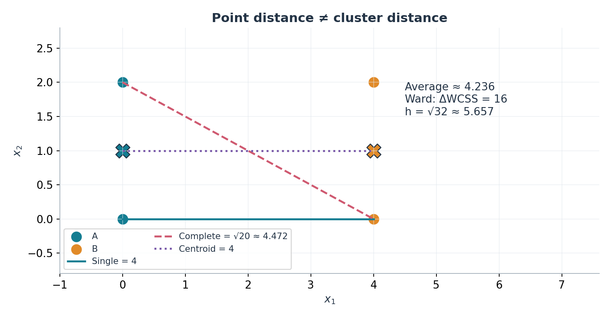

*On two tiny clusters of two points each, linkage choice changes the score. Average and centroid are not the same thing; Ward measures the squared-error jump.*

For $`A=\{(0,0),(0,2)\}`$ and $`B=\{(4,0),(4,2)\}`$, the four cross-distances are $`4,\; \sqrt{20},\; \sqrt{20},\; 4`$:
- **Single** = $`4`$, **Complete** = $`\sqrt{20} \approx 4.472`$
- **Average** = $`(8 + 2\sqrt{20})/4 \approx 4.236`$
- **Centroid** = distance between $`(0,1)`$ and $`(4,1)`$ = $`4`$
- **Ward** ($`\Delta\text{SSE}`$) = $`\frac{2\cdot 2}{2+2} \cdot 4^2 = 16`$

<details>
<summary><strong>Deeper: where do the cluster sizes in Ward's formula come from?</strong></summary>

Write each cluster's squared error as $`SSE(C) = \sum_{x \in C} \|x - \mu_C\|^2`$. Merging $`A`$ and $`B`$ produces the weighted mean $`\mu_{A\cup B} = \frac{n_A\mu_A + n_B\mu_B}{n_A + n_B}`$. Expanding $`x - \mu_{A\cup B} = (x - \mu_A) + (\mu_A - \mu_{A\cup B})`$ makes the cross terms vanish (since $`\sum_{x\in A}(x-\mu_A)=0`$), leaving:

```math
\Delta SSE(A, B) = SSE(A \cup B) - SSE(A) - SSE(B) = \frac{n_A n_B}{n_A + n_B}\,\|\mu_A - \mu_B\|_2^2
```

Ward therefore shares K-means' squared-error spirit, picking whichever merge raises total error the least. SciPy plots Ward dendrogram heights as $`h(A, B) = \sqrt{2\,\Delta SSE(A, B)}`$.

</details>

### Reading a dendrogram

Take five points: $`1=(1,1),\; 2=(1,2),\; 3=(6,6),\; 4=(6,6.5),\; 5=(2,1.5)`$. Under single linkage, the merges happen in this order:

| Step | Merge | Merge height | Clusters left |
| --- | --- | --- | --- |
| 1 | $`\{3\}`$ with $`\{4\}`$ | $`0.500`$ | 4 |
| 2 | $`\{1\}`$ with $`\{2\}`$ | $`1.000`$ | 3 |
| 3 | $`\{1, 2\}`$ with $`\{5\}`$ | $`\sqrt{1.25} \approx 1.118`$ | 2 |
| 4 | $`\{1, 2, 5\}`$ with $`\{3, 4\}`$ | $`\sqrt{36.25} \approx 6.021`$ | 1 |

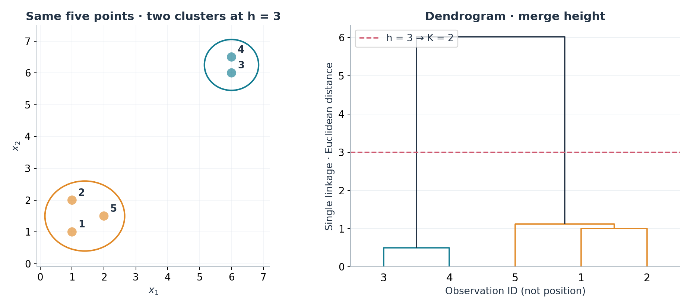

*Left: five points forming two clear groups. Right: their single-linkage dendrogram. A horizontal cut at height 3 crosses two vertical branches → {1,2,5} and {3,4}.*

Two rules for reading any dendrogram:
- Read the **vertical height** of a join to see how far apart two clusters were when they merged. The **horizontal order** of leaves is just layout — flipping any branch left-to-right represents the exact same clustering.
- A tall vertical gap between merge levels is a strong hint for where to cut. Above, the jump from $`1.12`$ to $`6.02`$ points straight at 2 clusters.

Here is the Ward dendrogram for the 3,000-point dataset from section 8:

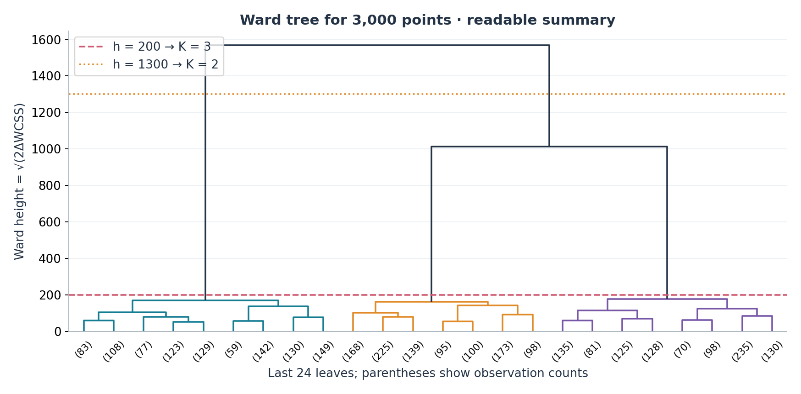

*Ward dendrogram of the 3,000 points (collapsed to 24 leaves so it stays readable). Internal merges finish at 177; the final two happen at 1,013 and 1,569. Cutting at h = 200 yields 3 groups (998, 1,000, and 1,002 points).*

### K-means vs. Hierarchical Clustering

| Aspect | K-Means | Hierarchical Clustering |
| --- | --- | --- |
| Pick $`K`$ upfront? | Yes | No — inspect the dendrogram and cut afterwards |
| Output | One flat partition + $`K`$ centers | Full nested merge tree |
| Predict on new points | Yes (`predict` via nearest center) | No built-in `predict` |
| Speed & memory | Fast, $`O(nKdT)`$ | Expensive, $`O(n^2)`$ memory (100k points ≈ 40 GB distance matrix) |
| Needs scaling? | Yes | Yes |

Use hierarchical clustering to explore small or medium datasets when you want to see how clusters nest; reach for K-means when datasets grow large.

### Python implementation

```python
from scipy.cluster.hierarchy import linkage, dendrogram, fcluster
from sklearn.cluster import AgglomerativeClustering
import matplotlib.pyplot as plt

# X is the 3,000-point unlabelled array from section 8
Z = linkage(X, method="ward", metric="euclidean")

plt.figure(figsize=(10, 4))
dendrogram(Z, truncate_mode="lastp", p=24, show_leaf_counts=True, color_threshold=200)
plt.axhline(200, color="black", linestyle="--")
plt.ylabel("Ward height = sqrt(2 * delta_SSE)")
plt.show()

# Cut at height 200 (SciPy) or ask for K=3 directly (scikit-learn)
labels_scipy = fcluster(Z, t=200, criterion="distance")
labels_sklearn = AgglomerativeClustering(n_clusters=3, linkage="ward").fit_predict(X)
```

---

## 10. Natural Language Processing (NLP) & Text Classification

**Executed notebook:** [NLP: sentiment classification](10%29%20Natural%20Language%20Processing/NLP%20Sentiment%20Classification.ipynb)

Models cannot read words — they only operate on numbers. **Natural Language Processing (NLP)** turns raw human text into numerical vectors so we can classify reviews, filter spam, search documents, or detect sentiment.

A classic text-classification pipeline has three clean stages: **prepare the text → convert to numerical features → train a classifier.**

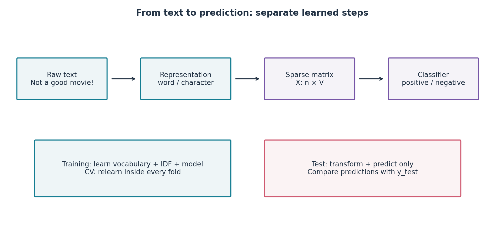

*A leak-free text pipeline. Vocabulary, IDF weights, and model parameters are learned only from training documents; test documents simply pass through them.*

### 1. Text preprocessing: cleaning, tokenization, stopwords, lemmatization

- **Normalization:** Lowercasing and tidying whitespace. Be careful with punctuation: stripping apostrophes *before* tokenization turns `shouldn't` into `shouldn t`, breaking the negation.
- **Tokenization:** Splitting text into tokens (words or subwords), e.g. `"not good movie"` → `["not", "good", "movie"]`.
- **Stopwords:** Very frequent words like `"the"`, `"and"`, `"is"`. Removing them blindly can hurt! In sentiment analysis, dropping **`"not"`** turns `"not good"` into `"good"` — completely flipping the meaning.
- **Stemming vs. Lemmatization:**
  - *Stemming* chops suffixes mechanically (`studies` → `studi`). Fast, occasionally ugly.
  - *Lemmatization* maps words to dictionary base forms (`loved` as verb → `love`), though NLTK's `WordNetLemmatizer` defaults to nouns unless you pass part-of-speech tags, and only covers English.

### 2. Bag of Words (BoW)

Build a vocabulary of $`V`$ unique tokens from the training set. Then represent $`n`$ documents as an $`n \times V`$ count matrix $`X`$, where $`X_{ij}`$ counts how many times word $`j`$ appears in document $`i`$.

For vocabulary `[acting, good, movie, not]` and three short reviews:

| Document | acting | good | movie | not |
| --- | --- | --- | --- | --- |
| D1: `good movie` | 0 | 1 | 1 | 0 |
| D2: `not good movie` | 0 | 1 | 1 | 1 |
| D3: `good acting good` | 1 | 2 | 0 | 0 |

Single words (**unigrams**) lose word order (`"dog bites man"` and `"man bites dog"` look identical). Adding adjacent pairs (**bigrams**, like `not good`) recovers local phrases, while short character slices (**char n-grams**, 3–5 characters) handle typos and word endings nicely.

### 3. Sparse matrices: don't waste RAM storing zeros

A short review only uses maybe 15 words out of a 5,000-word vocabulary, so **over 99% of the matrix is zeros**. A matrix dominated by zeros is called a **sparse matrix**.

Instead of storing every zero, **CSR (Compressed Sparse Row)** stores only the nonzero entries in three compact arrays:
- `data`: the nonzero values
- `indices`: the column index of each nonzero value
- `indptr`: where each row starts and ends inside `data`

![The 3-document matrix in CSR format. Document D2 is reconstructed directly from data[2:5] and its column indices — zero entries are never stored.](images/clf_28_csr_storage.png)

*The 3-document matrix in CSR format. Document D2 is reconstructed directly from data[2:5] and its column indices — zero entries are never stored.*

The memory difference is huge. On our 2,383-review training set below, the word TF-IDF matrix is **2,383 × 4,457** with only 32,613 nonzeros (density **0.31%**). As a dense `float64` array it takes **85.0 MB**; in CSR format it takes **0.40 MB** — **212× smaller**.

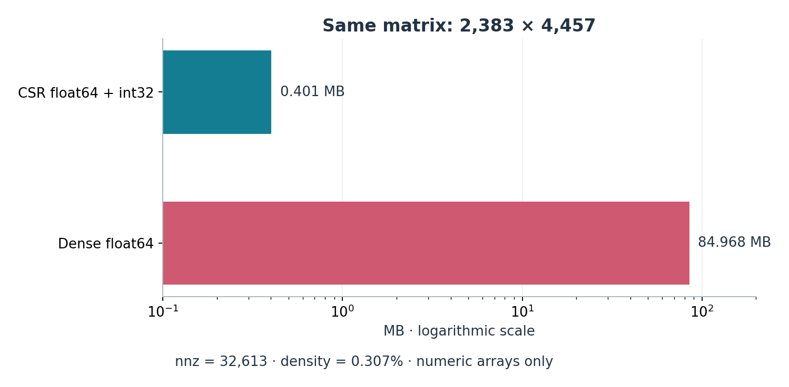

*The exact same training matrix uses 84.97 MB dense vs. 0.40 MB in CSR (log scale).*

> [!WARNING]
> **Avoid `.toarray()` unless you truly need it.** `MultinomialNB`, `LogisticRegression`, and `LinearSVC` all accept sparse matrices natively. Calling `.toarray()` just explodes memory for zero accuracy gain.

### 4. TF-IDF: down-weighting common words

Raw counts let everyday words like `"movie"` dominate. **TF-IDF** (*Term Frequency – Inverse Document Frequency*) multiplies a word's count in a document (TF) by how rare it is across all documents (IDF). Words appearing everywhere get down-weighted; distinctive words stand out.

With $`N`$ training documents and $`df_j`$ documents containing token $`j`$, scikit-learn's smoothed formula is:

```math
\text{idf}_j = \log\frac{1 + N}{1 + df_j} + 1, \qquad u_{ij} = \text{tf}_{ij} \cdot \text{idf}_j, \qquad x_i = \frac{u_i}{\|u_i\|_2}
```

In our 3-sentence example, `good` appears in 3/3 documents → $`\text{idf} = 1`$. `movie` is in 2/3 → $`1 + \log(4/3) \approx 1.288`$. `acting` and `not` appear in 1/3 → $`1 + \log(2) \approx 1.693`$. So D2 (`not good movie`) gets raw weights `[0, 1, 1.288, 1.693]`, which after L2 normalization becomes **`[0, 0.425, 0.548, 0.720]`** — putting the strongest weight on the rarest word, `not`.

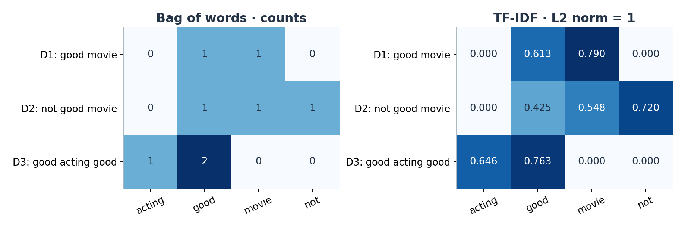

*Raw counts (left) vs. L2-normalized TF-IDF (right) for the same three documents. The zero pattern stays identical, while rarer words gain weight.*

### 5. Which models work best on text?

- **MultinomialNB over GaussianNB:** `GaussianNB` assumes continuous bell curves — a poor match for mostly-zero word counts. **Multinomial Naive Bayes** models word counts directly. With $`N_{cj}`$ the total count of token $`j`$ in training documents of class $`c`$ and Laplace smoothing $`\alpha > 0`$:

```math
\theta_{cj} = \frac{N_{cj} + \alpha}{\sum_{v=1}^{V} N_{cv} + \alpha V}, \qquad \hat{c} = \underset{c}{\arg\max}\;\left[\log \pi_c + \sum_{j=1}^{V} x_j \log \theta_{cj}\right]
```

Smoothing ($`\alpha = 1`$) stops a single unseen word from zeroing out the whole document's probability. On a tiny `[good, bad, movie]` vocabulary with positive totals `[4, 1, 3]`, negative totals `[1, 4, 3]`, and equal priors, each denominator is $`8 + 3 = 11`$. For `"good movie"`: $`q_+ = \frac{1}{2}\cdot\frac{5}{11}\cdot\frac{4}{11} = \frac{10}{121}`$ and $`q_- = \frac{1}{2}\cdot\frac{2}{11}\cdot\frac{4}{11} = \frac{4}{121}`$ → $`P(+\mid x) = 10/14 \approx \mathbf{0.714}`$.

- **Logistic Regression & LinearSVC:** High-dimensional sparse TF-IDF vectors are often nearly linearly separable, so regularized linear models are tough to beat as baselines. Logistic regression assigns each word a weight $`w_j`$ pushing toward positive or negative sentiment, while L2 regularization keeps rare words from getting wild weights.

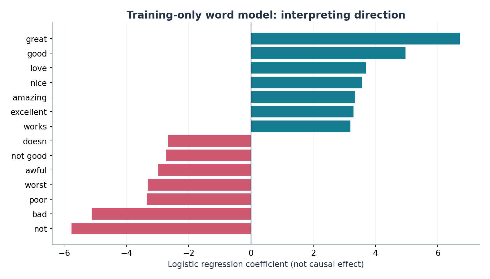

*Strongest positive (right) and negative (left) word coefficients learned by Logistic Regression on word TF-IDF features.*

### Benchmark on real reviews (UCI Sentiment Labelled Sentences)

Using 3,000 English reviews from Amazon, IMDb, and Yelp (2,979 unique rows after deduplication; stratified 80/20 split → 2,383 train / 596 test), we compared six pipelines with **5-fold CV on the training set only** (each fold fits its own vectorizer inside `Pipeline`):

| Pipeline | 5-fold CV Accuracy | 5-fold CV Macro-F1 | Fold std |
| --- | --- | --- | --- |
| Majority baseline (`DummyClassifier`) | 0.501 | 0.334 | 0.000 |
| Counts + `GaussianNB` (dense) | 0.669 | 0.658 | 0.018 |
| Uni/bigrams + `MultinomialNB` | 0.808 | 0.808 | 0.027 |
| Word TF-IDF + `LinearSVC` | 0.811 | 0.811 | 0.020 |
| Word TF-IDF + `LogisticRegression` | 0.813 | 0.813 | 0.032 |
| **Word + Char TF-IDF + `LogisticRegression`** | **0.838** | **0.838** | **0.019** |

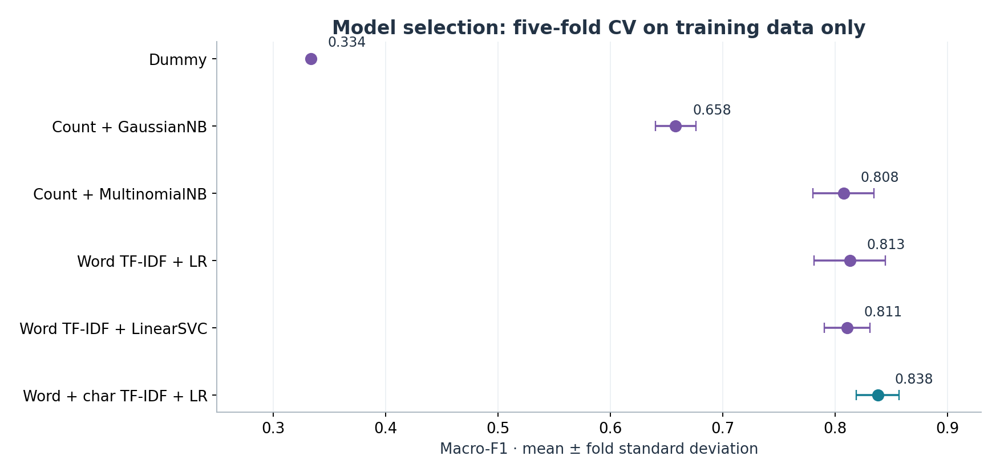

*5-fold training CV comparison. GaussianNB lags well behind; combining word and character TF-IDF with Logistic Regression takes the lead.*

On the untouched 596-review test set, the winning pipeline scores **83.89% accuracy** (macro-F1 = **0.839**): 500 right, 96 wrong.

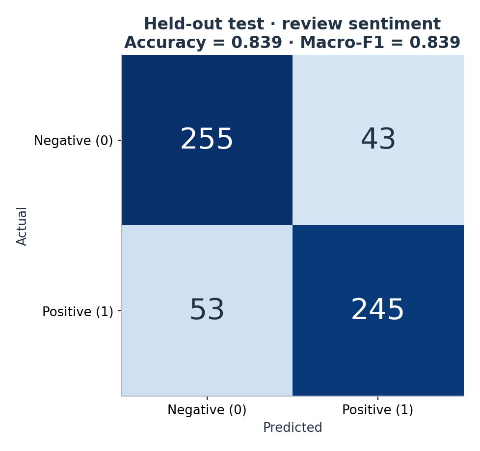

*Confusion matrix of the selected sentiment model on the 596 held-out reviews (298 per class).*

### Python implementation

```python
from sklearn.feature_extraction.text import TfidfVectorizer
from sklearn.linear_model import LogisticRegression
from sklearn.metrics import accuracy_score, classification_report
from sklearn.model_selection import train_test_split
from sklearn.pipeline import FeatureUnion, Pipeline
from Classification.nlp_text_classification import load_sentiment

data, _ = load_sentiment()
X_train, X_test, y_train, y_test = train_test_split(
    data.text, data.label, test_size=0.2, random_state=42, stratify=data.label
)

features = FeatureUnion([
    ("word", TfidfVectorizer(ngram_range=(1, 2), min_df=2, max_features=15000, sublinear_tf=True)),
    ("char", TfidfVectorizer(analyzer="char_wb", ngram_range=(3, 5), min_df=2, max_features=15000, sublinear_tf=True)),
])

pipe = Pipeline([
    ("features", features),
    ("clf", LogisticRegression(C=3, max_iter=2000, random_state=42)),
])

pipe.fit(X_train, y_train)
y_pred = pipe.predict(X_test)
print("Test accuracy:", round(accuracy_score(y_test, y_pred), 4))  # 0.8389
print(classification_report(y_test, y_pred, target_names=["negative", "positive"]))
```

> [!NOTE]
> **Where modern NLP goes next:** Bag of Words and TF-IDF remain fast, rock-solid baselines. Their ceiling is context — sarcasm or long-range negation trips them up. Dense vector **embeddings** and pretrained language models (Transformers / BERT) handle context much better, while still relying on the exact same train/test split and `Pipeline` discipline.

---

## 11. PCA — Principal Component Analysis

Imagine working with 10, 30, or 1,000 columns. You cannot plot 30 dimensions on a screen, and many features are near-duplicates anyway (in the breast cancer data, `radius_mean`, `perimeter_mean`, and `area_mean` all measure size). **PCA (Principal Component Analysis)** is an unsupervised technique that compresses high-dimensional data into fewer dimensions while keeping as much information (variance) as possible.

Where people use PCA most often:
1. **Dimensionality reduction:** Shrink 30 features down to 10 to speed up training and cut noise.
2. **Visualization:** Project 4-D (Iris) or 10-D data down to 2-D so you can actually look at it.
3. **Feature extraction:** Turn correlated features into uncorrelated, orthogonal axes (common in finance/stock factor modeling and gene expression analysis).

### Intuition: find the direction of maximum spread

Suppose you want to squash a 2-D cloud of points onto a single 1-D line. Which angle loses the least information?

The line along which the points **spread out the most (maximum variance)**! Projecting orthogonally onto that direction both separates the points best and minimizes the sum of squared projection errors.

- That first axis is the **first principal component** ($`p_1`$, PC1).
- The second component ($`p_2`$, PC2) is strictly **perpendicular** to $`p_1`$ ($`p_1^\top p_2 = 0`$) and captures the most remaining variance.
- In $`d`$ dimensions, PCA finds $`d`$ mutually orthogonal axes ranked by variance; you simply keep the top $`k`$ and drop the rest.

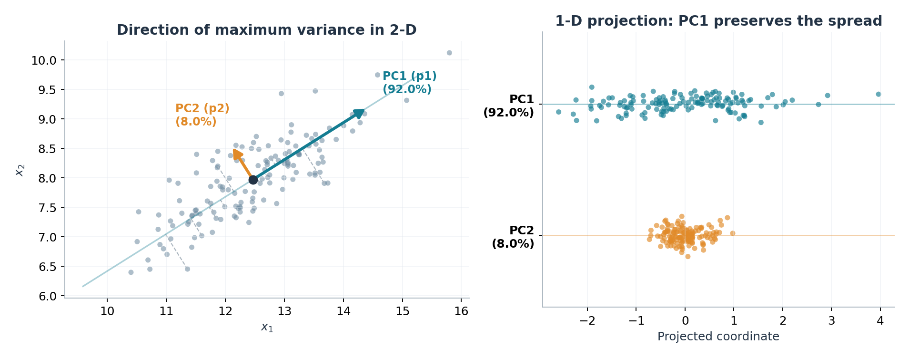

*Left: in 2-D, PC1 captures the main diagonal stretch (92.0%) and perpendicular PC2 captures the thin residual spread (8.0%). Right: projecting to 1-D along PC1 preserves almost all the structure.*

### The math (step by step)

1. **Center (and scale) the data:** Subtract each column's mean ($`\tilde{X} = X - \mu`$). If units differ, divide by each column's standard deviation too (`StandardScaler`).
2. **Compute the covariance matrix:** The $`d \times d`$ symmetric matrix measuring how features vary together:

```math
\Sigma = \frac{1}{n - 1}\,\tilde{X}^\top \tilde{X}
```

3. **Maximize projected variance:** Projecting onto a unit vector $`v`$ ($`\|v\|_2 = 1`$) gives coordinates $`\tilde{X}v`$, whose variance is $`v^\top \Sigma v`$. Using a Lagrange multiplier $`\lambda`$ to enforce $`\|v\|_2^2 = 1`$:

```math
\mathcal{L}(v, \lambda) = v^\top \Sigma v - \lambda(v^\top v - 1) \quad \Longrightarrow \quad \nabla_v \mathcal{L} = 2\Sigma v - 2\lambda v = 0 \quad \Longrightarrow \quad \Sigma v = \lambda v
```

That is the classic **eigenvalue / eigenvector** equation!
- Each **eigenvector** $`v_k`$ is a principal component direction.
- Its **eigenvalue** $`\lambda_k`$ is the variance along that direction.
- The share of variance kept by component $`k`$ (**explained variance ratio**) is:

```math
\text{Explained variance ratio}_k = \frac{\lambda_k}{\sum_{j=1}^{d} \lambda_j}
```

4. **Project:** Sort eigenvalues from largest to smallest ($`\lambda_1 \ge \lambda_2 \ge \dots \ge \lambda_d`$), stack the top $`k`$ eigenvectors into $`V_k \in \mathbb{R}^{d \times k}`$, and multiply:

```math
Z = \tilde{X} V_k \in \mathbb{R}^{n \times k}
```

<details>
<summary><strong>Deeper: why does scikit-learn use SVD under the hood?</strong></summary>

Explicitly forming $`\tilde{X}^\top \tilde{X}`$ is slow for wide matrices and loses numerical precision. Instead, Singular Value Decomposition (**SVD**) factors the centered matrix directly as $`\tilde{X} = U S V^\top`$. The columns of $`V`$ are already the eigenvectors of $`\Sigma`$, and $`\lambda_k = S_k^2 / (n - 1)`$ are the eigenvalues. That is what scikit-learn's `PCA` computes behind the scenes.

</details>

### Worked example: Iris from 4-D down to 2-D

The Iris dataset has 150 flowers and 4 measurements (sepal/petal length and width). After standardizing and keeping 2 components:
- **PC1** alone captures **73.0%** of total variance,
- **PC2** captures **22.9%**,
- Together they preserve **95.8%** of the information in just 2 dimensions! (On unscaled Iris, `PCA(n_components=2)` gives 92.5% + 5.3% = 97.8% because petal length has a much wider numerical spread than the other columns.)

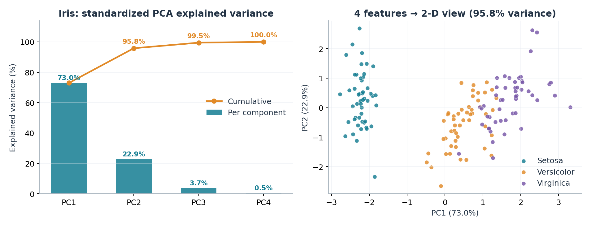

*Left: per-component and cumulative explained variance on standardized Iris. Right: 4-D flowers projected onto 2-D — Setosa separates cleanly on its own.*

### Common trap: `StandardScaler` vs. `whiten=True`

You will often see tutorials comment `PCA(n_components=2, whiten=True) # whiten = normalize`. **Those are not the same thing!**

- **`StandardScaler` (BEFORE PCA):** Equalizes feature scales before computing variance. Skip it on mismatched units — like `area_mean` (144–2,501) and `smoothness_mean` (0.05–0.16) — and `area_mean` swallows **100.0%** of PC1 while `smoothness_mean` vanishes. On all 30 Wisconsin features, unscaled PC1 claims 98.2% on its own; after `StandardScaler`, the first 10 components cleanly capture 95.2%.
- **`whiten=True` (AFTER PCA):** Divides each output component by $`\sqrt{\lambda_k}`$ so every output component has variance **1.0** — turning an elliptical cloud into a sphere. That can help some downstream linear or neural models, but it does *not* fix unscaled input columns.

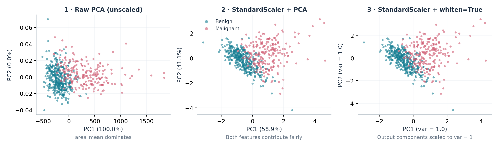

*Breast cancer area_mean vs. smoothness_mean. Left: unscaled PCA collapses onto area_mean. Middle: StandardScaler balances both features. Right: whiten=True scales output components to unit variance.*

### Python implementation

```python
from sklearn.datasets import load_iris
from sklearn.decomposition import PCA
from sklearn.preprocessing import StandardScaler
from sklearn.pipeline import make_pipeline

iris = load_iris()
X, y = iris.data, iris.target

# Good habit: always pair StandardScaler with PCA (inside a Pipeline if splitting train/test)
pca_pipe = make_pipeline(StandardScaler(), PCA(n_components=2))
X_2d = pca_pipe.fit_transform(X)

pca = pca_pipe.named_steps["pca"]
print("Explained variance ratio:", pca.explained_variance_ratio_.round(4))  # [0.7296, 0.2285]
print("Total variance kept:     ", round(pca.explained_variance_ratio_.sum(), 4))  # 0.9581
```

> [!WARNING]
> **Three things to keep in mind:** (1) PCA is unsupervised — it never looks at labels $`y`$, so maximum variance isn't always the best direction for separating classes. (2) Principal components are linear mixes of all original features, which makes them harder to explain than raw columns. (3) When feeding PCA into a classifier, fit PCA on the training split only inside a `Pipeline`.

---

## 12. Model Selection: K-Fold CV & Grid Search CV

Every model has two very different kinds of numbers:

| Kind | Who sets it? | Examples |
| --- | --- | --- |
| **Learned parameters** | Learned automatically during `.fit()` | Logistic weights $`w, b`$; decision tree split thresholds |
| **Hyperparameters** | Chosen by **you** before training starts | $`K`$ in KNN; `C` and `gamma` in SVM; `max_depth` in trees |

The practical question is: **how do you pick the best hyperparameters without cheating?**

If you try `K = 1, 2, ..., 15` and pick whichever scores highest on the **test set**, you have quietly tuned your model to the test set. It is like peeking at the exam questions while studying — your reported test score becomes unrealistically optimistic.

### K-Fold Cross-Validation

Here is the clean workflow:
1. Split your data into **Train (80%)** and **Test (20%)** upfront. Lock the test set away until the very end.
2. Slice the training set into $`K`$ equal **folds** (typically $`K = 5`$ or $`K = 10`$).
3. Run $`K`$ rounds: in each round, hold out one fold for **validation**, train on the other $`K - 1`$ folds, and record the score.
4. Average the $`K`$ validation scores (and check their standard deviation):

```math
\text{CV}_K = \frac{1}{K} \sum_{k=1}^{K} \text{score}_k
```

For classification, always prefer **`StratifiedKFold`** over plain `KFold` — it keeps the class ratio (e.g., 62.7% benign / 37.3% malignant) identical in every single fold.

On the 455 training tumours of Wisconsin Breast Cancer, `StandardScaler + KNN (K = 7)` scores **96.7%, 97.8%, 96.7%, 95.6%, 97.8%** across the 5 folds → mean **96.92% ± 0.82%**. On the untouched 114-tumour test set it scores **95.61%**.

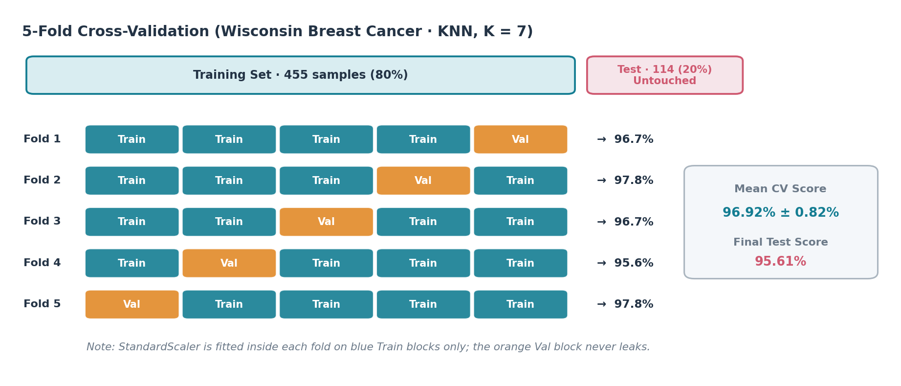

*5-fold cross-validation workflow. The test set stays untouched on the side; each fold takes a turn as the validation slice, and the five scores are averaged.*

> [!WARNING]
> **Watch out for scaler leakage!** If you fit `StandardScaler` on the entire training set *before* running cross-validation, the validation fold's mean and standard deviation leak into the training folds. Always wrap scaler + model in a `Pipeline` so each fold fits the scaler from scratch on its blue training blocks only.

### Grid Search CV: searching hyperparameter combinations systematically

When you have several hyperparameters to tune at once — say $`K`$ and `weights` in KNN, or `C` and `gamma` in RBF SVM — **Grid Search CV** automates the entire search.

How it works:
- Give it a dictionary of candidate values for each hyperparameter.
- `GridSearchCV` forms every combination (the Cartesian grid).
- For every combination, it runs full $`K`$-fold CV on the training set.
- It picks the combination with the best average CV score and (with `refit=True`, the default) automatically retrains that winner on the full training set.

With $`M`$ grid combinations and $`K`$ folds, it performs $`M \times K + 1`$ total fits. For a 4 × 4 SVM grid with 5-fold CV, that is $`16 \times 5 + 1 = 81`$ fits.

Two real runs on Wisconsin Breast Cancer (training split only):
- **KNN (`K = 1..15` × `weights = [uniform, distance]`):** Best 5-fold CV is **97.36%** at `K = 3, uniform` (untouched test: 93.86% — a helpful reminder that on 114 test tumours a single tumour moves accuracy by ~0.9%, so look for a stable plateau rather than a single spiky point).
- **SVM (`C ∈ {0.1, 1, 10, 100}` × `gamma ∈ {0.001, 0.01, 0.1, 1}`):** Best 5-fold CV is **97.58%** at `C = 10, gamma = 0.01`, reaching **98.25%** on the untouched test set!

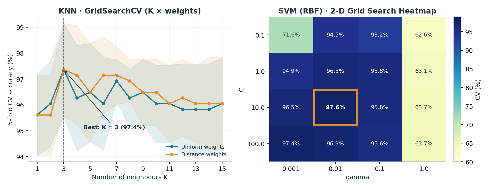

*Left: 5-fold CV accuracy curve for KNN across K and weighting schemes. Right: 2-D GridSearchCV heatmap for RBF SVM (C × gamma); the orange box marks the winner.*

When a grid explodes in size (say 5 hyperparameters × 10 values = 100,000 combinations), switch to **`RandomizedSearchCV`** — sampling 50–100 random combinations usually lands almost at the same optimum in a fraction of the time.

### Python implementation

```python
from sklearn.model_selection import GridSearchCV, StratifiedKFold, train_test_split
from sklearn.pipeline import Pipeline
from sklearn.preprocessing import StandardScaler
from sklearn.svm import SVC

X_train, X_test, y_train, y_test = train_test_split(
    X, y, test_size=0.2, random_state=42, stratify=y
)

pipe = Pipeline([
    ("scaler", StandardScaler()),
    ("svm", SVC(kernel="rbf")),
])

param_grid = {
    "svm__C": [0.1, 1, 10, 100],
    "svm__gamma": [0.001, 0.01, 0.1, 1],
}

cv = StratifiedKFold(n_splits=5, shuffle=True, random_state=42)
grid = GridSearchCV(pipe, param_grid=param_grid, cv=cv, scoring="accuracy")
grid.fit(X_train, y_train)

print("Best params:  ", grid.best_params_)          # {'svm__C': 10, 'svm__gamma': 0.01}
print("Best CV score:", round(grid.best_score_, 4)) # 0.9758
print("Test score:   ", round(grid.score(X_test, y_test), 4))  # 0.9825
```

---

## 13. Recommendation Systems

Netflix picking your next show, Spotify building Discover Weekly, or Amazon's *"customers also bought"* shelf all solve the same core problem: **predicting how much a user will like an item they haven't seen yet**.

Picture a huge **user–item rating matrix** $`R`$ where rows are users and columns are movies or products. In real life, **more than 99% of that matrix is empty** — nobody watches and rates all 10,000 titles on a platform. A recommender's job is to fill in the most promising blanks.

### Two main families

| Family | Core idea | Strengths | Weaknesses |
| --- | --- | --- | --- |
| **Content-Based Filtering** | *"Recommend items similar to what you already liked"* (genre, director, TF-IDF tags) | Needs no other users; works immediately for brand-new items | Gets stuck in a *filter bubble* — rarely surprises you |
| **Collaborative Filtering** | *"People who rated things like you also loved this"* | Needs only the interaction matrix; discovers unexpected cross-genre matches | Struggles with brand-new users or unrated items (*cold-start*) |

Most real-world platforms combine both into **hybrid systems**.

### Collaborative Filtering: similarity and predicted ratings

There are two neighborhood flavors:
- **User-Based:** Find the $`k`$ users whose ratings look most like yours, then predict your rating from theirs.
- **Item-Based:** Find items that get rated similarly (*"people who loved The Matrix also loved Inception"*). Item-based is often preferred at scale because item relationships change much more slowly than millions of individual users.

The go-to similarity metric between two rating vectors is **cosine similarity**:

```math
\text{sim}(u, v) = \frac{u \cdot v}{\|u\|_2\,\|v\|_2} = \frac{\sum_i r_{u,i}\,r_{v,i}}{\sqrt{\sum_i r_{u,i}^2}\;\sqrt{\sum_i r_{v,i}^2}}
```

The closer the angle between two vectors, the closer cosine similarity gets to $`1`$. (Some users are harsh critics while others hand out 5s freely; subtracting each user's average rating before taking the cosine gives **Pearson correlation**, which removes that generosity bias.)

Once you have the top-$`k`$ neighbors $`N_k(u)`$, predict user $`u`$'s missing rating for item $`i`$ with a similarity-weighted average:

```math
\hat{r}_{u, i} = \frac{\sum_{v \in N_k(u)} \text{sim}(u, v)\, r_{v, i}}{\sum_{v \in N_k(u)} |\text{sim}(u, v)|}
```

### A worked example by hand

Consider 6 users and 6 movies (three sci-fi, three romance/drama). **Alex** hasn't watched *Interstellar* (`?`) yet — should we recommend it?

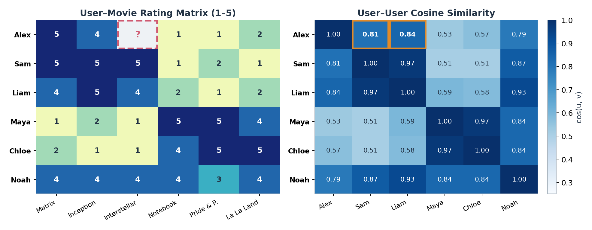

*Left: 6×6 user–movie rating matrix (Alex's Interstellar rating is missing). Right: user–user cosine similarity matrix; Alex's top-2 neighbors are Liam (0.84) and Sam (0.81).*

Alex's vector is `[5, 4, 0, 1, 1, 2]`. Fellow sci-fi fans Liam (`0.844`, rated Interstellar **4**) and Sam (`0.810`, rated Interstellar **5**) are the closest two neighbors. Plugging them into the formula:

```math
\hat{r}_{\text{Alex, Interstellar}} = \frac{0.844 \times 4 + 0.810 \times 5}{0.844 + 0.810} = \frac{3.376 + 4.050}{1.654} \approx \mathbf{4.49}
```

**4.49 out of 5** — an easy recommendation! Romance fans Maya and Chloe have low similarity to Alex (0.53 and 0.57), so their 1-star ratings barely enter the picture.

### Matrix Factorization (SVD): hidden taste dimensions

With millions of users and hundreds of thousands of items, comparing every user to every other user is slow, and two users often have zero rated items in common.

**Matrix factorization** takes a cleaner angle: maybe behind 10,000 movies lie just 20–50 **latent factors** — hidden taste dimensions like *"sci-fi vs. romance"*, *"fast action vs. slow drama"*, or *"classic vs. modern"*. The model doesn't need labels for those factors; it discovers them automatically from the ratings!

We approximate the large $`m \times n`$ matrix $`R`$ as the product of two skinny matrices:

```math
R \approx U V^\top, \qquad U \in \mathbb{R}^{m \times k}, \quad V \in \mathbb{R}^{n \times k}
```

- $`u_u \in \mathbb{R}^k`$: user $`u`$'s taste vector across the $`k`$ hidden dimensions.
- $`v_i \in \mathbb{R}^k`$: movie $`i`$'s profile across the same $`k`$ dimensions.
- Prediction is simply a dot product (plus user baseline): $`\hat{r}_{u,i} = \mu_u + u_u^\top v_i`$.

Since real rating matrices have missing entries, we minimize squared error only over the **observed ratings** ($`\Omega`$) with L2 regularization to prevent overfitting:

```math
\min_{U, V} \sum_{(u, i) \in \Omega} \big(r_{u,i} - u_u^\top v_i\big)^2 + \lambda\Big(\sum_u \|u_u\|_2^2 + \sum_i \|v_i\|_2^2\Big)
```

On a complete (or mean-imputed) centered matrix, **SVD** (*Singular Value Decomposition*, $`R_{\text{centered}} = U S V^\top`$) gives the exact best rank-$`k`$ approximation. Below, SVD projects 36 synthetic users and 12 movies into 2 learned latent dimensions:

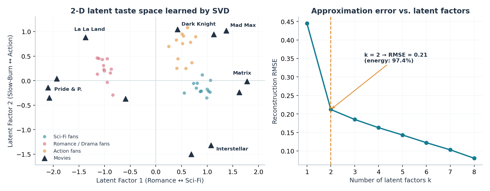

*Left: SVD places users and movies in the same 2-D taste space — aligned directions produce high dot products (high ratings). Right: just k = 2 latent factors capture 97.4% of the energy and drop RMSE to 0.21.*

### Real-world headaches and evaluation

- **Cold-start:** A brand-new user or brand-new movie has zero history. That's why streaming apps ask you to pick 3 favorite genres at signup and blend in content features or popularity until enough interactions accumulate.
- **Sparsity:** Most cells are empty, so regularization ($`\lambda`$) and implicit feedback (clicks, watch time, skips) matter hugely.
- **Evaluation metrics:**
  - **RMSE / MAE** when predicting explicit star ratings.
  - **Precision@K**, **Recall@K**, and **NDCG@K** when judging the quality and ordering of a top-K recommendation list.

### Python implementation

```python
import numpy as np

# 6 users x 6 movies rating matrix (0 = not yet watched)
R = np.array([
    [5, 4, 0, 1, 1, 2],  # Alex (? = Interstellar)
    [5, 5, 5, 1, 2, 1],  # Sam
    [4, 5, 4, 2, 1, 2],  # Liam
    [1, 2, 1, 5, 5, 4],  # Maya
    [2, 1, 1, 4, 5, 5],  # Chloe
    [4, 4, 4, 4, 3, 4],  # Noah
], dtype=float)

# 1) User-user cosine similarity
norms = np.linalg.norm(R, axis=1, keepdims=True)
sim = (R @ R.T) / (norms @ norms.T)

# Predict Interstellar (col 2) for Alex (row 0) from top-2 neighbors who rated it
rated_by = np.where(R[:, 2] > 0)[0]
top2 = rated_by[np.argsort(sim[0, rated_by])[-2:]]
pred = np.dot(sim[0, top2], R[top2, 2]) / np.sum(np.abs(sim[0, top2]))
print("Predicted Interstellar rating:", round(pred, 2))  # 4.49

# 2) Rank-2 Truncated SVD reconstruction
user_means = np.where(R > 0, R, np.nan)
row_mean = np.nanmean(user_means, axis=1, keepdims=True)
R_filled = np.where(R > 0, R, row_mean) - row_mean
U, S, Vt = np.linalg.svd(R_filled, full_matrices=False)
R_svd = row_mean + (U[:, :2] * S[:2]) @ Vt[:2, :]
print("SVD estimate (Alex, Interstellar):", round(R_svd[0, 2], 2))
```

---

## Check yourself

<details>
<summary>1. A logistic regression model computes z = 0 for a tumour. What does it predict?</summary>

$`\sigma(0) = 0.5`$: the tumour lies exactly on the decision boundary $`w^{\top}x + b = 0`$, and the model is maximally unsure.

</details>

<details>
<summary>2. Why is the cost almost exactly 0.693 at the first iteration of training?</summary>

With tiny initial weights every prediction is about 0.5, and the cross-entropy of a 0.5 prediction is $`-\log(0.5) = \log 2 \approx 0.693`$, whatever the true label is.

</details>

<details>
<summary>3. KNN with K = 1 scores 100% on the training set. Is it the best K?</summary>

No. Each training point is its own nearest neighbour, so 100% is guaranteed and says nothing. On the test set K = 1 is among the worst choices (94.7% versus 97.1% at K = 9).

</details>

<details>
<summary>4. You delete a training point that lies far from an SVM’s boundary. Does the boundary move?</summary>

No. Its hinge loss is zero and its multiplier $`\alpha_i`$ is zero, so it is not a support vector. Only the points on or inside the margin determine the solution.

</details>

<details>
<summary>5. For radius_mean = 15 the likelihood is higher for malignant, yet Naive Bayes predicts benign. How?</summary>

The posterior is likelihood × prior. Benign tumours are more common (prior 0.627 vs 0.373), and $`0.0619 \cdot 0.627 = 0.0388`$ beats $`0.0928 \cdot 0.373 = 0.0346`$.

</details>

<details>
<summary>6. What is the entropy of a leaf with 9 benign and 9 malignant tumours? And of a leaf with 20 benign only?</summary>

1 bit for the 50 / 50 leaf (the maximum for two classes) and 0 for the pure leaf.

</details>

<details>
<summary>7. A model has precision 1.000 and recall 0.953. Which kind of mistake did it make?</summary>

Precision 1 means no false positives: every “malignant” call was correct. Recall below 1 means false negatives: it missed some malignant tumours (2 of 43 here).

</details>

<details>
<summary>8. What happens in K-means if you keep increasing K just to minimize WCSS?</summary>

At $`K = n`$, every point becomes its own cluster and WCSS drops to 0 — leaving no grouping at all. That is why we look for the elbow and check the silhouette score instead of minimizing WCSS blindly.

</details>

<details>
<summary>9. In a dendrogram, are two leaves sitting next to each other on the horizontal axis guaranteed to be close?</summary>

No. Horizontal leaf order is purely layout — flipping a subtree changes nothing about the clusters. Always read the **vertical merge height** where their branches join.

</details>

<details>
<summary>10. Why can blindly stripping all stopwords hurt sentiment classification?</summary>

Words like `not` often live in stopword lists. Removing `not` turns `"not good"` straight into `"good"`, flipping the review's sentiment.

</details>

<details>
<summary>11. Does setting `whiten=True` in PCA remove the need for `StandardScaler`?</summary>

No. `StandardScaler` balances feature scales *before* PCA so large-unit features don't dominate variance. `whiten=True` divides the output components by $`\sqrt{\lambda_k}`$ *after* PCA so each component has variance 1.

</details>

<details>
<summary>12. What goes wrong if you fit `StandardScaler` on the full training set before running K-fold cross-validation?</summary>

Statistics from each validation fold (its mean and standard deviation) leak into the training folds. Wrapping the scaler inside a `Pipeline` ensures every fold fits the scaler on its training blocks only.

</details>

<details>
<summary>13. Why does pure collaborative filtering fail on a brand-new movie with zero ratings?</summary>

Collaborative filtering learns strictly from user–item interactions, so an unrated movie has an empty column (*cold-start* problem). Platforms bridge that gap with content-based features (genre, cast, text) or popularity priors.

</details>
