# Sınıflandırma

🇬🇧 English version: [Classification](Classification.md)

> [!NOTE]
> **Amaç:** Sınıflandırma algoritmalarından kümelemeye, NLP, PCA, model seçimi ve öneri sistemlerine kadar temel makine öğrenmesi yöntemlerini sezgi, matematik ve çalıştırılabilir kodla anlamak.

**Çalıştırılmış uygulamalar:** [10 notebook, çıktılar ve kurulum](README.tr.md). Her bölümün başındaki bağlantı kodu, tabloları ve grafikleri birlikte açar.

**İçindekiler**

- [Büyük resim](#büyük-resim)
- [1. Lojistik Regresyon](#1-lojistik-regresyon)
- [2. K-En Yakın Komşu (KNN)](#2-k-en-yakın-komşu-knn)
- [3. Destek Vektör Makinesi (SVM)](#3-destek-vektör-makinesi-svm)
- [4. Naive Bayes](#4-naive-bayes)
- [5. Karar Ağacı ile Sınıflandırma](#5-karar-ağacı-ile-sınıflandırma)
- [6. Rastgele Orman ile Sınıflandırma](#6-rastgele-orman-ile-sınıflandırma)
- [7. Karmaşıklık Matrisi ve Değerlendirme Metrikleri](#7-karmaşıklık-matrisi-ve-değerlendirme-metrikleri)
- [Algoritma Karşılaştırması](#algoritma-karşılaştırması)
- [8. K-means Kümeleme](#8-k-means-kümeleme-gözetimsiz-öğrenme)
- [9. Hiyerarşik Kümeleme](#9-hiyerarşik-kümeleme-hierarchical-clustering)
- [10. Doğal Dil İşleme](#10-doğal-dil-i̇şleme-nlp-ve-metin-sınıflandırma)
- [11. PCA — Temel Bileşen Analizi](#11-pca--temel-bileşen-analizi-principal-component-analysis)
- [12. Model Seçimi: K-Katlı CV ve Grid Search CV](#12-model-seçimi-k-katlı-çapraz-doğrulama-ve-grid-search-cv)
- [13. Öneri Sistemleri](#13-öneri-sistemleri-recommendation-systems)
- [Kendini sına](#kendini-sına)

---

## Büyük resim

Sınıflandırma, bir veri noktasının hangi **kategoriye** (sınıfa) ait olduğunu tahmin etme görevidir. Sürekli bir sayı tahmin eden regresyonun aksine (bkz. [Regresyon](../Regression/Regression.tr.md)), sınıflandırma ayrık bir etiket üretir — örneğin *Kötü huylu / İyi huylu*, *Spam / Spam değil* ya da *Kedi / Köpek*.

1–7. bölümlerdeki altı sınıflandırıcı ve değerlendirme **Wisconsin Meme Kanseri veri seti** (Wisconsin Breast Cancer) üzerinde gösteriliyor (569 örnek, 30 sayısal öznitelik, ikili hedef: `M` = Malignant, kötü huylu → `1`; `B` = Benign, iyi huylu → `0`). Sınıflar dengeli değil: **357 iyi huylu (%62.7)** ve **212 kötü huylu (%37.3)**. Bu iki sayıyı aklında tut; Naive Bayes’te ve değerlendirme bölümünde yeniden karşımıza çıkacaklar.

Her algoritma aynı soruyu farklı bir fikirle yanıtlar:

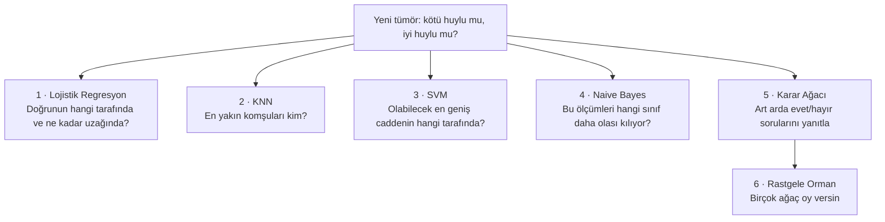

### 1–7. notebook’ların izlediği hat

1. CSV dosyasını **yükle**; `id` ve boş `Unnamed: 32` sütunlarını at.
2. Hedefi **kodla**: `M` → 1, `B` → 0.
3. Önce eğitim ve test kümelerine **ayır**.
4. Gereken öznitelikleri yalnız **eğitim verisinde öğrenilen** ölçekle normalize et; CV içinde ölçekleyiciyi her fold’da yeniden fit et.
5. Model/hiperparametre seçimini eğitim içi CV ile yap; son modeli eğitim kümesinde **eğit**, ayrılmış test kümesinde **puanla**.

> **Güncel notebook düzeni:** 1–7 aynı stratified %80/%20 ayrımını (`random_state=42`) kullanır. Aşağıdaki eski grafik ve örnek tabloların bir kısmı kendi başlıklarında belirtilen önceki ayrımlara aittir. Güncel ölçümlerin tamamı [notebook dizininde](README.tr.md) bulunur; eski örnek yüzdelerle doğrudan sıralama yapılmamalıdır.

> [!NOTE]
> Aşağıdaki görsellerin çoğu 30 öznitelikten yalnızca ikisini, `radius_mean` ve `texture_mean`, kullanıyor; çünkü iki boyut çizilebilir. Metinde verilen doğruluk değerleri, aksini söylemediğim sürece 30 özniteliğin tamamını kullanır.

---

## 1. Lojistik Regresyon

**Çalıştırılmış notebook:** [Lojistik Regresyon](1%29%20%20Logistic%20Regression%20Classification/Logistic%20Regression.ipynb)

Adına rağmen Lojistik Regresyon bir regresyon değil, **sınıflandırma** algoritmasıdır. Bir örneğin belirli bir sınıfa ait olma olasılığını modeller ve **sigmoid fonksiyonu** ile 0 ile 1 arasında bir değer üretir.

### Sınıflandırma için neden doğrusal regresyon değil?

Doğrusal regresyon `[0, 1]` dışında değerler tahmin edebilir; bu da olasılık olarak anlamsızdır. Sigmoid fonksiyonu her gerçel sayıyı `(0, 1)` aralığına sıkıştırır:

```math
\sigma(z) = \frac{1}{1 + e^{-z}}
```

$`\sigma(z) \ge 0.5`$ ise → sınıf `1` tahmin et; değilse sınıf `0`.

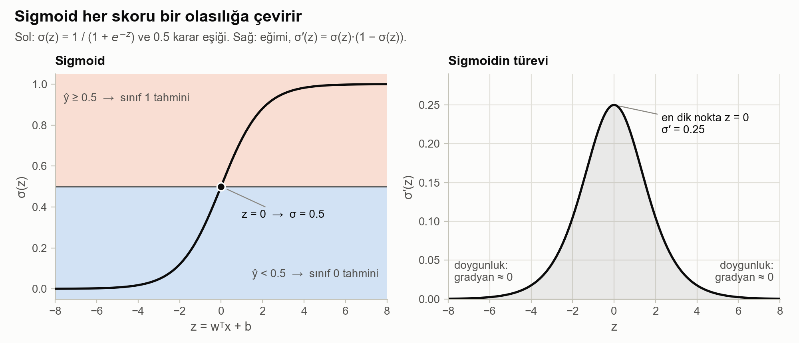

*Sol: sigmoid her z skorunu 0 ile 1 arasında bir olasılığa eşler. Sağ: türevi; z = 0 noktasında en büyük, eğrinin düzleştiği yerlerde neredeyse sıfır.*

### Model: sigmoidden geçirilen doğrusal bir skor

```math
z = w^{\top}x + b, \qquad \hat{y} = \sigma(z) = P(y = 1 \mid x)
```

- $`w`$ = öznitelik başına bir **ağırlık** (burada 30), $`b`$ = **yanlılık terimi (bias)**
- $`z`$ = herhangi bir gerçel sayı olabilen ham skor
- $`\hat{y}`$ = sınıf 1’in (kötü huylu) tahmin edilen olasılığı

**z ne anlama gelir?** Sigmoidi z için çözersen **log-odds** (olasılık oranının logaritması) elde edersin:

```math
\log\frac{\hat{y}}{1 - \hat{y}} = w^{\top}x + b
```

Yani lojistik regresyon *log-odds için doğrusal bir modeldir*. $`x_j`$ özniteliğini 1 artırmak log-odds değerine $`w_j`$ ekler; bu da odds değerini $`e^{w_j}`$ ile çarpar.

**Karar sınırı nerede?** $`\hat{y} \ge 0.5`$ tam olarak $`z \ge 0`$ olduğunda sağlanır; dolayısıyla sınır şu noktalar kümesidir:

```math
w^{\top}x + b = 0
```

Bu, 2 boyutta bir doğru, 30 boyutta düz bir hiperdüzlemdir. Lojistik regresyon **doğrusal bir sınıflandırıcıdır**: sigmoid yalnızca her iki tarafta ne kadar emin olduğunu belirler.

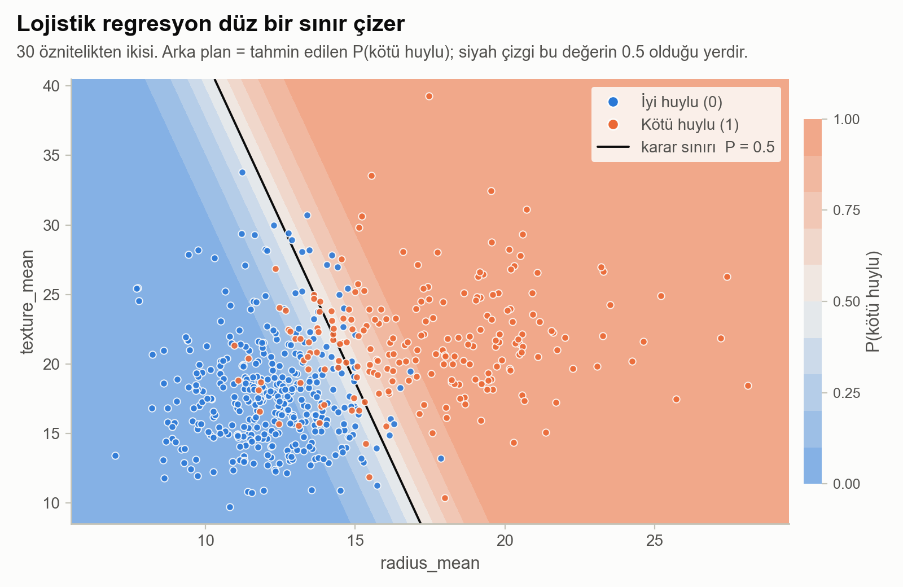

*İki öznitelikte lojistik regresyon. Arka plan rengi tahmin edilen kötü huylu olasılığıdır; siyah çizgi bu olasılığın 0.5 olduğu yerdir.*

### Hesaplama grafı (Computation Graph)

Hesaplama grafı, matematiksel işlemleri düğümlerden oluşan yönlü bir graf olarak ifade etmenin görsel bir yoludur. Her düğüm bir işlemi temsil eder; kenarlar değerleri taşır. Bu, **ileri geçişi** (çıktıyı hesaplama) ve **geri geçişi** (gradyanları hesaplama) düşünmeyi kolaylaştırır.

Lojistik regresyonda ileri geçişin tamamı şöyle görünür — girdiler öğrenilen ağırlıklarla çarpılır, bias ile toplanır, sigmoidden geçirilir ve gerçek etiketle karşılaştırılır:

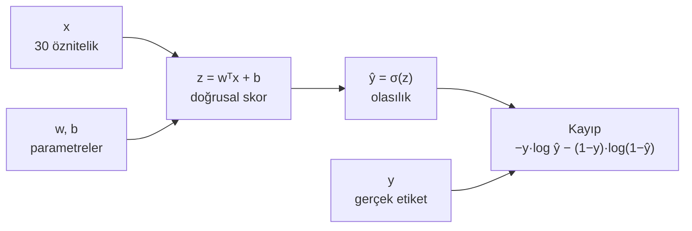

Geri geçiş aynı grafı **sağdan sola** yürür; her parametre değiştiğinde kaybın nasıl değiştiğini bulmak için yerel türevleri çarpar (zincir kuralı).

### Kayıp ve Maliyet (Loss vs. Cost)

| Terim | Tanım |
|---|---|
| **Kayıp (loss)** | **Tek** bir eğitim örneği için hata |
| **Maliyet (cost)** | **Tüm** eğitim örnekleri üzerinden ortalama kayıp |

Eğitim sırasında **maliyeti** en küçük yaparız.

### İkili çapraz entropi kaybı (Binary Cross-Entropy)

```math
L(y, \hat{y}) = -\,y\log(\hat{y}) - (1 - y)\log(1 - \hat{y})
```

- $`y = 1`$ iken: kayıp = $`-\log(\hat{y})`$. Model $`\hat{y} = 1`$ tahmin ederse kayıp → 0. $`\hat{y} \to 0`$ ise kayıp → ∞.
- $`y = 0`$ iken: kayıp = $`-\log(1 - \hat{y})`$. Aynı mantığın simetriği.

Bu fonksiyon, emin ama yanlış tahminleri çok ağır cezalandırır.

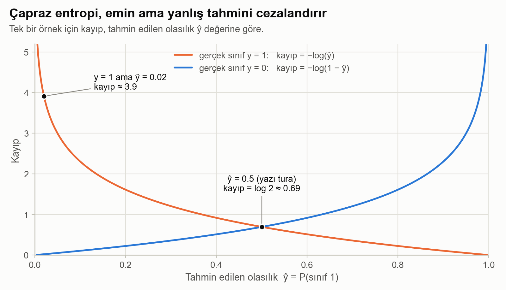

*Tek bir örnek için çapraz entropi. Emin olup yanılmak, kararsız olmaktan çok daha pahalıdır.*

Tüm $`m`$ eğitim örneği üzerinden maliyet:

```math
J(w, b) = \frac{1}{m}\sum_{i=1}^{m}\Big[-y_i\log(\hat{y}_i) - (1 - y_i)\log(1 - \hat{y}_i)\Big]
```

<details>
<summary><b>Daha derin: bu formül nereden geliyor? (en büyük olabilirlik)</b></summary>

Model, etiketin 1 gelme olasılığı $`\hat{y}`$ olan bir yazı tura olduğunu söyler. İki durum tek bir ifadeye sığar:

```math
P(y \mid x) = \hat{y}^{\,y}\,(1 - \hat{y})^{\,1 - y}
```

Kontrol et: $`y = 1`$ için $`\hat{y}`$, $`y = 0`$ için $`1 - \hat{y}`$ verir. Örneklerin bağımsız olduğunu varsayarsak tüm eğitim kümesinin olasılığı bir çarpımdır; logaritması da bir toplamdır:

```math
\log \mathcal{L}(w, b) = \sum_{i=1}^{m}\Big[y_i\log(\hat{y}_i) + (1 - y_i)\log(1 - \hat{y}_i)\Big]
```

Eğitim, gözlenen etiketleri olabildiğince olası kılmalıdır; yani bu ifadeyi **en büyük** yaparız. İşareti çevirip $`m`$ değerine bölersen tam olarak $`J`$ maliyetini elde edersin. Çapraz entropi keyfi bir seçim değildir: onu en küçük yapmak, en büyük olabilirlik (maximum likelihood) tahminidir.

</details>

<details>
<summary><b>Daha derin: neden regresyondaki gibi kare hata kullanmıyoruz?</b></summary>

İçinde sigmoid varken $`(y - \sigma(w^{\top}x + b))^2`$ ifadesi $`w`$ değişkenine göre **dışbükey değildir**: düz bölgeleri vardır ve gradyan inişini tuzağa düşürebilir. Gradyanı ayrıca $`\sigma'(z)`$ çarpanını içerir; bu çarpan model emin ama yanlışken neredeyse sıfırdır, yani öğrenme tam da en hızlı olması gereken yerde durur. Çapraz entropi bu model için dışbükeydir ve gradyanında böyle bir çarpan yoktur; sonraki bölüm bunu gösteriyor.

</details>

### Parametreleri başlatmak

```python
def initialize_weights_and_bias(dimension):
    w = np.full((dimension, 1), 0.01)  # küçük, sıfırdan farklı bir değer
    b = 0.0
    return w, b
```

- **Ağırlıklar 0 yerine küçük bir sabitle (0.01) başlatılır.** Gizli katmanları olan bir sinir ağında her ağırlığı aynı değerle başlatmak, her nöronun aynı çıktıyı hesaplamasına ve aynı gradyanı almasına yol açar; böylece hiçbir zaman farklı öznitelikler öğrenemezler (*simetri problemi*). Sade lojistik regresyon ise dışbükey maliyetli tek bir birimdir; sıfırdan da yakınsardı. Küçük ve sıfırdan farklı başlangıcı, sinir ağlarına taşınan bir alışkanlık olduğu için koruyorum.
- **Bias 0’dan başlar**; simetri sorunu yalnızca ağırlıklar için geçerli olduğundan bu sorun değildir.
- Ağırlıklar bu kadar küçükken her örnek için $`z \approx 0`$ ve $`\hat{y} \approx 0.5`$ olur; dolayısıyla ilk maliyet $`\log 2 \approx 0.693`$ çıkar: saf tahmin yürütmenin maliyeti. Bu, her uygulama için kullanışlı bir sağlama kontrolüdür.

### İleri ve geri yayılım (Forward & Backward Propagation)

**İleri yayılım** tahmini ve maliyeti hesaplar:

```math
z = w^{\top}X + b, \qquad \hat{y} = \sigma(z), \qquad J = \frac{1}{m}\sum_{i=1}^{m} L(y_i, \hat{y}_i)
```

**Geri yayılım**, maliyetin $`w`$ ve $`b`$ parametrelerine göre gradyanlarını hesaplar. Zincir kuralını hesaplama grafı boyunca, her seferinde tek bir halka olacak şekilde uygula:

```math
\frac{\partial L}{\partial w} = \frac{\partial L}{\partial \hat{y}}\cdot\frac{\partial \hat{y}}{\partial z}\cdot\frac{\partial z}{\partial w}
```

| Halka | Türev |
|---|---|
| Kaybın tahmine göre türevi | $`\dfrac{\partial L}{\partial \hat{y}} = -\dfrac{y}{\hat{y}} + \dfrac{1 - y}{1 - \hat{y}} = \dfrac{\hat{y} - y}{\hat{y}(1 - \hat{y})}`$ |
| Tahminin skora göre türevi | $`\dfrac{\partial \hat{y}}{\partial z} = \sigma(z)(1 - \sigma(z)) = \hat{y}(1 - \hat{y})`$ |
| Skorun parametrelere göre türevi | $`\dfrac{\partial z}{\partial w} = x, \qquad \dfrac{\partial z}{\partial b} = 1`$ |

İlk iki halkayı çarp; o hantal kesir tümüyle sadeleşir:

```math
dz = \frac{\partial L}{\partial z} = \frac{\hat{y} - y}{\hat{y}(1 - \hat{y})}\cdot\hat{y}(1 - \hat{y}) = \hat{y} - y
```

Skora göre gradyan yalnızca **tahmin eksi gerçek** değeridir. Tüm $`m`$ örnek üzerinden ortalama almak, sütun düzeninde şu üç satırı verir:

```math
dz = \hat{y} - y, \qquad dw = \frac{1}{m}\,X\,dz^{\top}, \qquad db = \frac{1}{m}\sum_{i=1}^{m} dz_i
```

(Bu türetimde her örnek bir **sütundur**, boyut 30 × m’dir. Güncel notebook eşdeğer satır düzenini, m × 30 boyutunu kullanır: ağırlık gradyanı `X.T @ (p-y) / m` olur; veri seti transpoze edilmez.)

Bu gradyanlar bize maliyetin hangi yönde (ve ne kadar dik) arttığını söyler — biz de parametreleri **ters** yönde hareket ettiririz.

### Gradyan inişi (ağırlıkları güncellemek)

```math
w \leftarrow w - \alpha \cdot dw, \qquad b \leftarrow b - \alpha \cdot db
```

$`\alpha`$ (alfa) **öğrenme oranıdır (learning rate)** — her iterasyonda ne kadar büyük adım attığımız. Güncelleme döngüsü, maliyet yakınsayana (kayda değer biçimde düşmeyi bırakana) dek sabit sayıda iterasyon boyunca yinelenir.

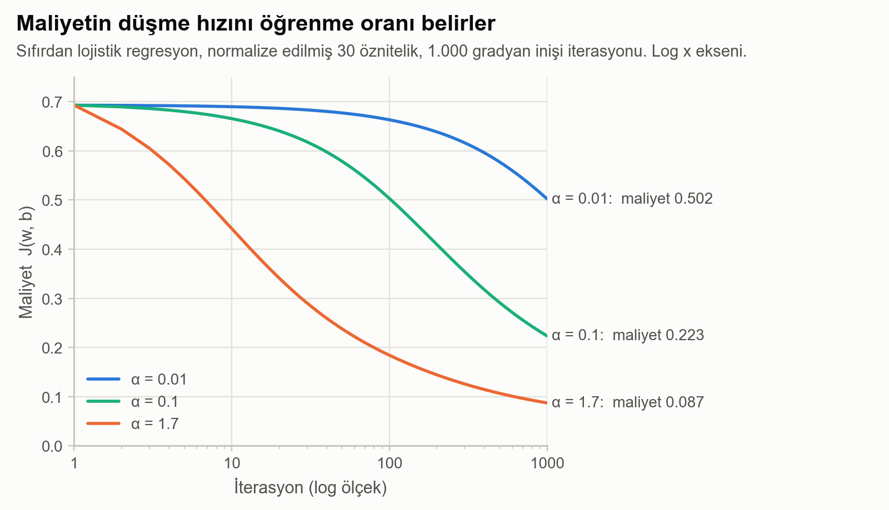

*Üç öğrenme oranı için eğitim boyunca maliyet. Üçü de log 2 = 0.693 değerinden başlar; büyük öğrenme oranı aynı 1000 iterasyonda çok daha ileri gider.*

| Öğrenme oranı α | 1000 iterasyon sonunda maliyet | Eğitim doğruluğu | Test doğruluğu |
|---|---|---|---|
| 0.01 | 0.502 | %89.9 | %91.2 |
| 0.1 | 0.223 | %94.3 | %95.6 |
| **1.7** (bu grafikteki ayar) | **0.087** | **%98.2** | **%97.4** |

> [!TIP]
> 1.7’lik bir öğrenme oranı kulağa çok büyük gelir; ama burada işe yarıyor, çünkü her öznitelik `[0, 1]` aralığına normalize edildi; bu da gradyanları küçük, maliyet yüzeyini düzgün tutuyor. Ölçeklenmemiş özniteliklerde aynı değer maliyeti patlatırdı. Doğru öğrenme oranı her zaman girdilerin ölçeğine bağlıdır.

### Neden sigmoid? Temel özellikler

1. **Olasılıksal çıktı** — sonuç her zaman `(0, 1)` aralığındadır; olasılık olarak yorumlanabilir.
2. **Türevlenebilir** — gradyan inişi için şarttır; türevi $`\sigma(z)(1 - \sigma(z))`$.
3. **Monoton** — daha büyük $`z`$ her zaman daha yüksek tahmin olasılığı demektir.

<details>
<summary><b>Daha derin: σ′(z) = σ(z)(1 − σ(z)) olduğunun kanıtı</b></summary>

$`\sigma(z) = (1 + e^{-z})^{-1}`$ yaz ve zincir kuralıyla türev al:

```math
\sigma'(z) = \frac{e^{-z}}{(1 + e^{-z})^2} = \frac{1}{1 + e^{-z}}\cdot\frac{e^{-z}}{1 + e^{-z}} = \sigma(z)\,\big(1 - \sigma(z)\big)
```

Son adım $`1 - \sigma(z) = \dfrac{e^{-z}}{1 + e^{-z}}`$ eşitliğini kullanır. Türev $`z = 0`$ noktasında 0.25 ile tepe yapar ve büyük pozitif ya da negatif z için sıfıra iner; sigmoid grafiğinin sağ panelinde görülen “doygunluk” budur.

</details>

### Bu notebook’taki uygulama

Notebook, lojistik regresyonu NumPy ile **sıfırdan** yazar, sonra sonucu **scikit-learn** kütüphanesinin `LogisticRegression` sınıfıyla karşılaştırır. Önce sıfırdan yazmak, sklearn’ün perde arkasında ne yaptığını anlamanın en iyi yoludur.

```python
import numpy as np
import pandas as pd
from scipy.special import expit
from sklearn.model_selection import train_test_split
from sklearn.preprocessing import MinMaxScaler
from sklearn.pipeline import make_pipeline
from sklearn.linear_model import LogisticRegression

# Run from a numbered algorithm folder; full portable setup is in the notebook.
data = pd.read_csv("../datasets/data.csv")
x = data.drop(columns=["id", "diagnosis", "Unnamed: 32"])
y = data.diagnosis.map({"B": 0, "M": 1})
x_train, x_test, y_train, y_test = train_test_split(
    x, y, test_size=0.2, stratify=y, random_state=42
)
scaler = MinMaxScaler().fit(x_train)
A_train, A_test = scaler.transform(x_train), scaler.transform(x_test)

def train(X, y, alpha=1.0, iterations=4000):
    w, b = np.zeros(X.shape[1]), 0.0
    for _ in range(iterations):
        error = expit(X @ w + b) - y
        dw, db = X.T @ error / len(y), error.mean()
        w -= alpha * dw
        b -= alpha * db
    return w, b

w, b = train(A_train, y_train.to_numpy())
y_pred = (expit(A_test @ w + b) >= 0.5).astype(int)
print((y_pred == y_test).mean())             # 0.973684... (NumPy)
lr = make_pipeline(MinMaxScaler(), LogisticRegression(max_iter=3000, random_state=42))
lr.fit(x_train, y_train)                     # scaler fitted on training rows only
print(lr.score(x_test, y_test))              # 0.973684... (sklearn, L2)
```

Güncel ortak ayrımda iki uygulama da **%97.37** test doğruluğuna ulaşır (114 örneğin 111’i). Eşit doğruluk, katsayıların eşit olduğu anlamına gelmez: NumPy örneğinde düzenlileştirme yoktur; sklearn L2 kullanır. Tam notebook sayısal gradyan kontrolünü ve kararlı çapraz entropi eğrisini de içerir. Yukarıdaki eski öğrenme oranı grafikleri kendi örnek deneylerine aittir.

---

## 2. K-En Yakın Komşu (KNN)

**Çalıştırılmış notebook:** [K-En Yakın Komşu](2%29%20K-Nearest%20Neighbour%20%28KNN%29%20Classification/K-Nearest%20Neighbour%20%28KNN%29.ipynb)

KNN basit, **parametrik olmayan** bir algoritmadır — bütün eğitim kümesini ezberler ve tahmini sorgu anında en yakın noktalara bakarak yapar. Hiçbir eğitim adımı yoktur; bu yüzden ona **tembel öğrenici (lazy learner)** denir.

### Algoritma (adım adım)

1. **K seç** — dikkate alınacak komşu sayısı.
2. Sorgu noktasından her eğitim örneğine olan **uzaklıkları hesapla** (en yaygını Öklid uzaklığıdır).
3. **En yakın K** eğitim örneğini bul.
4. **Oyla** — bu K komşu arasındaki çoğunluk sınıfı tahmin olur.

Formülle yazarsak, $`N_K(x)`$ en yakın K eğitim noktasının kümesi olmak üzere, sınıf 1 için tahmin edilen olasılık komşuların o sınıfa ait olan payıdır:

```math
\hat{P}(y = 1 \mid x) = \frac{1}{K}\sum_{i \in N_K(x)} y_i, \qquad \hat{y} = \begin{cases} 1 & \hat{P} \gt 0.5 \text{ ise} \\ 0 & \text{aksi halde} \end{cases}
```

### Öklid uzaklığı

İki boyutta (Pisagor):

```math
d(p, q) = \sqrt{(p_1 - q_1)^2 + (p_2 - q_2)^2}
```

Daha yüksek boyutlarda şuna genellenir:

```math
d(p, q) = \sqrt{\sum_{j=1}^{n}(p_j - q_j)^2}
```

Öklid uzaklığı **Minkowski** ailesinin bir üyesidir. scikit-learn’ün varsayılanı `metric="minkowski"` ve `p=2` değeridir:

```math
d_r(p, q) = \Big(\sum_{j=1}^{n}\lvert p_j - q_j\rvert^{\,r}\Big)^{1/r} \qquad r = 1:\ \text{Manhattan}, \quad r = 2:\ \text{Öklid}
```

### K seçimi

- **Küçük K (ör. 1):** Gürültüye çok duyarlı — tek bir aykırı değer tahmini değiştirebilir. Düşük yanlılık, yüksek varyans → **aşırı öğrenme**.
- **Büyük K:** Daha pürüzsüz bir karar sınırı; ama ilgisiz komşuları da içerebilir. Yüksek yanlılık, düşük varyans → **eksik öğrenme**.
- **En iyi uygulama:** Doğruluğu K değerine karşı çiz ve doğruluğun artmayı bıraktığı noktayı seç.

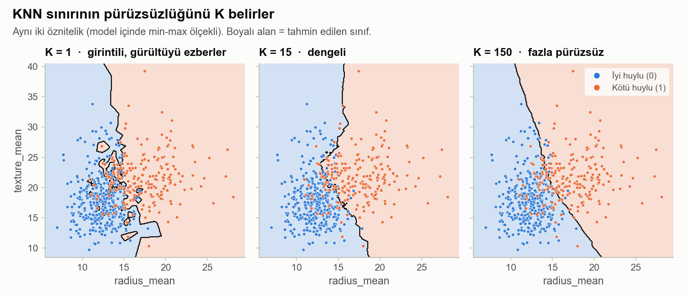

*Aynı veri K = 1, 15 ve 150 ile sınıflandırılmış. Küçük K tek tek noktaların çevresine adacıklar çizer; çok büyük K sınırı düzleştirir.*

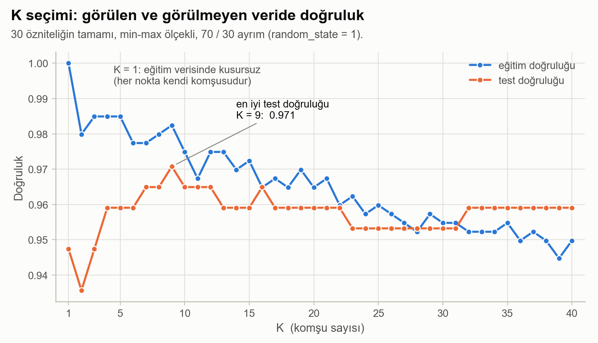

*K = 1 ile 40 arası için eğitim ve test doğruluğu, 30 özniteliğin tamamı. K = 1 eğitim verisinde kusursuz, test verisinde en kötüsü.*

Eğri benim ayrımımda (70 / 30, `random_state=1`, 171 test tümörü) şunu söylüyor:

- **K = 1** eğitim kümesinde %100 alır, çünkü her nokta kendi en yakın komşusudur; ama test kümesinde yalnızca %94.7. Aradaki fark aşırı öğrenmedir.
- Test doğruluğu **K = 9 için tepe yapar (%97.1, 171 tümörün 166’sı)**. 7 ile 12 arasındaki her K bunun bir tümör yakınındadır; yani eğri orada düzdür. O eski örnekte **K = 8** kullanılmıştı; güncel notebook ortak %80/%20 ayrımında eğitim CV’siyle **K = 3** seçer.
- K ≈ 20 sonrasında iki eğri birlikte aşağı kayar: model fazla pürüzsüzleşmektedir.

> [!WARNING]
> **Edinmeye değer iki alışkanlık.**
>
> - K değerini **test** doğruluğuna bakarak seçmek, test kümesini sessizce modele sızdırır. Temiz yol, K değerini eğitim verisi üzerinde çapraz doğrulamayla seçmek ve test kümesine en sonda, bir kez dokunmaktır.
> - İki sınıf varken **tek sayı olan bir K** asla berabere biten bir oylama üretmez.

### KNN için normalizasyon kritiktir

KNN tümüyle uzaklığa dayanır. Büyük değerli bir öznitelik (ör. `area_mean`, 144 ile 2501 arası) uzaklık hesabında küçük değerli bir özniteliği (ör. `smoothness_mean`, 0.05 ile 0.16 arası) bastırır. **Min-Max normalizasyonu** her özniteliği `[0, 1]` aralığına ölçekler:

```math
x_{norm} = \frac{x - x_{min}}{x_{max} - x_{min}}
```

**Elle bir örnek.** Alanı neredeyse aynı olan, ama smoothness aralığının iki ucunda duran iki tümör al:

|   | area_mean farkı | smoothness_mean farkı | Öklid uzaklığı |
|---|---|---|---|
| **Ham değerler** | 20 | 0.10 | $`\sqrt{20^2 + 0.10^2} = 20.0002`$ |
| **Min-max sonrası** | 20 / 2357.5 = 0.008 | 0.10 / 0.11 = 0.909 | $`\sqrt{0.008^2 + 0.909^2} = 0.909`$ |

Ham değerlerde smoothness farkı, o özniteliğin neredeyse bütün aralığı olmasına rağmen, uzaklığa hiçbir şey katmıyor. Ölçeklemeden sonra, olması gerektiği gibi, baskın hâle geliyor.

| Model (aynı 70 / 30 ayrım) | Test doğruluğu, ham öznitelikler | Test doğruluğu, min-max ölçekli |
|---|---|---|
| KNN, K = 8 | %93.0 | **%96.5** |
| SVM, RBF çekirdeği | %91.8 | **%97.1** |
| Gaussian Naive Bayes | %94.7 | %94.7 (ölçek fark etmez) |

> [!TIP]
> $`x_{min}`$ ve $`x_{max}`$ değerlerini **yalnızca eğitim kümesinden** hesapla, sonra aynı sayıları test kümesine uygula. Aksi halde test verisi hakkındaki bilgi eğitime sızar. scikit-learn’ün `Pipeline` yapısı bunu senin yerine yapar.

### Tembelliğin bedeli

- **Eğitim bedava, tahmin pahalı.** `fit` yalnızca veriyi saklar. Her bir tahmin, $`n`$ eğitim noktasının tamamına $`d`$ özniteliğin hepsi üzerinden uzaklık hesaplar: sorgu başına $`O(n \cdot d)`$.
- **Boyut laneti (curse of dimensionality).** Öznitelik sayısı arttıkça bütün noktalar birbirine neredeyse eşit uzaklıkta olmaya başlar ve “en yakın” anlamını yitirir. Bilgi taşımayan öznitelikleri atmak ya da önce boyut indirgemek çok yardımcı olur.

### Python uygulaması

```python
from sklearn.neighbors import KNeighborsClassifier
from sklearn.preprocessing import MinMaxScaler
from sklearn.pipeline import Pipeline
from sklearn.model_selection import GridSearchCV, StratifiedKFold

# x_train/x_test are the raw, stratified 80/20 split from section 1.
cv = StratifiedKFold(n_splits=5, shuffle=True, random_state=42)
pipeline = Pipeline([("scale", MinMaxScaler()), ("knn", KNeighborsClassifier())])
search = GridSearchCV(pipeline, {"knn__n_neighbors": list(range(1, 26))},
                      cv=cv, scoring="accuracy", n_jobs=1)
search.fit(x_train, y_train)                 # each fold fits its own scaler
knn = search.best_estimator_
print(search.best_params_)                  # {'knn__n_neighbors': 3}
print(search.best_score_)                   # 0.975824... (training CV)
print(knn.score(x_test, y_test))             # 0.956140... (held-out test)
```

---

## 3. Destek Vektör Makinesi (SVM)

**Çalıştırılmış notebook:** [Destek Vektör Makinesi](3%29%20Support%20Vector%20Machine%20%28SVM%29%20Classification/Support%20Vector%20Machine%20%28SVM%29.ipynb)

SVM, iki sınıfı **en büyük marjla (maximum margin)** — her sınıfın en yakın veri noktaları arasındaki olabilecek en geniş boşlukla — ayıran **hiperdüzlemi** bulur. O en yakın noktalara **destek vektörleri (support vectors)** denir.

### Sezgi

İki nokta kümesi arasına bir doğru çizdiğini düşün. Onları doğru ayıran sonsuz sayıda doğru vardır. SVM, **iki kümeye de en uzak** olanı seçer — marjı en büyük yapmak sınıflandırıcıyı yeni veriye karşı daha dayanıklı kılar. Bunu iki sınıf arasına olabilecek en geniş caddeyi sığdırmak gibi düşün; karar sınırı caddenin orta çizgisidir.

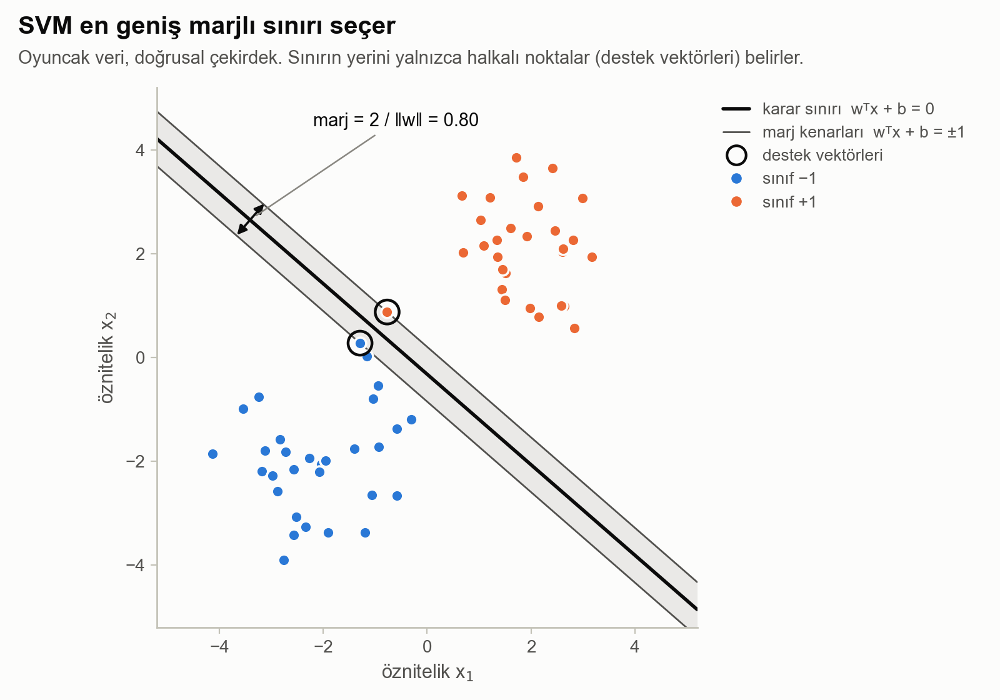

*Oyuncak veri üzerinde doğrusal bir SVM. Gri bant marjdır. Kenarlarına yalnızca halkalı iki nokta değer; diğer bütün noktalar yer değiştirse ya da kaybolsa bile sınır değişmezdi.*

### Matematik: marj formülü nereden gelir

SVM, 0 ve 1 yerine $`y_i \in \{-1, +1\}`$ etiketlerini kullanır. Sınır, $`w^{\top}x + b = 0`$ olan noktalar kümesidir ve herhangi bir $`x`$ noktasının ona uzaklığı:

```math
\text{uzaklık}(x) = \frac{\lvert w^{\top}x + b\rvert}{\lVert w\rVert}
```

$`w`$ ile $`b`$ değerlerini aynı sabitle çarpmak sınırı yerinden oynatmaz; dolayısıyla ölçeği sabitlemekte özgürüz. Ölçeği, her iki taraftaki en yakın noktalar $`w^{\top}x + b = \pm 1`$ sağlayacak şekilde seç. O noktalar $`1/\lVert w\rVert`$ uzaklıkta durur ve cadde bunun iki katı genişliktedir:

```math
\text{Marj} = \frac{2}{\lVert w\rVert}
```

Yukarıdaki grafikte $`w = (1.65,\ 1.90)`$; dolayısıyla $`\lVert w\rVert = 2.52`$ ve marj $`2 / 2.52 = 0.80`$.

Marjı en büyük yapmak, bütün noktaların doğru sınıflandırılıp caddenin dışında kalması kısıtı altında $`\lVert w\rVert^2 / 2`$ ifadesini en küçük yapmaya eşdeğerdir:

```math
\min_{w,\,b}\ \frac{1}{2}\lVert w\rVert^2 \qquad \text{öyle ki} \qquad y_i\,(w^{\top}x_i + b) \ge 1 \quad \text{(her } i \text{ için)}
```

### Sert ve yumuşak marj (Hard vs. Soft Margin)

| Tür | Açıklama |
|---|---|
| **Sert marj** | Hiçbir yanlış sınıflandırmaya izin yok. Yalnızca veri kusursuz biçimde doğrusal ayrılabilir olduğunda çalışır. |
| **Yumuşak marj** | Bir miktar yanlış sınıflandırmaya izin verir (`C` parametresiyle denetlenir). Gerçek dünyanın gürültülü verisi için daha kullanışlıdır. |

Yumuşak marj her noktaya, marjı ne kadar ihlal edebileceğini ölçen bir **gevşeklik (slack)** $`\xi_i \ge 0`$ verir ve toplam gevşekliği ücretlendirir:

```math
\min_{w,\,b,\,\xi}\ \frac{1}{2}\lVert w\rVert^2 + C\sum_{i=1}^{m}\xi_i \qquad \text{öyle ki} \qquad y_i\,(w^{\top}x_i + b) \ge 1 - \xi_i, \quad \xi_i \ge 0
```

**`C`**** (düzenlileştirme parametresi)** bir birim gevşekliğin fiyatıdır:

- Büyük `C` → yanlış sınıflandırmayı ağır cezalandırır → dar marj, aşırı öğrenme riski.
- Küçük `C` → daha fazla hataya göz yumar → geniş marj, daha iyi genelleme.

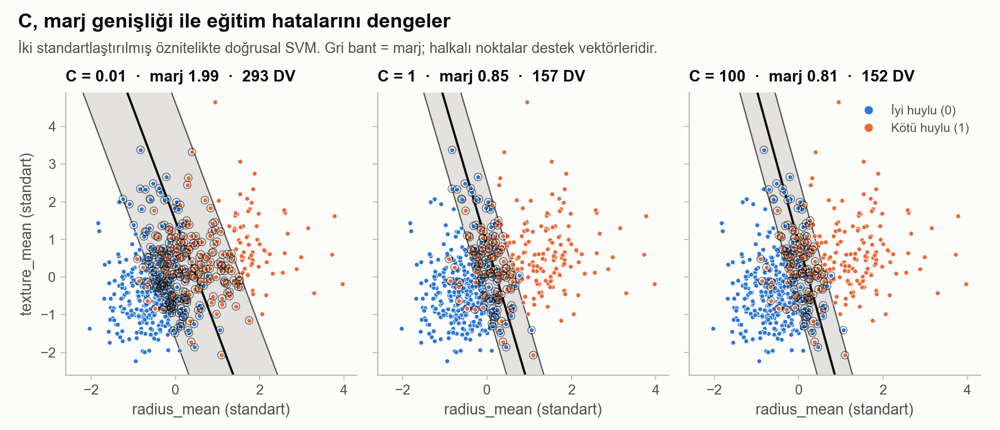

*Aynı iki öznitelik, üç farklı C değeriyle. Küçük C geniş bir cadde satın alır ve içinde çok sayıda nokta kalmasını kabul eder; büyük C ihlalleri azaltmak için caddeyi daraltır.*

| C | Marj genişliği | Destek vektörü sayısı (569 içinden) |
|---|---|---|
| 0.01 | 1.99 | 293 |
| 1 | 0.85 | 157 |
| 100 | 0.81 | 152 |

### SVM ile lojistik regresyon kuzendir

Optimumda her gevşeklik $`\xi_i = \max(0,\ 1 - y_i f(x_i))`$ değerine eşittir; burada $`f(x) = w^{\top}x + b`$. Bunu yerine koymak kısıtları ortadan kaldırır ve SVM’nin gerçekte neyi en küçük yaptığını gösterir:

```math
\min_{w,\,b}\ \frac{1}{2}\lVert w\rVert^2 + C\sum_{i=1}^{m}\max\big(0,\ 1 - y_i f(x_i)\big)
```

İkinci terim **hinge kaybıdır**. Lojistik regresyon bunun yerine **log kaybını**, $`\log(1 + e^{-y_i f(x_i)})`$, en küçük yapar. İkisi de doğruluğun saydığı 0–1 kaybının yumuşatılmış birer vekilidir:

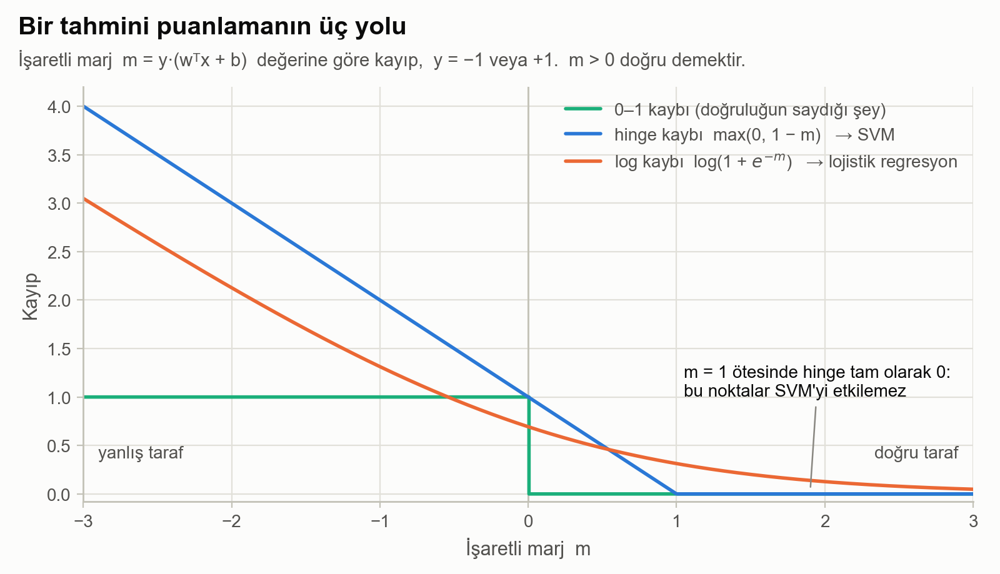

*İşaretli marja karşı üç kayıp fonksiyonu. Hinge kaybı, marjın güvenle ötesindeki noktalar için tam sıfırdır; log kaybı sıfıra hiçbir zaman tam ulaşmaz.*

Hinge kaybının sıfırda düz kalan kısmı, destek vektörlerinin matematiksel nedenidir: doğru sınıflanmış ve marjın ötesindeki noktalar hiçbir katkı yapmaz; çözüm yalnızca caddenin üstündeki ya da içindeki birkaç noktaya bağlıdır.

### Çekirdek hilesi (Kernel Trick)

Veri doğrusal ayrılamadığında SVM, veriyi ayırıcı bir hiperdüzlemin var olduğu **daha yüksek boyutlu bir uzaya** eşler. Yaygın çekirdekler:

- `linear` — dönüşüm yok (doğrusal ayrılabilir veri için)
- `rbf` (Radial Basis Function) — sonsuz boyuta eşler; doğrusal olmayan durumların çoğunu çözer
- `poly` — polinom dönüşümü

scikit-learn’ün `SVC` sınıfı varsayılan olarak `kernel='rbf'` kullanır.

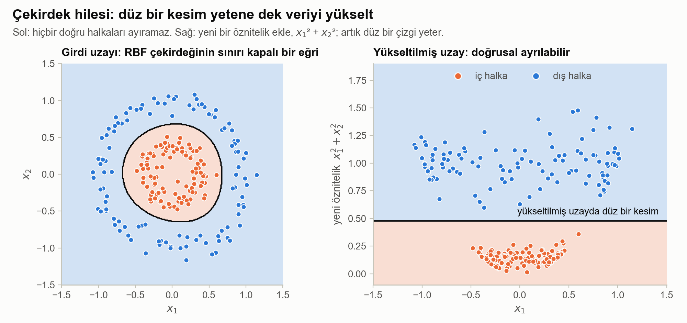

*Sol: hiçbir doğrunun ayıramayacağı iki halka. Sağ: yeni bir öznitelik, merkeze uzaklığın karesi eklendikten sonra düz bir kesim onları kusursuz ayırır.*

Bu halkalarda doğrusal bir SVM noktaların %62’sini doğru bilir; RBF çekirdeği %100’ünü.

**Neden “hile” deniyor?** SVM çözümü veri noktaları arasında yalnızca **iç çarpımlara** ihtiyaç duyar. Bir çekirdek, $`K(x, x') = \phi(x)^{\top}\phi(x')`$, yükseltilmiş uzaydaki iç çarpımı, yükseltilmiş koordinatları $`\phi(x)`$ **hiç hesaplamadan** verir. RBF çekirdeğinde o uzay sonsuz boyutludur; ama çekirdeğin kendisi tek satırdır:

```math
K(x, x') = \exp\big(-\gamma\,\lVert x - x'\rVert^2\big)
```

Bu bir benzerlik skorudur: aynı noktalar için 1, noktalar uzaklaştıkça 0’a doğru düşer. $`\gamma`$ ne kadar hızlı düşeceğini belirler. Büyük `gamma` → her destek vektörü yalnızca yakın çevresini etkiler → aşırı öğrenebilen kıvrımlı bir sınır. Küçük `gamma` → geniş etki → daha pürüzsüz bir sınır.

<details>
<summary><b>Daha derin: dual problem (iç çarpımların ortaya çıktığı yer)</b></summary>

Her eğitim noktası için bir Lagrange çarpanı $`\alpha_i \ge 0`$ tanımla. $`w`$ için çözmek $`w = \sum_i \alpha_i y_i x_i`$ verir ve optimizasyon şuna dönüşür:

```math
\max_{\alpha}\ \sum_{i=1}^{m}\alpha_i - \frac{1}{2}\sum_{i=1}^{m}\sum_{j=1}^{m}\alpha_i\alpha_j\,y_i y_j\,x_i^{\top}x_j \qquad \text{öyle ki} \qquad 0 \le \alpha_i \le C, \quad \sum_{i=1}^{m}\alpha_i y_i = 0
```

Veri yalnızca $`x_i^{\top}x_j`$ üzerinden girer. Bunu $`K(x_i, x_j)`$ ile değiştirirsen aynı algoritma yükseltilmiş uzayda çalışır. Yeni bir nokta için tahmin:

```math
f(x) = \sum_{i=1}^{m}\alpha_i\,y_i\,K(x_i, x) + b
```

$`\alpha_i`$ değerlerinin çoğu tam sıfır çıkar. $`\alpha_i \gt 0`$ olan noktalar destek vektörleridir ve tahmin anında gereken tek noktalar onlardır.

</details>

### Python uygulaması

```python
from sklearn.svm import SVC
from sklearn.pipeline import Pipeline
from sklearn.preprocessing import MinMaxScaler
from sklearn.model_selection import GridSearchCV, StratifiedKFold

cv = StratifiedKFold(n_splits=5, shuffle=True, random_state=42)
pipeline = Pipeline([("scale", MinMaxScaler()), ("svm", SVC(random_state=42))])
grid = [
    {"svm__kernel": ["linear"], "svm__C": [0.1, 1, 10]},
    {"svm__kernel": ["rbf"], "svm__C": [0.1, 1, 10], "svm__gamma": ["scale", 0.1, 1]},
]
search = GridSearchCV(pipeline, grid, cv=cv, scoring="accuracy", n_jobs=1)
search.fit(x_train, y_train)
svm = search.best_estimator_
print(search.best_params_)                  # C=10, gamma=1, kernel='rbf'
print(svm.score(x_test, y_test))             # 0.973684...
print(svm.named_steps["svm"].n_support_)     # [34 33]
```

KNN gibi SVM de uzaklık ölçer; dolayısıyla ölçeklenmiş özniteliklere ihtiyaç duyar: ham veride aynı model yalnızca %91.8 alır.

---

## 4. Naive Bayes

**Çalıştırılmış notebook:** [Naive Bayes](4%29%20Naive%20Bayes%20Classification/Naive%20Bayes.ipynb)

Naive Bayes, Bayes Teoremi’ne dayanan **olasılıksal bir sınıflandırıcıdır**. *Naive* (saf) denmesinin nedeni, sınıf etiketi verildiğinde bütün özniteliklerin **koşullu bağımsız** olduğunu varsaymasıdır — pratikte nadiren doğru olan ama şaşırtıcı derecede iyi çalışan bir sadeleştirme.

### Bayes Teoremi

```math
P(c \mid x) = \frac{P(x \mid c)\,P(c)}{P(x)}
```

| Terim | Ad | Anlam |
|---|---|---|
| $`P(c \mid x)`$ | **Sonsal (posterior)** | Gözlenen öznitelikler verildiğinde sınıfın olasılığı |
| $`P(x \mid c)`$ | **Olabilirlik (likelihood)** | Bu özniteliklerin bu sınıftan gözlenme olasılığı |
| $`P(c)`$ | **Önsel (prior)** | Bu sınıfın eğitim kümesinde ne kadar sık olduğu |
| $`P(x)`$ | **Kanıt (evidence)** | Sabit normalleştirici; sınıflandırmada yok sayılabilir |

Sınıflandırmak için her sınıfın sonsal olasılığını hesaplar, en yükseğini seçeriz. $`P(x)`$ her sınıf için aynı olduğundan payları karşılaştırmak yeterlidir:

```math
\hat{c} = \underset{c}{\arg\max}\ P(c)\,P(x \mid c)
```

### “Naive” bağımsızlık varsayımı

```math
P(x_1, x_2, \dots, x_n \mid c) = P(x_1 \mid c)\cdot P(x_2 \mid c)\cdots P(x_n \mid c) = \prod_{j=1}^{n} P(x_j \mid c)
```

Her öznitelik, sınıf olasılığına bağımsız katkı yapıyormuş gibi ele alınır. Bu, matematiği çözülebilir kılar, boyut lanetinden kaçınır ve hesabı çarpıcı biçimde hızlandırır.

**Ne kadar daha basit?** 30 özniteliği tam bir Gauss ile birlikte modellemek, sınıf başına 30 ortalama artı 465 varyans ve kovaryans gerektirir. Naive sürüm 30 ortalama ve 30 varyansa ihtiyaç duyar: sınıf başına 60 sayı; her biri basit bir ortalamadan tahmin edilir.

<details>
<summary><b>Daha derin: uygulamalar neden çarpmak yerine logaritmaları toplar</b></summary>

30 küçük olasılığı çarpmak, kayan noktalı sayılarda hızla sıfıra taşar (underflow). Logaritma monotondur; en büyük çarpıma sahip sınıf aynı zamanda en büyük log toplamına sahiptir:

```math
\hat{c} = \underset{c}{\arg\max}\ \Big[\log P(c) + \sum_{j=1}^{n}\log P(x_j \mid c)\Big]
```

scikit-learn dahil her Naive Bayes uygulaması bu log uzayında çalışır.

</details>

### Gaussian Naive Bayes

Öznitelikler **sürekli** olduğunda (meme kanseri veri setindeki 30 özniteliğin hepsi gibi) `GaussianNB`, her özniteliğin her sınıf içinde **normal (Gauss) dağılıma** uyduğunu varsayar:

```math
P(x_j \mid c) = \frac{1}{\sqrt{2\pi\sigma_{jc}^2}}\exp\!\left(-\frac{(x_j - \mu_{jc})^2}{2\sigma_{jc}^2}\right)
```

Model, her sınıftaki her öznitelik için $`\mu`$ (ortalama) ve $`\sigma^2`$ (varyans) değerlerini eğitim verisinden öğrenir. “Eğitim” bu ortalamaları hesaplamaktan ibarettir; ayarlanacak neredeyse hiçbir şey yoktur.

### Tek bir öznitelikte elle örnek

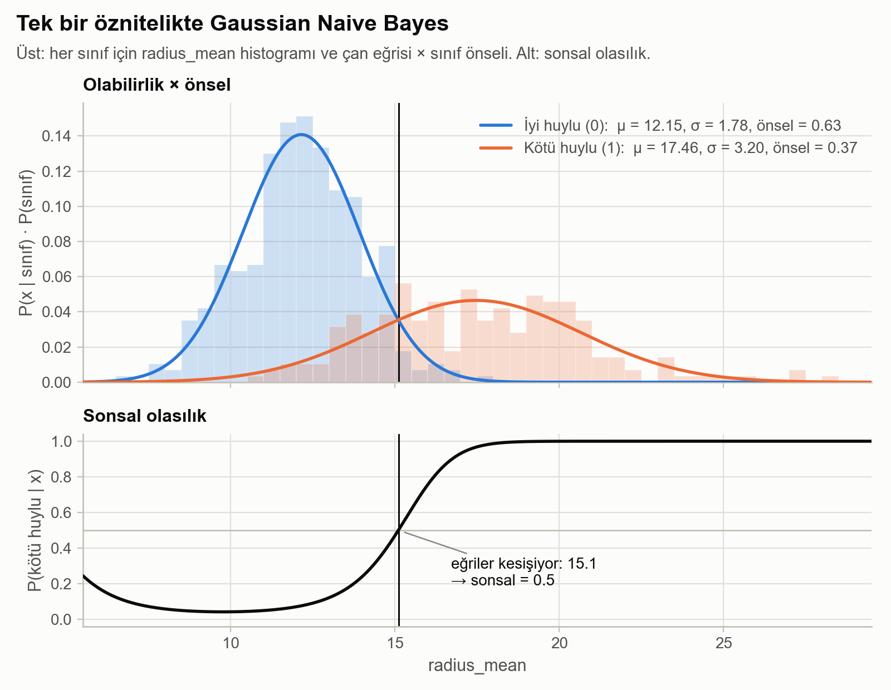

*Üst: her sınıfta radius_mean dağılımı ve sınıf önseliyle ölçeklenmiş çan eğrisi. Alt: bunun sonucunda kötü huylu olma olasılığı. Karar, iki eğrinin kesiştiği yerde değişir.*

Yalnızca bu özniteliği kullanarak **radius_mean = 15** olan bir tümörü sınıflandır:

|   | İyi huylu | Kötü huylu |
|---|---|---|
| Önsel $`P(c)`$ | 0.627 | 0.373 |
| Ortalama, standart sapma | 12.15, 1.78 | 17.46, 3.20 |
| Olabilirlik $`P(15 \mid c)`$ | 0.0619 | **0.0928** |
| Olabilirlik × önsel | **0.0388** | 0.0346 |
| Sonsal | **%52.9** | %47.1 |

> [!TIP]
> **Önsel, yanıtı değiştirir.** 15’lik bir yarıçap kötü huylu bir tümör için daha tipiktir (olabilirlik 0.093’e karşı 0.062). Ama iyi huylu tümörler veride düpedüz daha yaygın; önsellerle çarpınca iyi huylu taraf kıl payı kazanıyor. İki eğri **15.1** noktasında kesişiyor: bunun üstünde bu tek öznitelikli model kötü huylu diyor.

Alt panelin gösterdiği bir şey daha var: en solda kötü huylu olasılığı yeniden yükseliyor. Hiçbir tümör o kadar küçük değil. Bunun tek nedeni kötü huylu çan eğrisinin daha geniş olması; kuyruğu sonunda dar olan iyi huylu eğriyi geçiyor. Gauss varsayımının bir olgu değil, bir model olduğunu hatırlatan bir ayrıntı.

### Güçlü ve zayıf yanlar

| Güçlü yanlar | Zayıf yanlar |
|---|---|
| Eğitimi ve tahmini çok hızlıdır | Öznitelik bağımsızlığını varsayar (çoğu zaman ihlal edilir) |
| Az veriyle iyi çalışır | Olasılık tahminleri kötü kalibre olabilir |
| Yüksek boyutlu veriyi rahat kaldırır | Karmaşık korelasyonlu özniteliklerde zayıftır |
| Doğal olarak çok sınıflıdır | Bazı türevleri öznitelik ölçeğine duyarlıdır |

Bu veri setinde birçok öznitelik birbirinin neredeyse kopyası (radius, perimeter ve area hep büyüklüğü ölçüyor). Naive Bayes aynı kanıtı birkaç kez sayıyor; sondaki karşılaştırmada diğer modellerin altında kalmasının bir nedeni bu.

### Python uygulaması

```python
from sklearn.naive_bayes import GaussianNB

nb = GaussianNB().fit(x_train, y_train)      # continuous raw features; no scaler needed
print(nb.score(x_test, y_test))             # 0.938596...
print(nb.class_prior_)                      # [0.62637363 0.37362637]
print(nb.theta_[:, 0])                      # class means of radius_mean
print(nb.var_[:, 0])                        # smoothed class variances
```

---

## 5. Karar Ağacı ile Sınıflandırma

**Çalıştırılmış notebook:** [Karar Ağacı](5%29%20Decision%20Tree%20Classification/Decision%20Tree.ipynb)

**CART**, *Classification and Regression Trees* (sınıflandırma ve regresyon ağaçları) demektir: tek algoritma, iki iş. Regresyon sürümü [Regresyon](../Regression/Regression.tr.md) sayfasında anlatılıyor. Sınıflandırmada yalnızca iki şey değişir:

|   | Regresyon ağacı | Sınıflandırma ağacı |
|---|---|---|
| Yaprak neyi tahmin eder | Eğitim satırlarının **ortalamasını** | Eğitim satırlarının **çoğunluk sınıfını** |
| Bölme neyle puanlanır | Çocukların varyansı (MSE) | Çocukların **safsızlığı (impurity)**: entropi ya da Gini |

Geri kalan her şey aynıdır: her özniteliği ve her eşiği dene, en iyi bölmeyi tut, her çocuğun içinde yinele.

### Matematik: bir düğümün ne kadar karışık olduğunu ölçmek

Bir düğüm, bütün örnekleri tek bir sınıfa aitse **saf**, sınıflar karışıksa **saf değildir**. $`p_k`$, düğümdeki $`k`$ sınıfının payı olmak üzere:

```math
\text{Entropi:}\quad H = -\sum_{k} p_k\log_2 p_k \qquad\qquad \text{Gini:}\quad G = 1 - \sum_{k} p_k^2
```

$`p`$ = sınıf 1’in payı olan iki sınıflı durumda:

```math
H(p) = -p\log_2 p - (1 - p)\log_2(1 - p), \qquad G(p) = 2p(1 - p)
```

- **Entropi** bilgi kuramından gelir: düğümden rastgele seçilen bir örneğin sınıfını öğrenmek için gereken ortalama evet/hayır sorusu (bit) sayısı. Saf bir düğüm 0 soru ister; 50 / 50 bir düğüm 1 soru.
- **Gini**, düğümün kendi sınıf paylarına göre tahmin yürütürsen rastgele bir örneği yanlış etiketleme olasılığıdır.

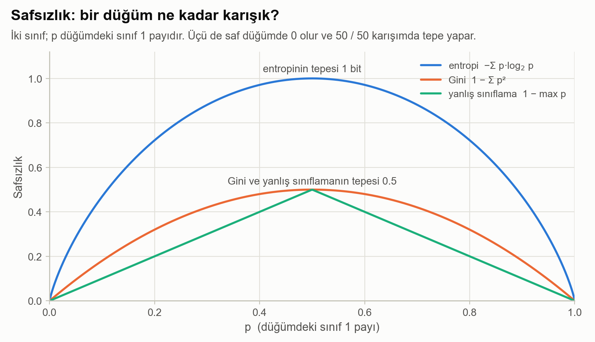

*İki sınıflı bir düğüm için entropi, Gini ve yanlış sınıflama oranı. Hepsi saf düğümde sıfır, 50 / 50 karışımda en büyüktür.*

### Matematik: entropiyi en küçük yapmak = bilgi kazancını en büyük yapmak

Bir bölme, düğümün $`n`$ örneğini bir sol çocuğa ($`n_L`$) ve bir sağ çocuğa ($`n_R`$) gönderir. **Bilgi kazancı (information gain)**, başlangıçtaki entropiden geriye kalan ağırlıklı entropinin çıkarılmasıdır:

```math
IG = H(\text{ebeveyn}) - \left[\frac{n_L}{n}H(L) + \frac{n_R}{n}H(R)\right]
```

Ağaç, **bilgi kazancı en büyük** olan bölmeyi seçer; bu, **ağırlıklı çocuk entropisi en düşük** olan bölmeyle aynıdır.

### Kök bölme, elle hesap

`radius_mean` ve `texture_mean` özniteliklerinde en iyi ilk soru “radius_mean ≤ 15.05 mi?” sorusudur.

| Düğüm | Örnek | İyi huylu | Kötü huylu | Kötü huylu payı | Entropi (bit) |
|---|---|---|---|---|---|
| Ebeveyn (tüm veri) | 569 | 357 | 212 | 0.373 | 0.953 |
| Sol: radius_mean ≤ 15.05 | 397 | 346 | 51 | 0.128 | 0.553 |
| Sağ: radius_mean 15.05 üstü | 172 | 11 | 161 | 0.936 | 0.343 |

```math
H(\text{ebeveyn}) = -0.373\log_2 0.373 - 0.627\log_2 0.627 = 0.953
```

```math
IG = 0.953 - \left[\frac{397}{569}\cdot 0.553 + \frac{172}{569}\cdot 0.343\right] = 0.953 - 0.490 = 0.463 \text{ bit}
```

Yarıçap hakkındaki tek bir soru, tanı hakkındaki belirsizliğin neredeyse yarısını ortadan kaldırıyor. Derinliği 2 olan ağacın tamamı (İ = iyi huylu, K = kötü huylu):

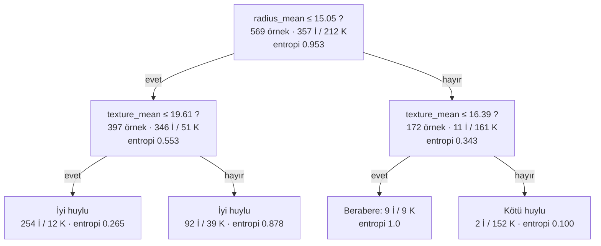

9 iyi huylu ve 9 kötü huylu tümör içeren yaprağa dikkat: entropi tam 1, yani yazı tura. Daha derin bir ağaç orada bölmeyi sürdürürdü.

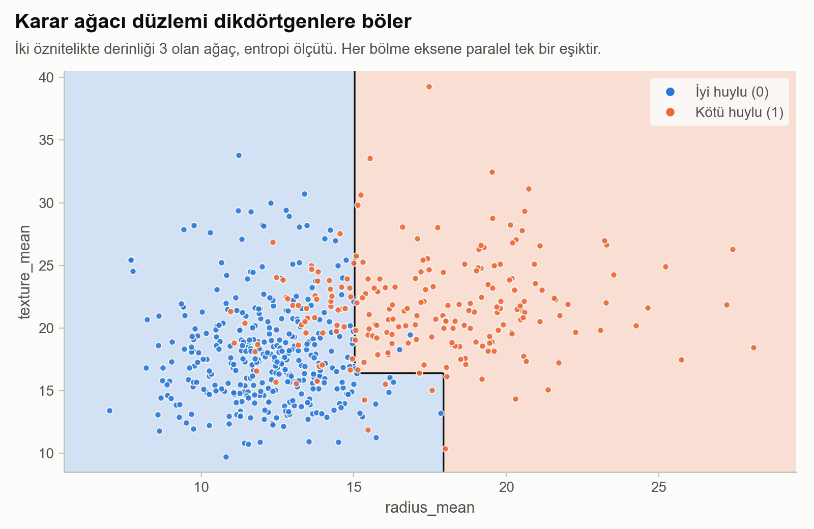

*İki öznitelikte derinliği 3 olan ağaç. Her bölme tek bir öznitelikteki tek bir eşiktir; bu yüzden bölgeler her zaman kenarları eksenlere paralel dikdörtgenlerdir.*

### Entropi mi, Gini mi?

Neredeyse her zaman aynı bölmeleri seçerler. Gini logaritma gerektirmez; bu yüzden biraz daha hızlıdır ve scikit-learn’ün varsayılanıdır (`criterion="gini"`). Yukarıda anlatılan bilgi kazancı sürümü için `criterion="entropy"` kullan.

### Artılar ve eksiler

- **Artılar:** Akış şeması gibi okunur; öznitelik ölçekleme gerekmez; doğrusal olmayan sınırları ve öznitelik etkileşimlerini yakalar.
- **Eksiler:** Sınırlar her zaman eksenlere paralel basamaklardır; derin bir ağaç eğitim kümesini ezberler; verideki küçük değişiklikler bütün ağacı değiştirebilir (yüksek varyans). Regresyon ağaçlarındaki aynı hiperparametreler onu dizginler: `max_depth`, `min_samples_split`, `min_samples_leaf`.

### Python uygulaması

```python
from sklearn.tree import DecisionTreeClassifier, plot_tree
from sklearn.model_selection import GridSearchCV, StratifiedKFold
import matplotlib.pyplot as plt

cv = StratifiedKFold(n_splits=5, shuffle=True, random_state=42)
search = GridSearchCV(DecisionTreeClassifier(criterion="entropy", random_state=42),
                      {"max_depth": [2, 3, 4, 5, None], "min_samples_leaf": [1, 3, 5]},
                      cv=cv, scoring="accuracy", n_jobs=1)
search.fit(x_train, y_train)
tree = search.best_estimator_
print(search.best_params_)                  # max_depth=4, min_samples_leaf=1
print(tree.score(x_test, y_test))           # 0.929824...

# A separate readable illustration, also fitted on training rows only.
features = ["radius_mean", "texture_mean"]
small_tree = DecisionTreeClassifier(max_depth=2, criterion="entropy", random_state=42)
small_tree.fit(x_train[features], y_train)
plt.figure(figsize=(12, 6))
plot_tree(small_tree, feature_names=features, class_names=["Benign", "Malignant"],
          filled=True, rounded=True, fontsize=10)
plt.tight_layout()
plt.show()
```

---

## 6. Rastgele Orman ile Sınıflandırma

**Çalıştırılmış notebook:** [Rastgele Orman](6%29%20Random%20Forest%20Classification/Random%20Forest.ipynb)

**Topluluk öğrenmesi (ensemble learning):** tek bir modele güvenmek yerine birçok model eğit ve yanıtlarını birleştir. Rastgele orman, karar ağaçlarından oluşan bir topluluktur.

### Algoritma (adım adım)

1. $`n`$ eğitim satırından **yerine koyarak** rastgele $`n`$ satır seç. Seçilen satırlara **alt örneklem (sub-sample)** ya da bootstrap örneklemi denir. Bazı satırlar birkaç kez gelir, yaklaşık üçte biri hiç gelmez.
2. Bu alt örneklemde bir karar ağacı büyüt. Her bölmede özniteliklerin yalnızca **rastgele bir alt kümesini** dikkate al (varsayılan olarak 30 özniteliğin $`\sqrt{30} \approx 5`$ tanesi).

3.

    1. ve 2. adımları $`B`$ ağaç için yinele (`n_estimators`).
4. Yeni bir örneği sınıflandırmak için **her ağaç oy versin**, çoğunluğu al. (scikit-learn ağaçların sınıf olasılıklarının ortalamasını alır; buna “yumuşak” oylama denir.)

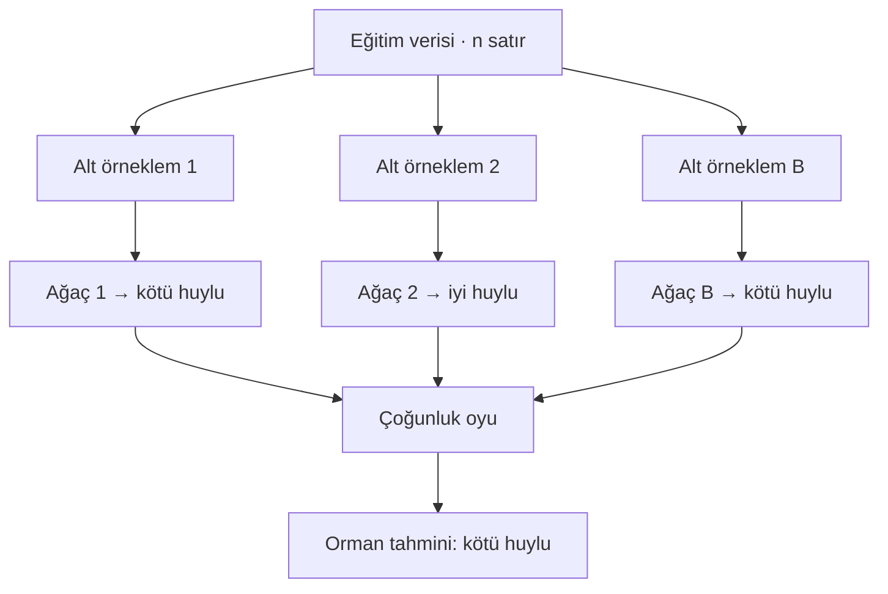

### Matematik: oylama neden tek seçmenden iyidir

Her ağacın $`p \gt 0.5`$ olasılıkla doğru bildiğini ve ağaçların hatalarını **birbirinden bağımsız** yaptığını varsay. $`B`$ ağacın çoğunluğunun doğru bilme olasılığı:

```math
P(\text{çoğunluk doğru}) = \sum_{k \gt B/2}\binom{B}{k}\,p^{k}(1 - p)^{B - k}
```

| Ağaç sayısı B (her biri %70 doğru) | Çoğunluk oyunun doğruluğu |
|---|---|
| 1 | %70.0 |
| 11 | %92.2 |
| 101 | %99.999 |

> [!WARNING]
> **İşin püf noktası “bağımsız” sözcüğünde.** Gerçek ağaçlar örtüşen verilerle eğitilir ve aynı hataların çoğunu yapar; bu yüzden kazanç bu tablonun vaat ettiğinden çok daha küçüktür. Ormanın rastgelelik eklemesinin (alt örneklemler ve rastgele öznitelik alt kümeleri) nedeni tam da budur: ağaçlar birbirine ne kadar az benzerse oylama o kadar işe yarar. Regresyon sayfası aynı fikri bir ortalamanın varyansı formülü olarak türetiyor: $`\rho\sigma^2 + \tfrac{1-\rho}{B}\sigma^2`$.

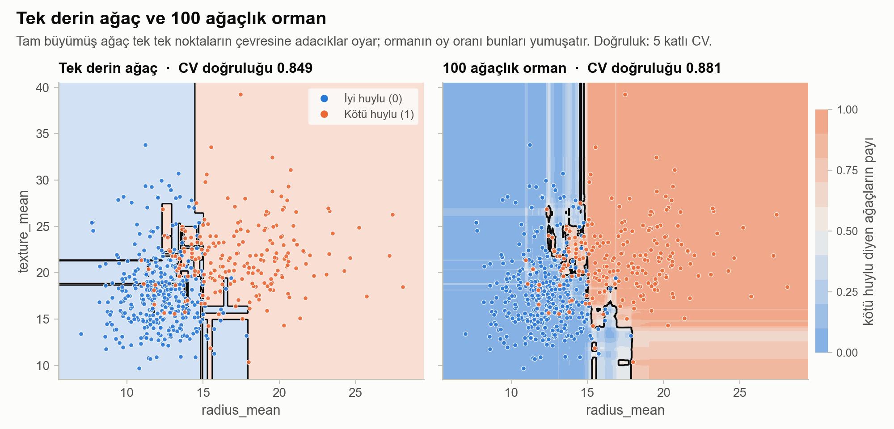

*Sol: tam büyümüş tek bir ağaç tek tek tümörlerin çevresine küçük adacıklar çizer. Sağ: 100 ağaçtan kötü huylu diyenlerin payı yumuşak biçimde değişir ve adacıklar erir.*

| Çapraz doğrulama doğruluğu | Tek ağaç | 100 ağaçlık orman |
|---|---|---|
| İki öznitelik (5 katlı) | %84.9 | **%88.1** |
| 30 özniteliğin tamamı (10 katlı) | %92.6 | **%95.6** |

### İki bedava ek

- **Torba dışı (out-of-bag) puanı.** Her ağaç, kendi alt örnekleminin dışında kalan satırlarda sınanabilir. Orman üzerinden ortalaması alındığında bu, test kümesine dokunmadan bir doğruluk tahmini verir: burada %95.7; gerçek test kümesindeki %95.9 değerinin hemen yanında.
- **Öznitelik önemi (feature importance).** Her özniteliğin bütün ağaçlarda safsızlığı ne kadar azalttığını toplamak öznitelikleri sıralar. Bu veri setindeki ilk beş: `concave points_worst` (0.150), `area_worst` (0.131), `concave points_mean` (0.094), `perimeter_worst` (0.092), `radius_worst` (0.083).

### Python uygulaması

```python
from sklearn.ensemble import RandomForestClassifier
from sklearn.model_selection import cross_val_score, StratifiedKFold

rf = RandomForestClassifier(n_estimators=200, oob_score=True, random_state=42, n_jobs=1)
cv = StratifiedKFold(n_splits=5, shuffle=True, random_state=42)
print(cross_val_score(rf, x_train, y_train, cv=cv, scoring="accuracy").mean())  # 0.962637...
rf.fit(x_train, y_train)
print(rf.score(x_test, y_test))              # 0.964912...
print(rf.oob_score_)                        # 0.953846...
print(pd.Series(rf.feature_importances_, index=x.columns).nlargest(10))
```

---

## 7. Karmaşıklık Matrisi ve Değerlendirme Metrikleri

**Çalıştırılmış notebook:** [Değerlendirme ve algoritma karşılaştırması](7%29%20Model%20Evaluation/Model%20Evaluation.ipynb)

Doğruluk, tahminlerin **kaçının** doğru olduğunu söyler. **Karmaşıklık matrisi (confusion matrix)** ise **ne tür** hatalar yapıldığını söyler; bir kanser testinde bu iki tür hata eşit derecede kötü değildir.

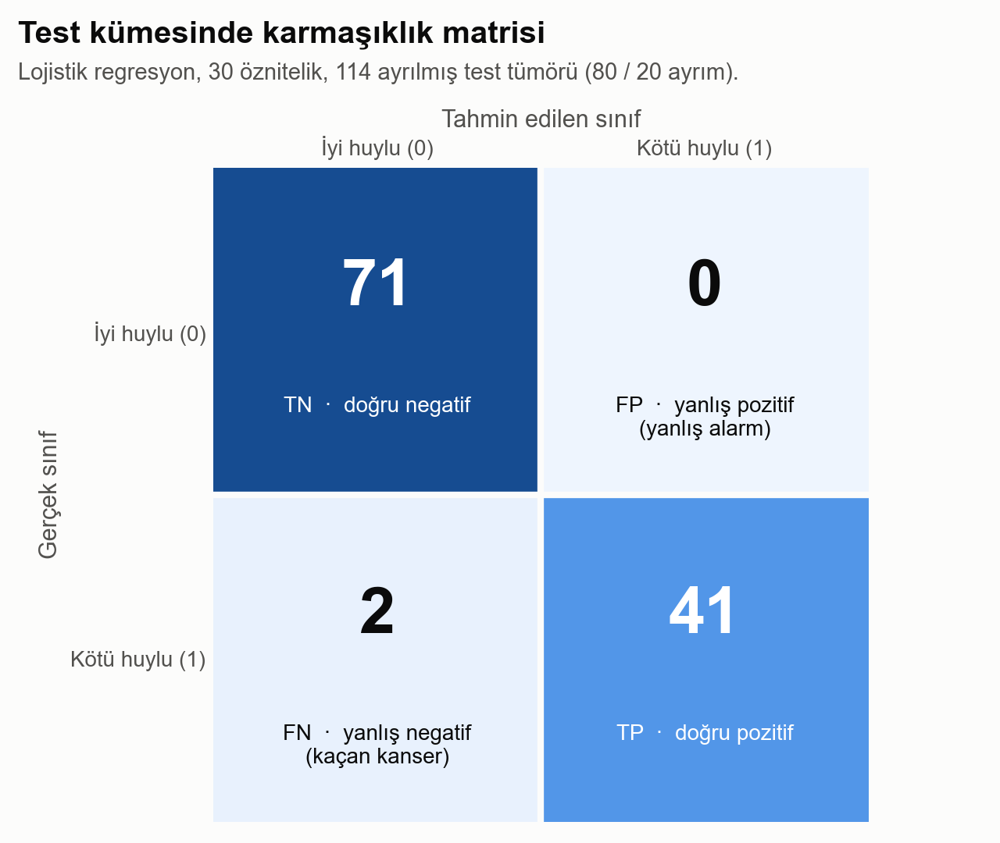

*Bölüm 1’deki lojistik regresyon modelinin 114 test tümörü üzerindeki karmaşıklık matrisi.*

|   | Tahmin: iyi huylu (0) | Tahmin: kötü huylu (1) |
|---|---|---|
| Gerçekte iyi huylu (0) | **TN = 71** doğru negatif: sağlıklı ve model de öyle diyor | **FP = 0** yanlış pozitif: yanlış alarm |
| Gerçekte kötü huylu (1) | **FN = 2** yanlış negatif: kaçan kanser | **TP = 41** doğru pozitif: kanser ve model buluyor |

### Bu dört sayıdan kurulan metrikler

| Metrik | Formül | Bu model | Yanıtladığı soru |
|---|---|---|---|
| **Doğruluk (accuracy)** | $`\dfrac{TP + TN}{TP + TN + FP + FN}`$ | 112 / 114 = 0.982 | Model genelde ne sıklıkla haklı? |
| **Kesinlik (precision)** | $`\dfrac{TP}{TP + FP}`$ | 41 / 41 = 1.000 | Kötü huylu dediğinde ne sıklıkla doğru? |
| **Duyarlılık (recall, sensitivity)** | $`\dfrac{TP}{TP + FN}`$ | 41 / 43 = 0.953 | Bütün kötü huylu tümörlerin kaçını buldu? |
| **Özgüllük (specificity)** | $`\dfrac{TN}{TN + FP}`$ | 71 / 71 = 1.000 | Bütün iyi huylu tümörlerin kaçını temize çıkardı? |
| **F1 skoru** | $`2\cdot\dfrac{\text{precision}\cdot\text{recall}}{\text{precision} + \text{recall}}`$ | 0.976 | Precision ile recall değerlerini dengeleyen tek sayı |

> [!WARNING]
> **Doğruluk tek başına neden yanıltabilir.** Her tümöre iyi huylu diyen bir “model” bu veri setinde %62.7 oranında haklıdır, çünkü iyi huylu vakaların payı budur; ve tam olarak sıfır kanser bulur (recall = 0). Taramada kaçan bir kanser (FN), yanlış alarmdan (FP) çok daha pahalıdır; bu yüzden izlenecek sayı **recall** değeridir. Burada %95.3: iki kötü huylu tümör gözden kaçtı.

### Eşik bir ayar düğmesidir

$`\hat{y} \ge 0.5`$ olduğunda sınıf 1 tahmin etmek yalnızca bir gelenektir. Eşiği düşürmek daha çok kanser yakalar ve daha çok yanlış alarm verir; yükseltmek tersini yapar.

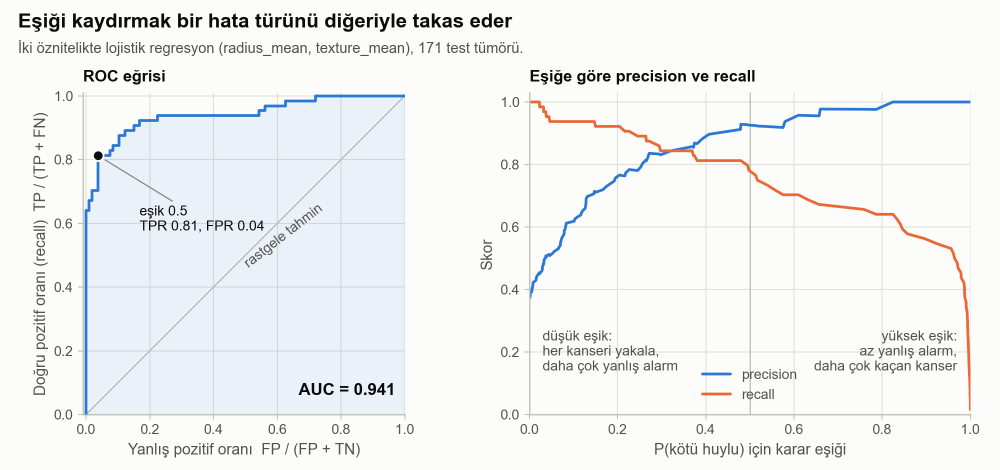

*Sol: olası her eşiğin izini süren ROC eğrisi. Sağ: eşik 0 ile 1 arasında değişirken precision ve recall.*

Grafikteki iki öznitelikli lojistik regresyon için (hataları, bu takası açıkça gösterecek kadar sık):

| Eşik | Precision | Recall |
|---|---|---|
| 0.2 | 0.77 | 0.92 |
| 0.5 | 0.92 | 0.77 |
| 0.8 | 1.00 | 0.64 |

- **ROC eğrisi**, her eşik için doğru pozitif oranını (recall) yanlış pozitif oranına, $`FP / (FP + TN)`$, karşı çizer. Kusursuz bir model sol üst köşeye yapışır; rastgele tahmin köşegeni izler.
- **AUC**, o eğrinin altındaki alan, bunu tek sayıda özetler: rastgele seçilmiş kötü huylu bir tümörün, rastgele seçilmiş iyi huylu bir tümörden daha yüksek skor alma olasılığı. 0.5 tahmin yürütmektir, 1.0 kusursuzdur; bu iki öznitelikli model **0.941** değerine ulaşıyor.

### Python uygulaması

```python
from sklearn.metrics import confusion_matrix, classification_report, roc_auc_score

# The section 1 logistic pipeline and its shared stratified 80/20 split.
y_pred = lr.predict(x_test)
print(confusion_matrix(y_test, y_pred, labels=[0, 1]))
# [[72  0]
#  [ 3 39]]
print(classification_report(y_test, y_pred, target_names=["benign", "malignant"]))
print(roc_auc_score(y_test, lr.predict_proba(x_test)[:, 1]))
```

Bu kısa kod, 1. bölümün lojistik modelini ölçer. Tam 7. notebook ayrıca altı sabit modeli eğitim CV’siyle karşılaştırır, SVM’yi seçer ve eşiği yalnız eğitim OOF tahminlerinden belirler; dolayısıyla buradaki lojistik sonuçlarıyla aynı deney değildir.

---

## Algoritma Karşılaştırması

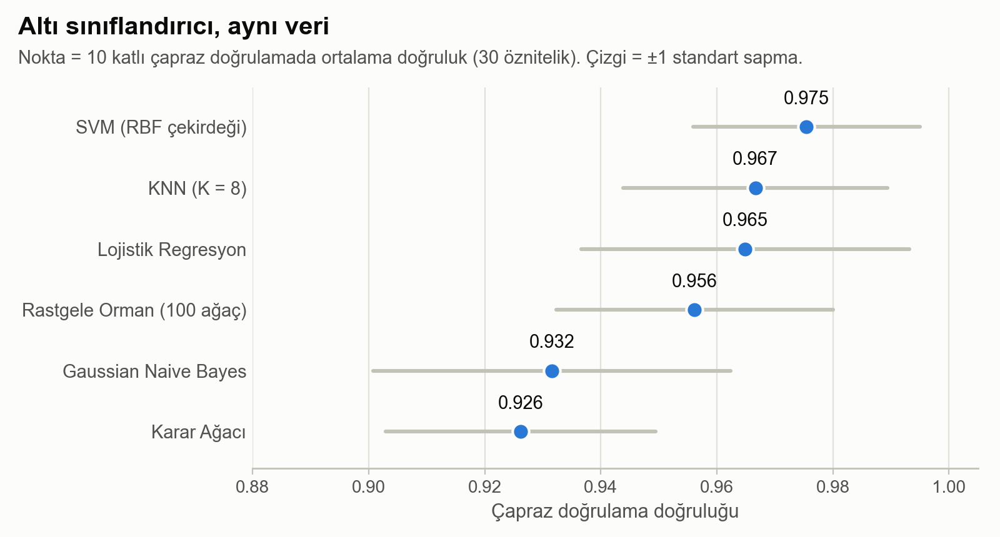

*Altı sınıflandırıcının 30 özniteliğin tamamında 10 katlı çapraz doğrulamadaki ortalama doğruluğu. Her noktadan geçen yatay çizgi, skorun kattan kata ne kadar değiştiğini gösterir.*

| Algoritma | 10 katlı CV doğruluğu | Katlar arası standart sapma |
|---|---|---|
| SVM (RBF çekirdeği) | **0.975** | 0.020 |
| KNN (K = 8) | 0.967 | 0.023 |
| Lojistik Regresyon | 0.965 | 0.028 |
| Rastgele Orman (100 ağaç) | 0.956 | 0.024 |
| Gaussian Naive Bayes | 0.932 | 0.031 |
| Karar Ağacı | 0.926 | 0.023 |

> [!TIP]
> **Sıralamayı dikkatle oku.** Bunlar eski 10 katlı deneyin betimleyici ortalamaları ve kat standart sapmalarıdır. Eğitim katlarının örtüşmesi ve bu hata çubukları, modellerin istatistiksel olarak eşit olduğunu veya farkların anlamlı olduğunu kanıtlamaz. Güncel 7. notebook, yalnız eğitimde 5 katlı karşılaştırma yapıp ardından ayrılmış test kümesini ölçer; güncel protokol için onun kayıtlı tablosunu kullan.

| Algoritma | Tür | Ana hiperparametre | Yorumlanabilir mi? | İyi ölçeklenir mi? | Öznitelik ölçekleme gerekir mi? |
|---|---|---|---|---|---|
| Lojistik Regresyon | Olasılıksal (doğrusal) | Öğrenme oranı, iterasyon sayısı | ✅ Evet | ✅ Evet | Evet (gradyan inişi) |
| KNN | Örnek tabanlı | K (komşu sayısı) | ✅ Evet | ❌ Büyük N için yavaş | Evet (uzaklık) |
| SVM | Geometrik marj | C, kernel, gamma | ⚠️ Kısmen | ✅ Çekirdeğe bağlı | Evet (uzaklık) |
| Naive Bayes | Olasılıksal | — | ✅ Evet | ✅ Evet | Hayır |
| Karar Ağacı | Kural tabanlı | max_depth | ✅ Evet | ✅ Evet | Hayır |
| Rastgele Orman | Ağaç topluluğu | n_estimators, max_features | ⚠️ Kısmen | ✅ Evet | Hayır |

## 8. K-Means Kümeleme (Gözetimsiz Öğrenme)

**Çalıştırılmış notebook:** [K-means kümeleme](8%29%20K-Means%20Clustering/K-Means.ipynb)

Şimdiye kadar gördüğümüz bütün algoritmalar **gözetimli** öğrenmeydi: elimizde $`(x_i, y_i)`$ çiftleri vardı ve model her örneğin doğru etiketini görerek öğreniyordu. **Kümeleme (clustering)** tarafında işler değişiyor. Elimizde sadece öznitelikler ($`x_i`$) var, etiket yok. Algoritmadan beklediğimiz şey, birbirine benzeyen noktaları kendi kendine gruplaması.

Müşterileri harcama alışkanlıklarına göre segmentlere ayırmak, benzer haberleri aynı torbaya koymak ya da sensör ölçümlerindeki doğal grupları bulmak bunun tipik örnekleri. Kümeleme bize sadece "şu noktalar birbirine yakın" der; o gruplara anlamlı isimler vermek (ör. "hafta sonu alışveriş yapanlar") hâlâ bizim işimiz.

Bu bölümde ve bir sonraki hiyerarşik kümeleme bölümünde, fikri gözle rahat görebilmek için 2 boyutlu sentetik bir veri seti kullanıyoruz: $`(25, 25)`$, $`(55, 60)`$ ve $`(55, 15)`$ merkezleri etrafına standart sapması 5 olan 1.000'er nokta (toplam 3.000 nokta). Biz veriyi nasıl ürettiğimizi biliyoruz ama algoritmalara hiçbir etiket verilmiyor.

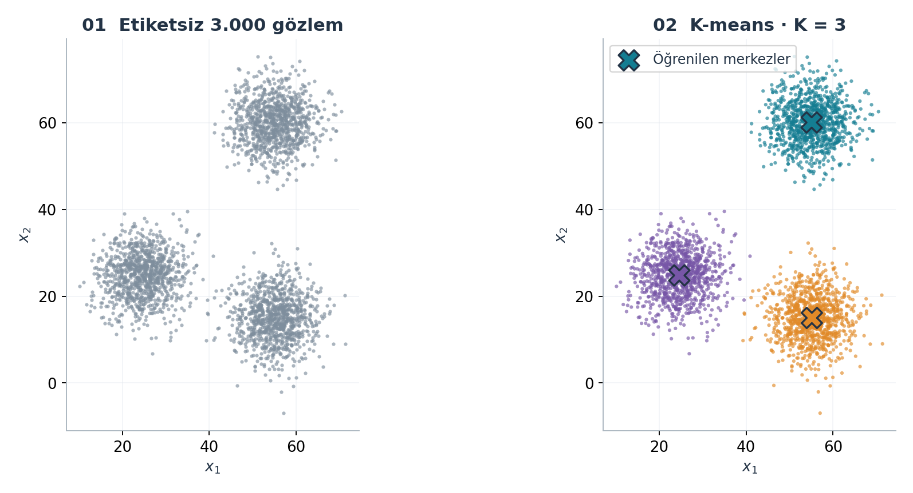

*Sol: algoritmanın gördüğü 3.000 etiketsiz nokta. Sağ: K = 3 ile K-means üç bulutu ayırıyor; çarpılar öğrenilen merkezler.*

### Amaç fonksiyonu: K-means neyi küçültüyor?

$`n`$ gözlem ve $`d`$ öznitelikten oluşan $`X`$ verisini $`K`$ gruba ($`C_1, \dots, C_K`$) bölmek istiyoruz. Her grubun bir merkezi ($`\mu_k`$) var. K-means'in küçültmeye çalıştığı değer **küme içi kareler toplamı**, yani **WCSS** (*Within-Cluster Sum of Squares*):

```math
J(c, \mu) = \sum_{k=1}^{K} \sum_{i \in C_k} \|x_i - \mu_k\|_2^2
```

İki boyutta bir noktanın kendi merkezine uzaklığının karesi bildiğimiz Pisagor:

```math
\|x_i - \mu_k\|_2^2 = (x_{i1} - \mu_{k1})^2 + (x_{i2} - \mu_{k2})^2
```

Burada karesini aldığımız için merkezden iki kat uzakta duran bir nokta maliyete dört kat fazla yük bindirir. scikit-learn'de eğitim bitince bu değer `model.inertia_` içinde saklanır.

### Lloyd algoritması: iki basit adımı sırayla döndürmek

Hem noktaların hangi kümeye gireceğini hem de merkezlerin tam yerini aynı anda çözmek zor. Ama birini sabitleyince diğeri çocuk oyuncağı oluyor:

1. **Başlat:** $`K`$ değerini seç ve $`K`$ tane başlangıç merkezi belirle.
2. **Atama (Assignment):** Merkezleri sabit tut, her noktayı en yakın merkeze gönder.
3. **Güncelleme (Update):** Atamaları sabit tut, her merkezi kendi kümesindeki noktaların ortalamasına taşı.
4. **Tekrarla:** Atamalar artık değişmeyene (ya da merkezler çok az kıpırdayana) kadar 2. ve 3. adımı döndür.

İki adımın matematiksel yazılışı şöyle:

```math
c_i = \underset{k}{\arg\min}\; \|x_i - \mu_k\|_2^2, \qquad \mu_k = \frac{1}{|C_k|} \sum_{i \in C_k} x_i
```

Not: En yakın merkezi bulurken karekök almaya gerek yok; uzaklığı küçük olanın karesi de küçüktür. Ayrıca bir merkez verideki gerçek bir nokta olmak zorunda değil — o kümenin ağırlık merkezidir.

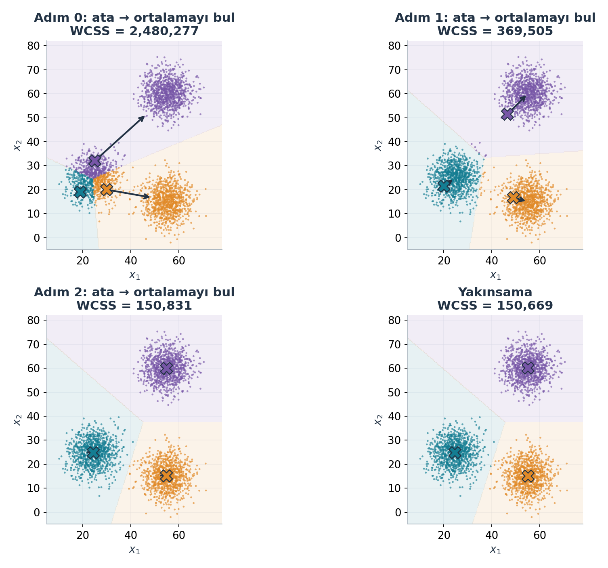

*Kötü seçilmiş başlangıç merkezlerinden Lloyd döngüsünün adımları. Oklar merkezlerin her adımda küme ortalamasına nasıl kaydığını gösteriyor.*

Yukarıdaki kasıtlı kötü başlangıçta WCSS sadece birkaç adımda **2.480.277 → 369.505 → 150.831 → 150.670 → 150.669** şeklinde çakılıp oturuyor.

<details>
<summary><strong>Merkez neden tam olarak aritmetik ortalama oluyor?</strong></summary>

Kümenin üyeleri sabitken, maliyetin aday merkez $`\mu`$ değişkenine göre türevini alıp sıfıra eşitleyelim:

```math
J_k(\mu) = \sum_{i \in C_k} \|x_i - \mu\|_2^2, \qquad \nabla_\mu J_k = 2|C_k|\mu - 2\sum_{i \in C_k} x_i = 0
```

Buradan doğrudan $`\mu = \frac{1}{|C_k|}\sum_{i \in C_k} x_i`$ çıkar. K-means'teki "means" (ortalamalar) kelimesi tam olarak kareli hata kullandığımız için buradan geliyor. Kare yerine mutlak fark ($`L_1`$) kullansaydık ortalama değil medyan çıkardı (K-medians).

</details>

### Elle küçük bir tur

Dört noktamız olsun: $`A=(1,1)`$, $`B=(1,3)`$, $`C=(5,5)`$, $`D=(7,5)`$. İki başlangıç merkezini $`\mu_1=(1,1)`$ ve $`\mu_2=(7,5)`$ seçelim:

| Nokta | $`\mu_1`$'e uzaklık² | $`\mu_2`$'ye uzaklık² | Atanan küme |
| --- | --- | --- | --- |
| A (1, 1) | 0 | 52 | 1 |
| B (1, 3) | 4 | 40 | 1 |
| C (5, 5) | 32 | 4 | 2 |
| D (7, 5) | 52 | 0 | 2 |

Başlangıç WCSS değeri $`0 + 4 + 4 + 0 = 8`$. Şimdi merkezleri güncelle:

```math
\mu_1 = \frac{(1,1)+(1,3)}{2} = (1, 2), \qquad \mu_2 = \frac{(5,5)+(7,5)}{2} = (6, 5)
```

Yeni merkezlerle her noktanın merkeze uzaklığının karesi $`1`$ oluyor; yani WCSS **8'den 4'e** düştü. Bir sonraki turda atamalar değişmeyeceği için algoritma duruyor.

### Başlangıç noktaları neden önemli? (K-means++)

Atama adımı da güncelleme adımı da WCSS'yi hiçbir zaman artıramaz, hep aşağı çeker veya sabit bırakır. Yani algoritma mutlaka bir yerde durur. Ama durduğu yer her zaman **en iyi çözüm (global minimum)** değildir — şanssız başlangıç merkezleri algoritmayı kötü bir yerel minimuma kilitleyebilir.

Bunu önlemek için iki şey yapıyoruz:
- **K-means++:** İlk merkezi rastgele seçer, sonraki her merkezi mevcut merkezlere uzak olan noktalardan seçme olasılığını artırarak başlangıçları veriye yayar.
- **Çoklu başlatma (`n_init=20`):** Algoritmayı farklı başlangıçlarla 20 kez çalıştırıp WCSS'si en düşük olan sonucu saklar.

### K nasıl seçilir? Dirsek (Elbow) ve Silhouette

WCSS'ye bakıp "en küçük olduğu $`K`$'yi alalım" diyemezsin. Çünkü $`K`$ arttıkça WCSS zaten hep düşer — her noktaya kendi merkezini verirsen ($`K = n`$) WCSS tam sıfır olur ama ortada gruplama diye bir şey kalmaz.

Bunun yerine iki yönteme birlikte bakmak çok işe yarar:

1. **Dirsek yöntemi (Elbow):** $`K`$ artarken WCSS'nin dik düşüşü bırakıp yataylaşmaya başladığı kırılma ("dirsek") noktasını ararız.
2. **Silhouette skoru:** Her $`i`$ noktası için kendi kümesindeki diğer noktalara ortalama uzaklığa $`a(i)`$, en yakın *diğer* kümenin noktalarına ortalama uzaklığa $`b(i)`$ diyelim:

```math
s(i) = \frac{b(i) - a(i)}{\max\{a(i),\; b(i)\}}, \qquad -1 \le s(i) \le 1
```

Skor $`+1`$'e ne kadar yakınsa nokta kendi grubuna o kadar sıkı oturmuş ve komşu gruptan o kadar uzaktır. $`0`$ civarı sınırdaki kararsız noktaları, negatif değer ise muhtemelen yanlış kümeye düştüğünü gösterir.

| K | WCSS (yuvarlanmış) | Ortalama Silhouette |
| --- | --- | --- |
| 1 | 1.893.615 | — |
| 2 | 663.481 | 0.629 |
| **3** | **150.669** | **0.744** |
| 4 | 133.699 | 0.598 |
| 5 | 116.800 | 0.465 |

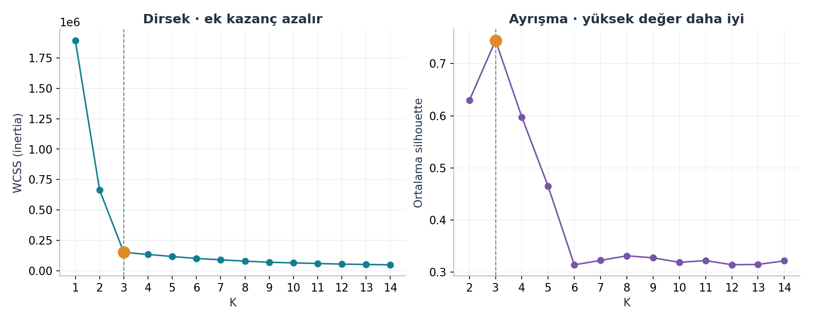

*Sol: WCSS, K = 3'e kadar sert düşüyor, sonra neredeyse düzleşiyor. Sağ: Silhouette skoru da açık ara K = 3'te zirve yapıyor.*

### K-means nerede zorlanır?

- **Ölçek farkı:** KNN'de olduğu gibi K-means de Öklid uzaklığı kullanır. Bir sütunu 10'la çarpmak uzaklık karesine etkisini 100 kat büyütür. Yaş ve maaş gibi farklı birimlerde mutlaka önce `StandardScaler` uygula.
- **Küresel olmayan şekiller:** K-means uzayı düz çizgilerle (Voronoi bölgeleriyle) böler. Hilal şeklindeki ya da iç içe geçmiş gruplarda $`K`$'yi doğru versen bile grupları ortadan ikiye keser.
- **Aykırı değerler:** Kare aldığımız için tek bir uç nokta küme ortalamasını kendine doğru çeker.

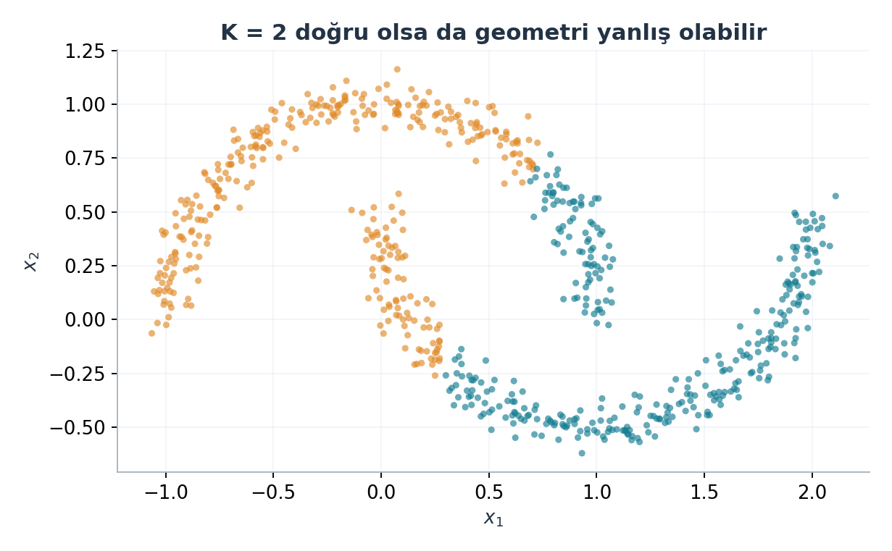

*İki hilal verisinde K-means. K = 2 doğru olsa bile en yakın merkez mantığı kıvrımlı yapıyı takip edemez.*

### Python uygulaması

```python
import numpy as np
from sklearn.cluster import KMeans
from sklearn.metrics import silhouette_score

rng = np.random.default_rng(42)
X = np.vstack([
    rng.normal(loc=mean, scale=5, size=(1000, 2))
    for mean in [(25, 25), (55, 60), (55, 15)]
])

for k in range(2, 6):
    km = KMeans(n_clusters=k, init="k-means++", n_init=20, random_state=42).fit(X)
    sil = silhouette_score(X, km.labels_, sample_size=1500, random_state=42)
    print(f"K={k}  WCSS={km.inertia_:,.0f}  silhouette={sil:.3f}")

# En iyi model: K = 3
model = KMeans(n_clusters=3, init="k-means++", n_init=20, random_state=42).fit(X)
print("Merkezler:\n", np.round(model.cluster_centers_, 2))
# [[24.63, 24.81], [55.07, 60.09], [55.12, 15.01]]
```

> [!TIP]
> **Küçük ama önemli bir uyarı:** K-means'in verdiği `0, 1, 2` sayıları sadece rastgele kimlik numaralarıdır; sıralı değil, olasılık değil. Ve modeli tekrar eğitirken bulduğun `cluster` sütununu yanlışlıkla girdi verisinin (`X`) içine katma!

---

## 9. Hiyerarşik Kümeleme (Hierarchical Clustering)

**Çalıştırılmış notebook:** [Hiyerarşik kümeleme](9%29%20Hierarchical%20Clustering/Hierarchical%20Clustering.ipynb)

K-means bize seçtiğimiz tek bir $`K`$ için tek bir bölme verir. **Hiyerarşik kümeleme** ise grupların adım adım nasıl birleştiğinin bütün soy ağacını çıkarır. Böylece önce ağaca bakıp sonra nereden keseceğine karar verebilirsin.

İki yönü vardır:
- **Birleştirici (Agglomerative — aşağıdan yukarı):** Her noktayı tek başına bir küme sayarak başlar, en yakın iki kümeyi birleştire birleştire tek bir köke kadar çıkar. Pratikte en çok kullanılan budur.
- **Bölücü (Divisive — yukarıdan aşağı):** Hepsini tek küme sayıp aşağı doğru böler.

Birleştirici algoritmanın mantığı çok sade:
1. $`n`$ noktayı $`n`$ ayrı küme olarak başlat.
2. Seçtiğin **bağlantı kuralına (linkage)** göre birbirine en yakın iki kümeyi bul.
3. Bu ikisini birleştir ve uzaklık tablosunu güncelle.
4. Tek bir büyük küme kalana kadar devam et.

Birleştirme kararları açgözlüdür (*greedy*): bir kez birleşen iki nokta bir daha ayrılmaz.

### İki küme arasındaki uzaklık nasıl ölçülür? (Linkage)

İki nokta arasındaki uzaklık basit (Öklid). Peki içinde birden fazla nokta olan $`A`$ ve $`B`$ kümelerinin birbirine ne kadar yakın olduğuna nasıl karar vereceğiz? Bunun beş yaygın yolu var:

| Linkage | Formül | Ne yapar? |
| --- | --- | --- |
| **Single (tek)** | $`\min_{x\in A,\, y\in B} d(x,y)`$ | En yakın iki uç noktaya bakar; uzun zincirler oluşturabilir (*chaining*) |
| **Complete (tam)** | $`\max_{x\in A,\, y\in B} d(x,y)`$ | En uzak iki uç noktaya bakar; sıkı, kompakt kümeleri sever |
| **Average (ortalama)** | $`\frac{1}{n_A n_B}\sum_{x\in A}\sum_{y\in B} d(x,y)`$ | Tüm ikili uzaklıkların ortalamasını alır |
| **Centroid (merkez)** | $`\|\mu_A - \mu_B\|_2`$ | İki kümenin ortalamaları arasındaki uzaklığa bakar |
| **Ward** | $`\frac{n_A n_B}{n_A + n_B}\|\mu_A - \mu_B\|_2^2`$ | Birleşme olursa toplam küme içi kare hatanın ($`\Delta\text{SSE}`$) ne kadar artacağına bakar |

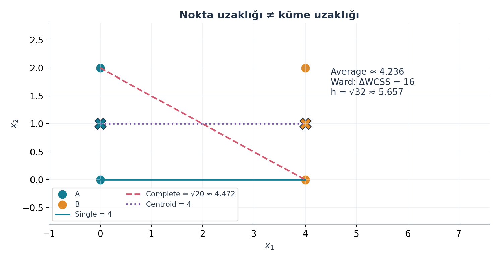

*İkişer noktalı iki kümede linkage seçimi ölçülen değeri değiştiriyor. Average ile Centroid aynı şey değil; Ward ise doğrudan hata artışını ölçüyor.*

Yukarıdaki küçük örnekte $`A=\{(0,0),(0,2)\}`$ ve $`B=\{(4,0),(4,2)\}`$ için dört çapraz uzaklık $`4,\; \sqrt{20},\; \sqrt{20},\; 4`$:
- **Single** = $`4`$, **Complete** = $`\sqrt{20} \approx 4.472`$
- **Average** = $`(8 + 2\sqrt{20})/4 \approx 4.236`$
- **Centroid** = $`(0,1)`$ ile $`(4,1)`$ arası = $`4`$
- **Ward** ($`\Delta\text{SSE}`$) = $`\frac{2\cdot 2}{2+2} \cdot 4^2 = 16`$

<details>
<summary><strong>Daha derin: Ward formülünde küme boyutları nereden geliyor?</strong></summary>

Her kümenin iç hata karesi $`SSE(C) = \sum_{x \in C} \|x - \mu_C\|^2`$ olsun. $`A`$ ve $`B`$ birleşince yeni ağırlıklı ortalama $`\mu_{A\cup B} = \frac{n_A\mu_A + n_B\mu_B}{n_A + n_B}`$ olur. $`x - \mu_{A\cup B} = (x - \mu_A) + (\mu_A - \mu_{A\cup B})`$ açılımını yapıp kareleri topladığımızda çapraz terimler sıfırlanır (çünkü $`\sum_{x\in A}(x-\mu_A)=0`$) ve elimizde şu kalır:

```math
\Delta SSE(A, B) = SSE(A \cup B) - SSE(A) - SSE(B) = \frac{n_A n_B}{n_A + n_B}\,\|\mu_A - \mu_B\|_2^2
```

Yani Ward, K-means ile aynı kare hata fikrini kullanır ama her adımda toplam hatayı en az artıran birleşmeyi seçer. SciPy'nin dendrogramda çizdiği Ward yüksekliği ise $`h(A, B) = \sqrt{2\,\Delta SSE(A, B)}`$ değeridir.

</details>

### Dendrogram okumak

Beş nokta alalım: $`1=(1,1),\; 2=(1,2),\; 3=(6,6),\; 4=(6,6.5),\; 5=(2,1.5)`$. Single linkage ile birleşmeler sırayla şöyle gider:

| Adım | Birleşen kümeler | Birleşme yüksekliği | Kalan küme sayısı |
| --- | --- | --- | --- |
| 1 | $`\{3\}`$ ile $`\{4\}`$ | $`0.500`$ | 4 |
| 2 | $`\{1\}`$ ile $`\{2\}`$ | $`1.000`$ | 3 |
| 3 | $`\{1, 2\}`$ ile $`\{5\}`$ | $`\sqrt{1.25} \approx 1.118`$ | 2 |
| 4 | $`\{1, 2, 5\}`$ ile $`\{3, 4\}`$ | $`\sqrt{36.25} \approx 6.021`$ | 1 |

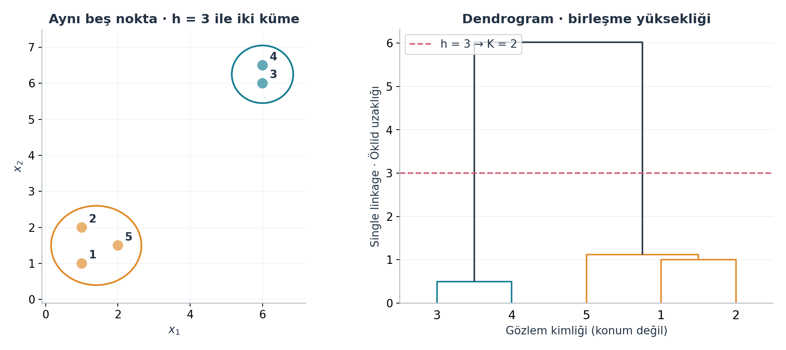

*Sol: iki gruba ayrılan beş nokta. Sağ: single-linkage dendrogramı. Yükseklik = 3 çizgisinden yatay kesince iki dikey dal kesilir → {1,2,5} ve {3,4}.*

Dendrogram okurken iki şeye dikkat et:
- **Dikey yükseklik** iki kümenin hangi uzaklıkta birleştiğini gösterir. **Yatay sıra** ise sadece çizim düzenidir — dallar sağa sola çevrilse de kümeleme değişmez.
- İki birleşme seviyesi arasındaki uzun dikey boşluk, "buradan kesebilirsin" diyen güçlü bir adaydır. Yukarıda $`1.12`$ ile $`6.02`$ arasındaki dev sıçrama açıkça 2 kümeyi işaret ediyor.

Aynı 3.000 noktalık sentetik veride Ward dendrogramına bakalım:

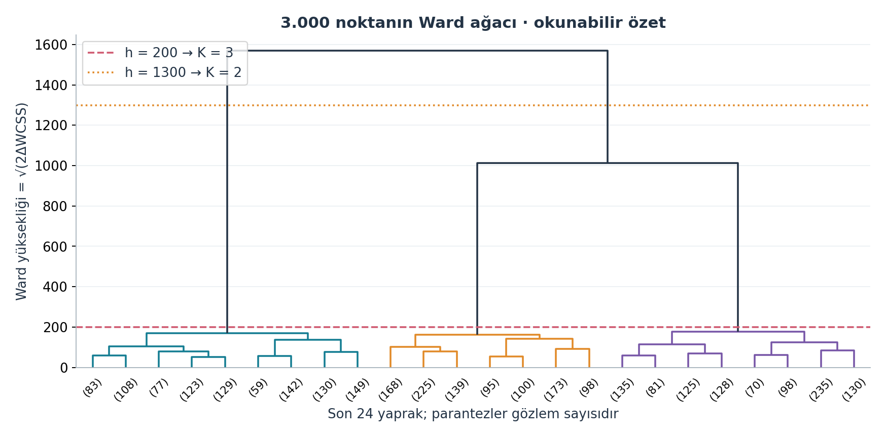

*3.000 noktanın Ward dendrogramı (okunabilmesi için 24 yaprağa özetlenmiş). İç birleşmeler 177'de bitiyor; son iki birleşme 1.013 ve 1.569'da. h = 200 kesimi tam 3 grup (998, 1.000, 1.002 nokta) veriyor.*

### K-means mi, Hiyerarşik kümeleme mi?

| Özellik | K-Means | Hiyerarşik Kümeleme |
| --- | --- | --- |
| K önceden seçilir mi? | Evet | Hayır — ağacı çizip sonra kesebilirsin |
| Çıktı | Tek bölme ve $`K`$ merkez | İç içe grupları gösteren tam ağaç |
| Yeni noktaya tahmin (`predict`) | Var (en yakın merkez) | Yerleşik `predict` yok |
| Hız ve bellek | Çok hızlı, $`O(nKdT)`$ | Pahalı, $`O(n^2)`$ bellek (100 bin noktada ~40 GB uzaklık matrisi!) |
| Ölçekleme gerekir mi? | Evet | Evet |

Kısacası küçük/orta veri setlerinde yapıyı keşfetmek için hiyerarşik kümeleme harikadır; büyük veri setlerinde K-means çok daha pratiktir.

### Python uygulaması

```python
from scipy.cluster.hierarchy import linkage, dendrogram, fcluster
from sklearn.cluster import AgglomerativeClustering
import matplotlib.pyplot as plt

# X, 8. bölümdeki 3.000 noktalık etiketsiz veri
Z = linkage(X, method="ward", metric="euclidean")

plt.figure(figsize=(10, 4))
dendrogram(Z, truncate_mode="lastp", p=24, show_leaf_counts=True, color_threshold=200)
plt.axhline(200, color="black", linestyle="--")
plt.ylabel("Ward yüksekliği = sqrt(2 * delta_SSE)")
plt.show()

# Ağacı 200 yüksekliğinden kes (SciPy) ya da doğrudan K=3 iste (sklearn)
labels_scipy = fcluster(Z, t=200, criterion="distance")
labels_sklearn = AgglomerativeClustering(n_clusters=3, linkage="ward").fit_predict(X)
```

---

## 10. Doğal Dil İşleme (NLP) ve Metin Sınıflandırma

**Çalıştırılmış notebook:** [NLP: duygu sınıflandırma](10%29%20Natural%20Language%20Processing/NLP%20Sentiment%20Classification.ipynb)

Bilgisayarlar kelimelerden anlamaz, sadece sayılardan anlar. **Doğal Dil İşleme (NLP)** dediğimiz alan, insan dilini modellerin işleyebileceği sayısal temsillere çevirip üzerinde sınıflandırma, duygu analizi, arama, özetleme gibi işler yapmaktır.

Klasik metin sınıflandırmanın omurgası üç adımdan oluşur: **metni hazırla → sayısal vektöre çevir → sınıflandırıcı eğit.**

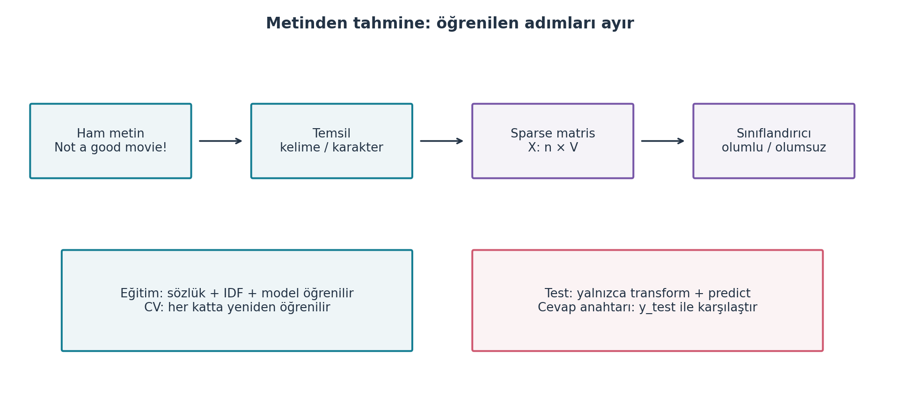

*Temiz bir metin sınıflandırma hattı. Sözlük, IDF ağırlıkları ve model sadece eğitim verisinden öğrenilir; test metinleri yalnızca bu öğrenilen dönüşümlerden geçer.*

### 1. Metni hazırlamak: temizleme, tokenization, stopwords, lemmatization

- **Normalleştirme:** Büyük/küçük harf tutarlılığı, fazla boşlukları temizleme. Noktalamayı rastgele silerken dikkatli ol: `shouldn't` kelimesindeki kesme işaretini tokenization'dan önce silersen `shouldn t` diye anlamsız bir şeye döner.
- **Tokenization:** Metni parçalara (kelimelere veya alt-kelimelere) ayırma. Örneğin `"not good movie"` → `["not", "good", "movie"]`.
- **Stopwords:** `"the"`, `"and"`, `"ve"`, `"bir"` gibi çok sık geçen kelimeler. Her zaman hepsini silmek doğru değildir! Özellikle duygu analizinde **`"not"`** kelimesini silersen `"not good"` bir anda `"good"` olur ve anlam tamamen tersine döner.
- **Stemming vs. Lemmatization:**
  - *Stemming* ekleri kaba kurallarla keser (`studies` → `studi`). Hızlıdır ama gerçek kelime çıkmayabilir.
  - *Lemmatization* kelimenin sözlük kökünü bulur (`loved` fiil olarak → `love`). Not: NLTK'nin `WordNetLemmatizer`'ı sadece İngilizce içindir ve fiil/isim bilgisi vermezsen kelimeleri varsayılan olarak isim sanar; Türkçe gibi sondan eklemeli diller için uygun değildir.

### 2. Bag of Words (Kelime Çantası)

Eğitim verisindeki tüm benzersiz kelimelerden $`V`$ boyutlu bir sözlük çıkarırız. Sonra $`n`$ belgenin her birini, o kelimenin belgede kaç kez geçtiğini sayan bir satır olarak yazarız ($`X \in \mathbb{R}^{n \times V}`$).

Sözlüğümüz `[acting, good, movie, not]` olsun ve üç kısa yorumumuz bulunsun:

| Belge | acting | good | movie | not |
| --- | --- | --- | --- | --- |
| D1: `good movie` | 0 | 1 | 1 | 0 |
| D2: `not good movie` | 0 | 1 | 1 | 1 |
| D3: `good acting good` | 1 | 2 | 0 | 0 |

Tek tek kelimelere (**unigram**) bakmak kelime sırasını kaybeder (`"köpek adamı ısırdı"` ile `"adam köpeği ısırdı"` aynı vektör olur). Yan yana ikililer (**bigram**, ör. `not good`) eklemek bu sorunu kısmen çözer. Kısa karakter dizileri (**char n-gram**, ör. 3–5 harflik parçalar) ise yazım hatalarına ve eklere karşı modeli dayanıklı yapar.

### 3. Sparse Matrisler: sıfırları boşuna bellekte tutma

Binlerce kelimelik bir sözlükte tek bir yorum en fazla 15–20 kelime içerir; yani tablonun **%99'undan fazlası sıfırdır**. Çoğu elemanı sıfır olan matrise **sparse (seyrek) matris** denir.

Sıfırları tek tek RAM'de tutmak yerine **CSR (Compressed Sparse Row)** formatı sadece sıfır olmayan değerleri üç küçük diziyle saklar:
- `data`: sıfır olmayan sayılar
- `indices`: her sayının hangi sütunda olduğu
- `indptr`: her satırın `data` içinde nerede başlayıp nerede bittiği

![Üç belgeli matrisin CSR gösterimi. İkinci belge (D2), sıfırları hiç saklamadan sadece data[2:5] ve karşılık gelen sütun indeksleriyle geri kurulur.](images/clf_28_csr_storage_tr.png)

*Üç belgeli matrisin CSR gösterimi. İkinci belge (D2), sıfırları hiç saklamadan sadece data[2:5] ve karşılık gelen sütun indeksleriyle geri kurulur.*

Bunun bellek kazancı devasa. Aşağıdaki 2.383 yorumluk duygu analizi verisinde kelime TF-IDF matrisi **2.383 × 4.457** boyutunda ve sadece 32.613 hücresi sıfır değil (yoğunluk **%0.31**). Normal yoğun matris (`float64`) **85.0 MB** yer tutarken CSR formatı sadece **0.40 MB** tutuyor — yani **212 kat daha az bellek**.

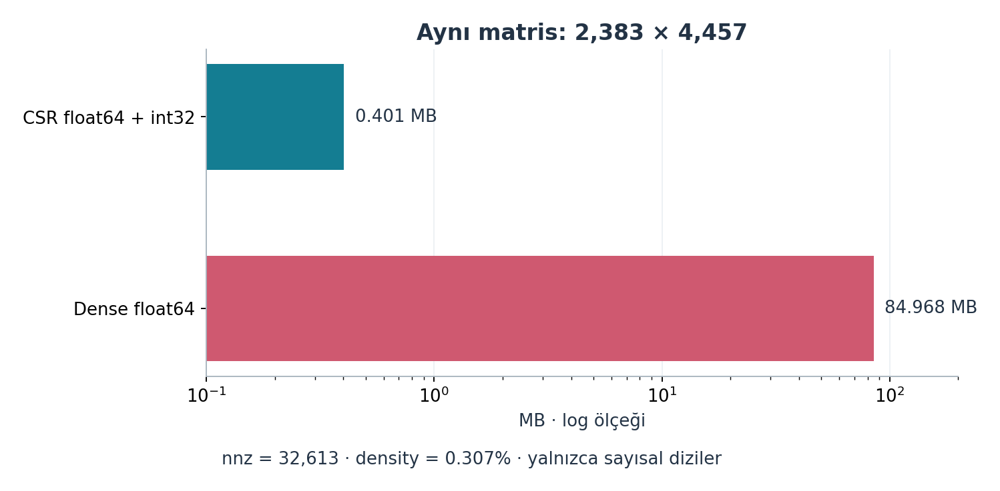

*Aynı eğitim matrisi yoğun biçimde 84.97 MB, CSR biçiminde 0.40 MB (yatay eksen logaritmik).*

> [!WARNING]
> **Gereksiz yere `.toarray()` çağırma.** scikit-learn'de `MultinomialNB`, `LogisticRegression` ve `LinearSVC` zaten sparse matrisi doğrudan alır. `.toarray()` sadece bütün o sıfırları RAM'e döküp bilgisayarını yavaşlatır (büyük veride belleği patlatır).

### 4. TF-IDF: sık geçen sıradan kelimelerin sesini kısmak

Ham sayımlarda her yorumda geçen `"movie"` veya `"good"` gibi kelimeler çok yüksek puan toplar. **TF-IDF** (*Term Frequency – Inverse Document Frequency*), bir kelimenin belgedeki sıklığını (TF), kaç belgede birden geçtiğinin tersiyle (IDF) çarpar. Her yerde geçen kelime baskılanır, ayırt edici kelime öne çıkar.

$`N`$ eğitim belgesi ve $`j`$ kelimesini içeren belge sayısı $`df_j`$ olmak üzere scikit-learn'ün yumuşatılmış formülü:

```math
\text{idf}_j = \log\frac{1 + N}{1 + df_j} + 1, \qquad u_{ij} = \text{tf}_{ij} \cdot \text{idf}_j, \qquad x_i = \frac{u_i}{\|u_i\|_2}
```

Yukarıdaki üç cümlede `good` 3/3 belgede var → $`\text{idf} = 1`$. `movie` 2/3 belgede → $`1 + \log(4/3) \approx 1.288`$. `acting` ve `not` 1/3 belgede → $`1 + \log(2) \approx 1.693`$. Yani D2 (`not good movie`) için ham ağırlıklar `[0, 1, 1.288, 1.693]`, L2 normuna bölünce **`[0, 0.425, 0.548, 0.720]`** oluyor. En nadir kelime olan `not` en yüksek ağırlığı aldı.

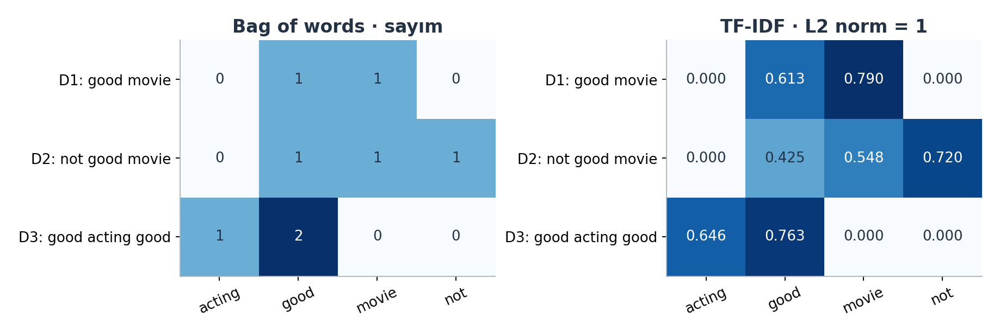

*Aynı üç belgenin ham sayım (sol) ve L2-normalleştirilmiş TF-IDF (sağ) temsilleri. Sıfırlar yerinde kalır, nadir kelimeler güçlenir.*

### 5. Metin için hangi modeller iyi çalışır?

- **Neden GaussianNB değil, MultinomialNB?** `GaussianNB` her özniteliğin çan eğrisine uyduğunu varsayar — çoğu sıfır olan kelime sayımlarına hiç uymaz. **Multinomial Naive Bayes** ise doğrudan kelime sayımları için tasarlanmıştır. $`N_{cj}`$, $`c`$ sınıfındaki eğitim belgelerinde $`j`$ kelimesinin toplam geçme sayısı ve $`\alpha > 0`$ (Laplace yumuşatması) olmak üzere:

```math
\theta_{cj} = \frac{N_{cj} + \alpha}{\sum_{v=1}^{V} N_{cv} + \alpha V}, \qquad \hat{c} = \underset{c}{\arg\max}\;\left[\log \pi_c + \sum_{j=1}^{V} x_j \log \theta_{cj}\right]
```

Yumuşatma ($`\alpha = 1`$), eğitimde hiç görülmemiş bir kelime testte çıkınca tüm olasılığı sıfırlamasın diye vardır. Örneğin `[good, bad, movie]` sözlüğünde olumlu toplamlar `[4, 1, 3]`, olumsuz toplamlar `[1, 4, 3]` ve iki sınıf eşit sıklıktaysa, `"good movie"` için payda $`8 + 3 = 11`$ olur: $`q_+ = \frac{1}{2}\cdot\frac{5}{11}\cdot\frac{4}{11} = \frac{10}{121}`$ ve $`q_- = \frac{1}{2}\cdot\frac{2}{11}\cdot\frac{4}{11} = \frac{4}{121}`$ → olumlu olasılığı $`10 / (10 + 4) \approx \mathbf{0.714}`$.

- **Lojistik Regresyon ve LinearSVC:** Yüksek boyutlu sparse TF-IDF vektörlerinde doğrusal modeller şaşırtıcı derecede güçlüdür. Lojistik regresyon her kelimeye bir ağırlık $`w_j`$ öğrenir: pozitif ağırlık olumlu sınıfa, negatif ağırlık olumsuz sınıfa iter; L2 düzenlileştirme nadir kelimelerin aşırı ağırlık almasını engeller.

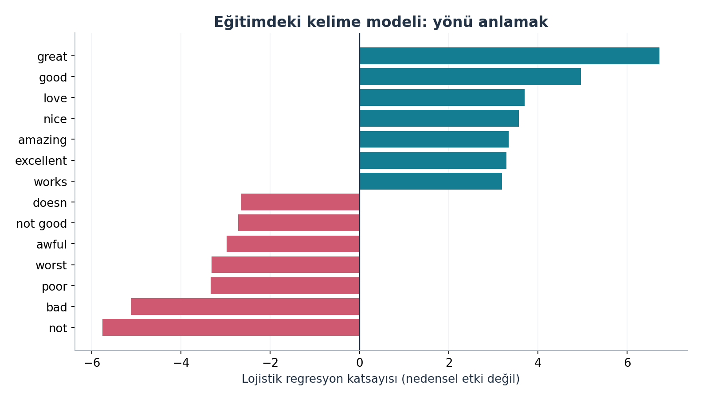

*Kelime TF-IDF + Lojistik Regresyon modelinin öğrendiği en güçlü olumlu (sağ) ve olumsuz (sol) kelime ağırlıkları.*

### Gerçek veri üzerinde karşılaştırma (UCI Duygu Analizi)

Amazon, IMDb ve Yelp'ten alınan 3.000 İngilizce yorum (21 tekrar satırı temizlenince 2.979 benzersiz yorum; 2.383 eğitim / 596 test) üzerinde 6 farklı hattı **sadece eğitim verisinde 5 katlı çapraz doğrulamayla** (her kat kendi sözlüğünü ve IDF'ini öğrenerek — veri sızıntısı olmadan!) karşılaştırdık:

| Pipeline | 5 katlı CV Doğruluk | 5 katlı CV Macro-F1 | Kat std |
| --- | --- | --- | --- |
| Çoğunluk sınıfı (`DummyClassifier`) | 0.501 | 0.334 | 0.000 |
| Sayım + `GaussianNB` (yoğun matris) | 0.669 | 0.658 | 0.018 |
| Unigram/bigram + `MultinomialNB` | 0.808 | 0.808 | 0.027 |
| Kelime TF-IDF + `LinearSVC` | 0.811 | 0.811 | 0.020 |
| Kelime TF-IDF + `LogisticRegression` | 0.813 | 0.813 | 0.032 |
| **Kelime + Karakter TF-IDF + `LogisticRegression`** | **0.838** | **0.838** | **0.019** |

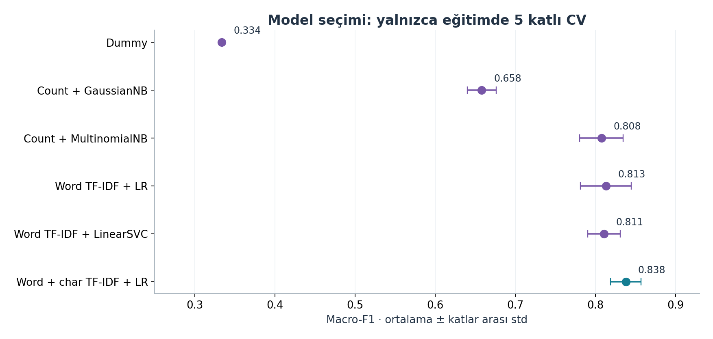

*Eğitim verisindeki 5 katlı CV karşılaştırması. GaussianNB geride kalıyor; kelime + karakter TF-IDF ile Lojistik Regresyon zirvede.*

Kazanan model ayrılmış 596 test yorumunda **%83.89 doğruluk** (macro-F1 = **0.839**) alıyor — 500 doğru, 96 yanlış:

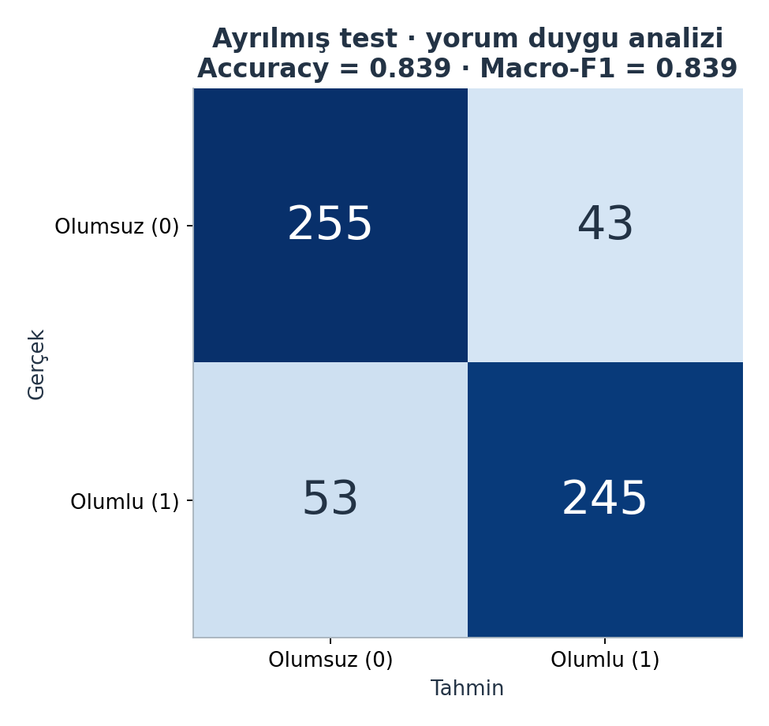

*Seçilen duygu analizi modelinin 596 test yorumu üzerindeki karmaşıklık matrisi (her sınıfta 298 yorum).*

### Python uygulaması

```python
from sklearn.feature_extraction.text import TfidfVectorizer
from sklearn.linear_model import LogisticRegression
from sklearn.metrics import accuracy_score, classification_report
from sklearn.model_selection import train_test_split
from sklearn.pipeline import FeatureUnion, Pipeline
from Classification.nlp_text_classification import load_sentiment

data, _ = load_sentiment()
X_train, X_test, y_train, y_test = train_test_split(
    data.text, data.label, test_size=0.2, random_state=42, stratify=data.label
)

features = FeatureUnion([
    ("word", TfidfVectorizer(ngram_range=(1, 2), min_df=2, max_features=15000, sublinear_tf=True)),
    ("char", TfidfVectorizer(analyzer="char_wb", ngram_range=(3, 5), min_df=2, max_features=15000, sublinear_tf=True)),
])

pipe = Pipeline([
    ("features", features),
    ("clf", LogisticRegression(C=3, max_iter=2000, random_state=42)),
])

pipe.fit(X_train, y_train)
y_pred = pipe.predict(X_test)
print("Test doğruluğu:", round(accuracy_score(y_test, y_pred), 4))  # 0.8389
print(classification_report(y_test, y_pred, target_names=["negative", "positive"]))
```

> [!NOTE]
> **Modern NLP'ye kısa köprü:** Bag of Words ve TF-IDF hâlâ şaşırtıcı derecede sağlam ve hızlı birer temel modeldir. Ama kelimenin bağlamını anlamazlar (`"film çok iyi değil"` veya ironi gibi durumlar). Daha karmaşık problemlerde yoğun vektörler (*embeddings*) ve önceden eğitilmiş dil modelleri (Transformer / BERT) bu boşluğu doldurur — yine aynı temiz bölme ve `Pipeline` disipliniyle.

---

## 11. PCA — Temel Bileşen Analizi (Principal Component Analysis)

Elimizde 10, 30 hatta 1.000 sütunlu (yüksek boyutlu) bir veri seti olduğunu düşün. Hem bunu 2 boyutta çizip gözle inceleyemiyoruz, hem de bir sürü sütun aslında birbirinin neredeyse kopyası (Wisconsin verisinde `radius_mean`, `perimeter_mean` ve `area_mean` hep aynı büyüklüğü ölçüyordu). **PCA (Principal Component Analysis)**, verideki bilgiyi olabildiğince koruyarak boyutu düşüren gözetimsiz bir yöntemdir.

Nerelerde sık kullanılır?
1. **Boyut indirgeme (Dimension Reduction):** 30 özniteliği 10 özniteliğe indirip modeli hızlandırmak ve gürültüyü azaltmak.
2. **Görselleştirme:** 4 boyutlu (Iris) veya 10 boyutlu veriyi 2 boyuta düşürüp ekrana çizmek.
3. **Öznitelik çıkarımı (Feature Extraction):** Birbiriyle korelasyonlu sütunları birbirine dik, bağımsız yeni eksenlere dönüştürmek (ör. finans/borsa faktör analizi, gen ifade verileri).

### Sezgi: varyansın en büyük olduğu yönü bul

2 boyutlu bir nokta bulutunu 1 boyuta (tek bir doğru üzerine) indirmek istediğini düşün. Doğruyu hangi açıyla koyarsan en az bilgi kaybedersin?

Cevap: **Noktaların en geniş yayıldığı (varyansın en büyük olduğu) yöne!** Noktaları bu doğrunun üstüne dik indirirsen hem noktalar birbirinden en iyi ayrılır hem de noktaların doğruya olan dik uzaklıklarının kareleri toplamı (bilgi kaybı) en küçük olur.

- Bu ilk eksene **birinci temel bileşen** ($`p_1`$, PC1) denir.
- İkinci temel bileşen ($`p_2`$, PC2), $`p_1`$'e **tam dik** ($`p_1^\top p_2 = 0`$) olup geriye kalan varyansın en büyüğünü yakalar.
- $`d`$ boyutlu veride bu şekilde birbirine dik $`d`$ eksen bulunur; sonra en çok varyans taşıyan ilk $`k`$ tanesini tutup gerisini atarız.

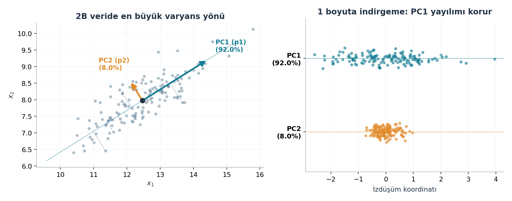

*Sol: 2B veride PC1 en büyük yayılım yönünü (%92.0), ona dik olan PC2 geriye kalan küçük kalınlığı (%8.0) yakalar. Sağ: 1 boyuta indirgendiğinde PC1 neredeyse tüm yapıyı korur.*

### Arkasındaki matematik (adım adım)

1. **Veriyi merkezle (ve ölçekle):** Her sütunun ortalamasını sıfıra çek ($`\tilde{X} = X - \mu`$). Birimler farklıysa standart sapmaya da böl (`StandardScaler`).
2. **Kovaryans matrisini kur:** Özniteliklerin birbirleriyle nasıl birlikte değiştiğini özetleyen $`d \times d`$ simetrik matris:

```math
\Sigma = \frac{1}{n - 1}\,\tilde{X}^\top \tilde{X}
```

3. **Varyansı en büyük yapan birim vektörü bul:** Birim uzunlukta ($`\|v\|_2 = 1`$) bir $`v`$ yönüne izdüşüm $`\tilde{X}v`$ olur. Bu izdüşümün varyansı $`v^\top \Sigma v`$ değeridir. Kısıtlı eniyileme (Lagrange çarpanı $`\lambda`$) kurarsak:

```math
\mathcal{L}(v, \lambda) = v^\top \Sigma v - \lambda(v^\top v - 1) \quad \Longrightarrow \quad \nabla_v \mathcal{L} = 2\Sigma v - 2\lambda v = 0 \quad \Longrightarrow \quad \Sigma v = \lambda v
```

Bu tam olarak **özdeğer / özvektör (eigenvalue / eigenvector)** denklemidir!
- Her **özvektör** $`v_k`$ bir temel bileşen yönüdür.
- Karşılık gelen **özdeğer** $`\lambda_k`$, verinin o yöndeki varyansıdır.
- $`k`$. bileşenin açıkladığı varyans oranı (**explained variance ratio**):

```math
\text{Açıklanan varyans oranı}_k = \frac{\lambda_k}{\sum_{j=1}^{d} \lambda_j}
```

4. **İzdüşüm al:** Özdeğerleri büyükten küçüğe sırala ($`\lambda_1 \ge \lambda_2 \ge \dots \ge \lambda_d`$), ilk $`k`$ özvektörü $`V_k \in \mathbb{R}^{d \times k}`$ matrisinde yan yana koy ve veriyi yeni uzaya taşı:

```math
Z = \tilde{X} V_k \in \mathbb{R}^{n \times k}
```

<details>
<summary><strong>Daha derin: scikit-learn perde arkasında neden SVD kullanıyor?</strong></summary>

Kovaryans matrisi $`\tilde{X}^\top \tilde{X}`$'i açıkça çarpmak, özellikle öznitelik sayısı büyükse hem yavaş hem de sayısal hassasiyet kaybettiricidir. Bunun yerine merkezlenmiş matris doğrudan Tekil Değer Ayrıştırması (**SVD**) ile parçalanır: $`\tilde{X} = U S V^\top`$. Buradaki $`V`$ sütunları zaten kovaryans matrisinin özvektörleri, $`\lambda_k = S_k^2 / (n - 1)`$ ise özdeğerleridir. scikit-learn'ün `PCA` sınıfı tam olarak bunu yapar.

</details>

### Gerçek örnek: Iris veri setini 4 boyuttan 2 boyuta indirmek

Klasik Iris veri setinde 150 çiçek ve 4 ölçü var (çanak/taç yaprak eni ve boyu). 4 boyutu çizemeyiz ama standartlaştırıp 2 bileşene indirgersek:
- **PC1** tek başına toplam varyansın **%73.0**'ını,
- **PC2** ise **%22.9**'unu açıklıyor.
- Toplam **%95.8** bilgiyi koruyarak 4 boyuttan 2 boyuta inmiş oluyoruz! (Ölçeklemeden ham veride `PCA(n_components=2)` çalıştırsaydın PC1 %92.5 + PC2 %5.3 = %97.8 çıkardı; çünkü taç yaprak boyu diğerlerine göre çok daha geniş bir aralıkta.)

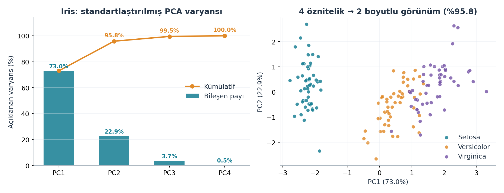

*Sol: Standartlaştırılmış Iris'te her bileşenin varyans payı ve kümülatif toplam. Sağ: 4 boyutlu çiçek verisinin 2B PCA görünümü — Setosa tamamen ayrılıyor.*

### Sık karıştırılan nokta: `StandardScaler` mı, `whiten=True` mu?

PCA kod örneklerinde sıkça `PCA(n_components=2, whiten=True)` satırının yanına *"whiten = normalize"* gibi notlar yazılır. **Bu ikisi aynı şey değildir!**

- **`StandardScaler` (PCA'dan ÖNCE):** Girdi sütunlarını aynı ölçeğe getirir. Bunu yapmazsan büyük birimli bir sütun (ör. 144–2.501 arası `area_mean`), küçük birimli sütunu (0.05–0.16 arası `smoothness_mean`) tamamen ezer ve PC1 tek başına **%100.0** varyans açıklıyormuş gibi görünür. Wisconsin verisinin 30 özniteliğinin tamamında da ham PCA'da PC1 tek başına %98.2 çıkarken, standartlaştırınca ilk 10 bileşen dengeli biçimde %95.2 varyans toplar.
- **`whiten=True` (PCA'dan SONRA):** Bulunan bileşenleri kendi standart sapmasına ($`\sqrt{\lambda_k}`$) böler. Böylece çıktıdaki PC1'in de PC2'nin de varyansı tam **1.0** olur — yani elips şeklindeki bulutu daireye çevirir. Bazı algoritmalar (ör. doğrusal modeller, sinir ağları) bundan fayda görebilir ama ham verideki ölçek dengesizliğini düzeltmez!

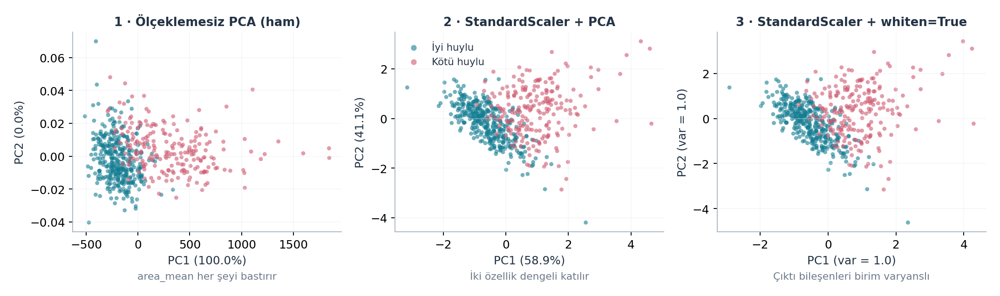

*Wisconsin verisinde area_mean ve smoothness_mean. Sol: ölçeklemesiz PCA tamamen area_mean eksenine kilitleniyor. Orta: StandardScaler sonrası iki özellik dengeli. Sağ: whiten=True çıktı varyanslarını 1'e eşitliyor.*

### Python uygulaması

```python
from sklearn.datasets import load_iris
from sklearn.decomposition import PCA
from sklearn.preprocessing import StandardScaler
from sklearn.pipeline import make_pipeline

iris = load_iris()
X, y = iris.data, iris.target

# Doğru pratik: önce StandardScaler, sonra PCA (eğitim/test ayrımı varsa Pipeline şart!)
pca_pipe = make_pipeline(StandardScaler(), PCA(n_components=2))
X_2d = pca_pipe.fit_transform(X)

pca = pca_pipe.named_steps["pca"]
print("Açıklanan varyans oranları:", pca.explained_variance_ratio_.round(4))  # [0.7296, 0.2285]
print("Toplam korunan varyans:    ", round(pca.explained_variance_ratio_.sum(), 4))  # 0.9581
```

> [!WARNING]
> **PCA kullanırken iki şeye dikkat:** (1) PCA etiketleri ($`y`$) hiç görmez; en yüksek varyanslı yön her zaman sınıfları en iyi ayıran yön olmayabilir. (2) Yeni bileşenler eski sütunların doğrusal birleşimidir, yani `"radius_mean > 15"` gibi doğrudan yorumlanamazlar. (3) Bir sınıflandırıcıdan önce PCA koyuyorsan `PCA`'yı da mutlaka `Pipeline` içinde sadece eğitim verisine fit et.

---

## 12. Model Seçimi: K-Katlı Çapraz Doğrulama ve Grid Search CV

Bir modeli eğitirken aslında iki farklı türde sayıyla uğraşırız:

| Tür | Kim belirler? | Örnekler |
| --- | --- | --- |
| **Öğrenilen parametreler** | Model `.fit()` sırasında veriden öğrenir | Lojistik regresyondaki $`w, b`$; karar ağacındaki bölme eşikleri |
| **Hiperparametreler** | Eğitim başlamadan **biz** seçeriz | KNN'deki $`K`$; SVM'deki `C` ve `gamma`; ağaçtaki `max_depth` |

Şimdi kritik soru şu: **En iyi hiperparametreyi (örneğin KNN için hangi $`K`$?) nasıl seçeceğiz?**

Eğer `K = 1, 2, ..., 15` deneyip **test setinde** en yüksek skoru vereni seçersen, test setini sessizce modelin tasarımına dahil etmiş olursun. Sınav sorularına önceden bakıp ona göre ezber yapmak gibi — test skorun gerçekte olduğundan yüksek görünür (*data leakage* / test setine aşırı öğrenme).

### K-Katlı Çapraz Doğrulama (K-Fold Cross-Validation)

Çözüm çok temiz:
1. Veriyi en başta **Eğitim (%80)** ve **Test (%20)** diye ayır. Test kutusunu kilitle; en sona kadar açma.
2. Eğitim verisini kendi içinde $`K`$ eşit parçaya (**kat / fold**) böl (genelde $`K = 5`$ veya $`K = 10`$).
3. Her turda katlardan birini **doğrulama (validation)**, kalan $`K - 1`$ katı **eğitim** olarak kullan ve bir skor elde et.
4. $`K`$ turun ortalamasını (ve standart sapmasını) al:

```math
\text{CV}_K = \frac{1}{K} \sum_{k=1}^{K} \text{skor}_k
```

Sınıflandırmada düz `KFold` yerine **`StratifiedKFold`** kullanmak çok daha iyidir; çünkü her katta sınıf oranlarını (ör. %62.7 iyi huylu / %37.3 kötü huylu) aynen korur.

Wisconsin Meme Kanseri eğitim verisinde (455 örnek) `StandardScaler + KNN (K = 7)` için 5 katlı CV sonuçları: **%96.7, %97.8, %96.7, %95.6, %97.8** → ortalama **%96.92 ± %0.82**. Hiç dokunulmamış 114 örneklik test setinde ise **%95.61**.

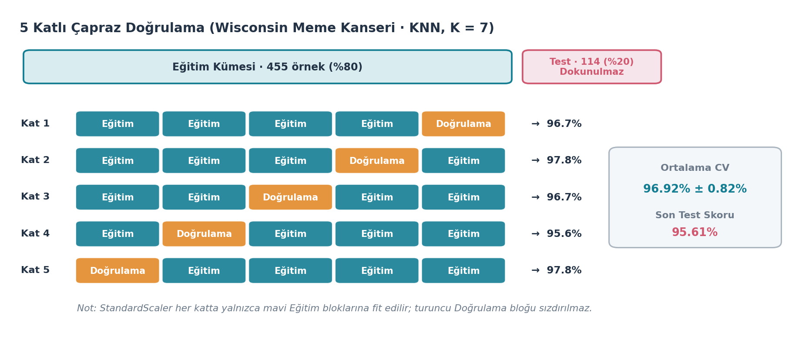

*5 katlı çapraz doğrulama akışı. Test kümesi kenarda dokunulmadan bekler; her katta farklı bir blok doğrulama olur ve 5 skorun ortalaması alınır.*

> [!WARNING]
> **Ölçekleyici sızıntısına dikkat!** `StandardScaler`'ı çapraz doğrulamadan *önce* tüm eğitim verisine uygularsan, turuncu doğrulama bloğunun ortalaması ve standart sapması mavi eğitim bloklarına sızmış olur. Ölçekleyiciyi ve modeli mutlaka `Pipeline` içine koy; böylece `cross_val_score` her katta ölçekleyiciyi sıfırdan sadece mavi bloklara fit eder.

### Grid Search CV: bütün kombinasyonları sistematik taramak

Tek bir hiperparametre değil de birden fazla hiperparametreyi (ör. KNN'de $`K`$ ve `weights`, ya da SVM'de `C` ve `gamma`) birlikte seçmek istediğimizde **Grid Search CV** devreye girer.

Mantığı adı gibi bir ızgara (grid):
- Her hiperparametre için denenecek aday değerleri bir listeye yazarsın.
- `GridSearchCV` bu listelerin **tüm olası kombinasyonlarını** (Kartezyen çarpımını) çıkarır.
- Her kombinasyon için tam bir $`K`$-katlı çapraz doğrulama çalıştırır.
- Ortalama doğrulama skoru en yüksek kombinasyonu seçer ve (varsayılan `refit=True` ile) o ayarlarla tüm eğitim verisinde son modeli otomatik eğitir.

Eğer $`M`$ farklı kombinasyon ve $`K`$ kat varsa, toplamda $`M \times K + 1`$ model eğitilir. Örneğin SVM'de 4 `C` değeri × 4 `gamma` değeri = 16 kombinasyon ve 5 kat → $`16 \times 5 + 1 = 81`$ eğitim.

Wisconsin verisinde iki gerçek deney:
- **KNN (`K = 1..15` × `weights = [uniform, distance]`):** En yüksek 5 katlı CV **%97.36** (`K = 3, uniform`). Dokunulmamış testte %93.86 — küçük bir test setinde (114 tümör) tek bir tümörlük değişim neredeyse %0.9 oynatır; o yüzden tek bir sayıya değil, eğrinin düz ve kararlı bölgesine bakmak iyidir.
- **SVM (`C ∈ {0.1, 1, 10, 100}` × `gamma ∈ {0.001, 0.01, 0.1, 1}`):** En yüksek 5 katlı CV **%97.58** (`C = 10, gamma = 0.01`). Dokunulmamış test setinde **%98.25**!

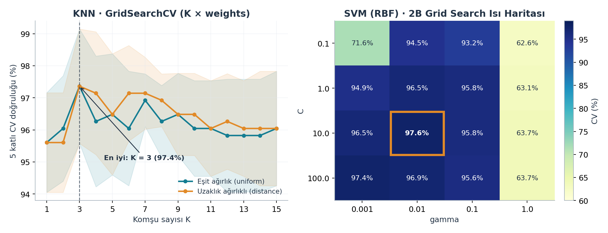

*Sol: KNN için K ve ağırlık seçeneklerinin 5 katlı CV eğrisi. Sağ: RBF SVM için C × gamma ızgarasının 5 katlı CV ısı haritası; turuncu çerçeve kazanan kombinasyonu gösteriyor.*

Izgara çok büyüdüğünde (ör. 5 hiperparametre × 10 aday = 100.000 kombinasyon) her hücreyi tek tek denemek imkânsızlaşır. O zaman **`RandomizedSearchCV`** kullanıp ızgaradan rastgele 50–100 nokta örneklemek çoğu zaman neredeyse aynı kaliteyi çok daha kısa sürede verir.

### Python uygulaması

```python
from sklearn.model_selection import GridSearchCV, StratifiedKFold, train_test_split
from sklearn.pipeline import Pipeline
from sklearn.preprocessing import StandardScaler
from sklearn.svm import SVC

X_train, X_test, y_train, y_test = train_test_split(
    X, y, test_size=0.2, random_state=42, stratify=y
)

pipe = Pipeline([
    ("scaler", StandardScaler()),
    ("svm", SVC(kernel="rbf")),
])

param_grid = {
    "svm__C": [0.1, 1, 10, 100],
    "svm__gamma": [0.001, 0.01, 0.1, 1],
}

cv = StratifiedKFold(n_splits=5, shuffle=True, random_state=42)
grid = GridSearchCV(pipe, param_grid=param_grid, cv=cv, scoring="accuracy")
grid.fit(X_train, y_train)

print("En iyi ayarlar:", grid.best_params_)          # {'svm__C': 10, 'svm__gamma': 0.01}
print("En iyi CV skoru:", round(grid.best_score_, 4)) # 0.9758
print("Test skoru:     ", round(grid.score(X_test, y_test), 4))  # 0.9825
```

---

## 13. Öneri Sistemleri (Recommendation Systems)

Netflix'in sıradaki diziyi, Spotify'ın haftalık çalma listesini, e-ticaret sitelerinin "bunu alanlar şunu da aldı" kutusunu çalıştıran şey **önceden etkileşimde bulunmadığın bir öğeyi ne kadar seveceğini tahmin etmek**.

Elimizde satırları kullanıcılar, sütunları ürünler/filmler olan dev bir **kullanıcı–öğe puan matrisi** $`R`$ var. Gerçek hayatta bu matrisin **%99'undan fazlası boştur** — kimse Netflix'teki 10.000 filmin hepsini izleyip puanlamıyor. Görevimiz o boşlukları akıllıca tahmin etmek.

### İki temel yaklaşım

| Yaklaşım | Temel fikir | Güçlü yanı | Zayıf yanı |
| --- | --- | --- | --- |
| **İçerik Tabanlı (Content-Based)** | *"Sevdiğin filmlere benzeyen başka filmler öner"* (tür, yönetmen, özet TF-IDF) | Başka kullanıcılara gerek yok; yeni eklenen filme hemen öneri çıkar | Hep aynı türde dönüp durur (*filtre balonu*); farklı zevk keşfedemez |
| **İşbirlikçi Filtreleme (Collaborative Filtering)** | *"Seninle aynı şeyleri seven insanlar bunu da çok sevmiş"* | Sadece puan matrisi yeter; beklenmedik ama isabetli öneriler bulur | Yeni kullanıcı veya hiç puan almamış yeni öğede zorlanır (*cold-start*) |

Büyük platformların neredeyse tamamı ikisini birleştiren **hibrit sistemler** kullanır.

### İşbirlikçi Filtreleme: benzerlik ve puan tahmini

İki yolu vardır:
- **Kullanıcı tabanlı (User-Based):** Sana en çok benzeyen $`k`$ kullanıcıyı bul, onların izlediği ama senin izlemediğin filmleri ağırlıklı ortalamayla puanla.
- **Öğe tabanlı (Item-Based):** *"Matrix'i sevenler Inception'ı da seviyor"* mantığıyla öğeler arası benzerliği hesapla. Pratikte sık tercih edilir; çünkü bir filmin kitlesi milyonlarca kullanıcının tek tek zevkine göre çok daha yavaş değişir.

İki kullanıcının (veya iki öğenin) puan vektörleri arasındaki benzerliği ölçmenin en yaygın yolu **kosinüs benzerliği (cosine similarity)**:

```math
\text{sim}(u, v) = \frac{u \cdot v}{\|u\|_2\,\|v\|_2} = \frac{\sum_i r_{u,i}\,r_{v,i}}{\sqrt{\sum_i r_{u,i}^2}\;\sqrt{\sum_i r_{v,i}^2}}
```

Araları açısal olarak ne kadar yakınsa kosinüs $`1`$'e o kadar yaklaşır. (Bazı kullanıcılar herkese 4–5 verirken bazıları cimridir ve en fazla 3 verir; bu puanlama cömertliği farkını temizlemek için puanlardan kullanıcının ortalamasını çıkarıp aynı formülü uygularsan **Pearson korelasyonu** elde edersin.)

En benzer $`k`$ komşuyu ($`N_k(u)`$) bulduktan sonra $`u`$ kullanıcısının $`i`$ öğesine vereceği tahmini puan, komşuların puanlarının benzerlikle ağırlıklandırılmış ortalamasıdır:

```math
\hat{r}_{u, i} = \frac{\sum_{v \in N_k(u)} \text{sim}(u, v)\, r_{v, i}}{\sum_{v \in N_k(u)} |\text{sim}(u, v)|}
```

### Elle küçük bir örnek

6 kullanıcı ve 6 filmimiz olsun (ilk üçü bilim kurgu, son üçü romantik/dram). **Ali** henüz *Interstellar*'ı izlememiş (`?`). Ona önerelim mi?

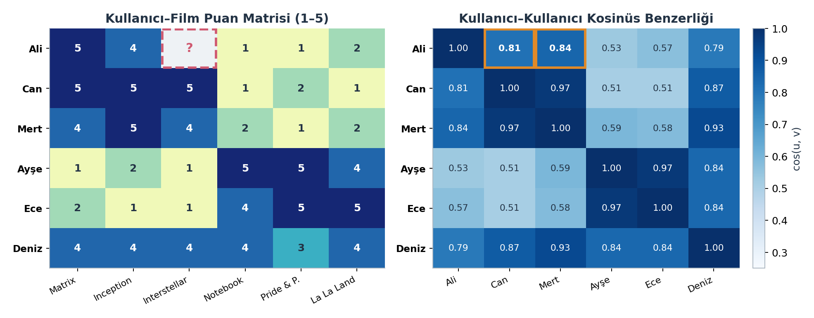

*Sol: 6×6 kullanıcı–film puan matrisi (Ali'nin Interstellar puanı eksik). Sağ: kosinüs benzerliği matrisi; Ali'ye en yakın iki komşu Mert (0.84) ve Can (0.81).*

Ali'nin vektörü `[5, 4, 0, 1, 1, 2]`. Bilim kurgu seven Mert (`0.844`, Interstellar'a **4** vermiş) ve Can (`0.810`, Interstellar'a **5** vermiş) en yakın iki komşusu. Formüle koyalım:

```math
\hat{r}_{\text{Ali, Interstellar}} = \frac{0.844 \times 4 + 0.810 \times 5}{0.844 + 0.810} = \frac{3.376 + 4.050}{1.654} \approx \mathbf{4.49}
```

5 üzerinden **4.49** — kesinlikle önerilir! Romantik film seven Ayşe ve Ece ile benzerliği düşük (0.53 ve 0.57) olduğu için onlar bu tahmine baskın gelmedi.

### Matris Ayrıştırma (Matrix Factorization / SVD): gizli zevk boyutları

Milyonlarca kullanıcı ve yüz binlerce film olduğunda herkesi herkesle karşılaştırmak hem çok yavaştır hem de iki kullanıcının ortak izlediği film sayısı çoğu zaman sıfırdır.

**Matris ayrıştırma** çok daha zarif bir fikirle gelir: belki de 10.000 filmin arkasında aslında sadece 20–50 tane **gizli zevk faktörü** (*latent factors*) vardır — mesela "bilim kurgu mu romantik mi", "hızlı aksiyon mu yavaş dram mı", "klasik mi modern mi" gibi. Model bu faktörlerin isimlerini bilmez; veriden kendi keşfeder!

$`m \times n`$ boyutlu büyük $`R`$ matrisini iki küçük matrisin çarpımı olarak yaklaşıklarız:

```math
R \approx U V^\top, \qquad U \in \mathbb{R}^{m \times k}, \quad V \in \mathbb{R}^{n \times k}
```

- $`u_u \in \mathbb{R}^k`$: $`u`$ kullanıcısının $`k`$ gizli faktördeki zevk profili.
- $`v_i \in \mathbb{R}^k`$: $`i`$ filminin aynı $`k`$ faktördeki içerik profili.
- Tahmin basit bir iç çarpım (artı kullanıcının ortalama puanı): $`\hat{r}_{u,i} = \mu_u + u_u^\top v_i`$.

Gerçek veride $`R`$'de boşluklar olduğu için öğrenme sadece **gözlemlenen puanlar** ($`\Omega`$) üzerinde, aşırı öğrenmeyi önleyen L2 düzenlileştirme ile yapılır:

```math
\min_{U, V} \sum_{(u, i) \in \Omega} \big(r_{u,i} - u_u^\top v_i\big)^2 + \lambda\Big(\sum_u \|u_u\|_2^2 + \sum_i \|v_i\|_2^2\Big)
```

Tam bir matriste bu ayrıştırmayı doğrudan **SVD** (*Singular Value Decomposition*) verir ($`R_{\text{merkezli}} = U S V^\top`$). 36 kullanıcı ve 12 filmlik sentetik bir veri setinde SVD'nin kendi kendine öğrendiği 2 boyutlu gizli uzaya bakalım:

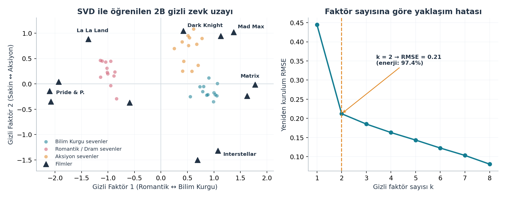

*Sol: SVD kullanıcıları ve filmleri aynı 2B zevk uzayına yerleştiriyor — aynı yöne bakan kullanıcı ve film yüksek iç çarpım (yüksek puan) üretir. Sağ: sadece k = 2 gizli faktör enerjinin %97.4'ünü yakalayıp RMSE'yi 0.21'e düşürüyor.*

### Pratikte karşılaşılan sorunlar ve ölçüm

- **Soğuk başlangıç (Cold-Start):** Platforma yeni kaydolan kullanıcının veya yeni eklenen filmin hiç puanı yoktur. Bu yüzden yeni kullanıcıya ilk ekranda "sevdiğin 3 türü seç" diye sorulur ve içerik tabanlı/popülerlik bazlı öneriyle başlanır.
- **Veri seyrekliği (Sparsity):** Puan matrisinin neredeyse tamamı boştur; bu yüzden düzenlileştirme ($`\lambda`$) ve örtük geri bildirimler (tıklama, izleme süresi, sepete ekleme) kritik rol oynar.
- **Nasıl ölçülür?**
  - Puan tahmini için **RMSE** / **MAE** (regresyon gibi).
  - Sıralama (ilk 10 öneri) için **Precision@K**, **Recall@K** ve sıranın önemini de katan **NDCG@K**.

### Python uygulaması

```python
import numpy as np

# 6 kullanıcı x 6 film puan matrisi (0 = henüz izlenmemiş)
R = np.array([
    [5, 4, 0, 1, 1, 2],  # Ali  (? = Interstellar)
    [5, 5, 5, 1, 2, 1],  # Can
    [4, 5, 4, 2, 1, 2],  # Mert
    [1, 2, 1, 5, 5, 4],  # Ayşe
    [2, 1, 1, 4, 5, 5],  # Ece
    [4, 4, 4, 4, 3, 4],  # Deniz
], dtype=float)

# 1) Kullanıcı-kullanıcı kosinüs benzerliği
norms = np.linalg.norm(R, axis=1, keepdims=True)
sim = (R @ R.T) / (norms @ norms.T)

# Ali (0) için Interstellar (2) puan tahmini — en benzer 2 komşu: Mert (2) ve Can (1)
rated_by = np.where(R[:, 2] > 0)[0]
top2 = rated_by[np.argsort(sim[0, rated_by])[-2:]]
pred = np.dot(sim[0, top2], R[top2, 2]) / np.sum(np.abs(sim[0, top2]))
print("Tahmini Interstellar puanı:", round(pred, 2))  # 4.49

# 2) Truncated SVD ile k = 2 gizli faktörlü yeniden kurulum
user_means = np.where(R > 0, R, np.nan)
row_mean = np.nanmean(user_means, axis=1, keepdims=True)
R_filled = np.where(R > 0, R, row_mean) - row_mean
U, S, Vt = np.linalg.svd(R_filled, full_matrices=False)
R_svd = row_mean + (U[:, :2] * S[:2]) @ Vt[:2, :]
print("SVD tahmini (Ali, Interstellar):", round(R_svd[0, 2], 2))
```

---

## Kendini sına

<details>
<summary>1. Bir lojistik regresyon modeli bir tümör için z = 0 hesaplıyor. Ne tahmin eder?</summary>

$`\sigma(0) = 0.5`$: tümör tam karar sınırının, $`w^{\top}x + b = 0`$, üstündedir ve model olabilecek en kararsız durumdadır.

</details>

<details>
<summary>2. Eğitimin ilk iterasyonunda maliyet neden neredeyse tam 0.693?</summary>

Başlangıç ağırlıkları çok küçükken her tahmin yaklaşık 0.5 olur; 0.5’lik bir tahminin çapraz entropisi, gerçek etiket ne olursa olsun, $`-\log(0.5) = \log 2 \approx 0.693`$ eder.

</details>

<details>
<summary>3. K = 1 olan KNN eğitim kümesinde %100 alıyor. En iyi K bu mu?</summary>

Hayır. Her eğitim noktası kendi en yakın komşusudur; yani %100 garantidir ve hiçbir şey söylemez. Test kümesinde K = 1 en kötü seçeneklerden biridir (%94.7; K = 9 için %97.1).

</details>

<details>
<summary>4. Bir SVM’nin sınırından uzakta duran bir eğitim noktasını siliyorsun. Sınır yerinden oynar mı?</summary>

Hayır. O noktanın hinge kaybı sıfır, çarpanı $`\alpha_i`$ sıfırdır; yani destek vektörü değildir. Çözümü yalnızca marjın üstündeki ya da içindeki noktalar belirler.

</details>

<details>
<summary>5. radius_mean = 15 için olabilirlik kötü huylu tarafında daha yüksek; ama Naive Bayes iyi huylu diyor. Nasıl?</summary>

Sonsal, olabilirlik × önseldir. İyi huylu tümörler daha yaygın (önsel 0.627’ye karşı 0.373) ve $`0.0619 \cdot 0.627 = 0.0388`$, $`0.0928 \cdot 0.373 = 0.0346`$ değerini geçer.

</details>

<details>
<summary>6. 9 iyi huylu ve 9 kötü huylu tümör içeren bir yaprağın entropisi nedir? Peki yalnızca 20 iyi huylu içeren bir yaprağın?</summary>

50 / 50 yaprak için 1 bit (iki sınıf için en büyük değer), saf yaprak için 0.

</details>

<details>
<summary>7. Bir modelin precision değeri 1.000, recall değeri 0.953. Ne tür bir hata yapmış?</summary>

Precision 1, hiç yanlış pozitif yok demektir: her “kötü huylu” kararı doğruydu. Recall değerinin 1’in altında olması yanlış negatif demektir: bazı kötü huylu tümörleri kaçırdı (burada 43 tümörün 2’si).

</details>

<details>
<summary>8. K-means'te WCSS en küçük olsun diye K değerini sürekli artırırsak ne olur?</summary>

Her nokta kendi başına bir küme olur ($`K = n`$) ve WCSS sıfırlanır; ama ortada özetleme ya da gruplama kalmaz. Bu yüzden K seçerken sadece WCSS'nin minimumuna değil, dirsek noktasına ve silhouette skoruna bakarız.

</details>

<details>
<summary>9. Hiyerarşik kümelemede dendrogramın yatay ekseninde yan yana duran iki nokta mutlaka birbirine çok yakın mıdır?</summary>

Hayır. Yatay sıralama sadece çizim tercihidir; bir alt dal ters çevrilse de kümeleme değişmez. Yakınlığı anlamak için iki noktayı bağlayan yatay çizginin **dikey yüksekliğine** bakmalısın.

</details>

<details>
<summary>10. Duygu analizinde tüm stopwords kelimelerini körlemesine silmek neden tehlikelidir?</summary>

`not` (veya Türkçede olumsuzluk taşıyan kelimeler) stopword listesinde olabilir. Onu silince `"not good"` bir anda `"good"` hâline gelir ve yorumun anlamı tam tersine döner.

</details>

<details>
<summary>11. PCA'da `whiten=True` vermek, öncesinde `StandardScaler` kullanma ihtiyacını ortadan kaldırır mı?</summary>

Hayır. `StandardScaler` PCA'dan *önce* girdi sütunlarının ölçek farkını dengeler. `whiten=True` ise PCA'dan *sonra* çıkan bileşenleri $`\sqrt{\lambda_k}`$'ye bölerek her bileşenin varyansını 1 yapar.

</details>

<details>
<summary>12. `StandardScaler`'ı çapraz doğrulamadan önce tüm eğitim verisine fit edersen ne yanlış gider?</summary>

Doğrulama katındaki örneklerin ortalama ve standart sapması eğitim katlarına sızar (*data leakage*). Ölçekleyiciyi `Pipeline` içine koyarsan her katta sadece o katın eğitim verisiyle fit edilir.

</details>

<details>
<summary>13. Yeni açılan bir film platformunda hiç puanlanmamış yeni bir filme işbirlikçi filtreleme neden öneri üretemez?</summary>

Çünkü işbirlikçi filtreleme sadece kullanıcı–öğe etkileşim matrisinden öğrenir; yeni filmin satırı/sütunu tamamen boştur (*cold-start* problemi). Bu durumda içerik tabanlı özellikler (tür, oyuncu, özet) veya popülerlik devreye girer.

</details>
